# CẨM NANG KIẾN TRÚC & NGUYÊN LÝ VẬN HÀNH TOÀN DIỆN: OLIST DATA LAKEHOUSE (PHIÊN BẢN V3)

> **Dành cho ai?** Tài liệu này được biên soạn theo phong cách **"từ con số 0 đến làm chủ toàn diện hệ thống"** (Zero-to-Hero). Dù bạn là người mới bắt đầu tìm hiểu về Big Data hay là thành viên chuẩn bị bảo vệ đồ án / phỏng vấn kỹ sư dữ liệu (Data Engineer), tài liệu này sẽ giúp bạn **đả thông hoàn toàn** mọi ngóc ngách: từ bài toán nghiệp vụ, kiến trúc 12 container, luồng chảy dữ liệu qua 3 tầng Medallion (Bronze $\rightarrow$ Silver/Quarantine $\rightarrow$ Gold), mô hình hóa chiều Kimball, cơ chế khóa nguyên tử Iceberg, kiểm định chất lượng tự động, đến tối ưu hóa hiệu năng Spark V3.

---

## MỤC LỤC TỔNG QUAN

1. [Phần 1: Bức Tranh Toàn Cảnh — Hệ Thống Này Giải Quyết Bài Toán Gì?](#phần-1-bức-tranh-toàn-cảnh--hệ-thống-này-giải-quyết-bài-toán-gì)
2. [Phần 2: Kiến Trúc Hạ Tầng 4 Phân Tầng & 12 Dịch Vụ Docker](#phần-2-kiến-trúc-hạ-tầng-4-phân-tầng--12-dịch-vụ-docker)
3. [Phần 3: Phân Quyền Bảo Mật Đa Tầng (Least-Privilege IAM & Network Isolation)](#phần-3-phân-quyền-bảo-mật-đa-tầng-least-privilege-iam--network-isolation)
4. [Phần 4: Kiến Trúc Medallion & Luồng Chảy Dữ Liệu End-to-End](#phần-4-kiến-trúc-medallion--luồng-chảy-dữ-liệu-end-to-end)
   - [4.1. Khâu Tiếp Nhận (Staging & Validation)](#41-khâu-tiếp-nhận-staging--validation)
   - [4.2. Tầng Bronze (Raw History & Idempotent Batch Ingestion)](#42-tầng-bronze-raw-history--idempotent-batch-ingestion)
   - [4.3. Tầng Silver & Quarantine (Làm Sạch, Chuẩn Hóa & Không Bỏ Sót Dữ Liệu Lỗi)](#43-tầng-silver--quarantine-làm-sạch-chuẩn-hóa--không-bỏ-sót-dữ-liệu-lỗi)
   - [4.4. Tầng Gold (Kimball Star Schema, Bridge Tables, Data Marts & Đối Soát Tài Chính)](#44-tầng-gold-kimball-star-schema-bridge-tables-data-marts--đối-soát-tài-chính)
5. [Phần 5: Hệ Thống Kiểm Toán Hai Tầng (Control Audit Plane) & Cổng Chất Lượng Dữ Liệu (Quality Gate)](#phần-5-hệ-thống-kiểm-toán-hai-tầng-control-audit-plane--cổng-chất-lượng-dữ-liệu-quality-gate)
6. [Phần 6: Điều Phối Tự Động Hóa Bằng Apache Airflow (4 DAGs & Cơ Chế Bất Biến)](#phần-6-điều-phối-tự-động-hóa-bằng-apache-airflow-4-dags--cơ-chế-bất-biến)
7. [Phần 7: Bảo Trì Bảng Apache Iceberg Tự Động (Compaction, Snapshot Expiration, Orphan Cleanup)](#phần-7-bảo-trì-bảng-apache-iceberg-tự-động-compaction-snapshot-expiration-orphan-cleanup)
8. [Phần 8: Hành Trình Tối Ưu Hóa Spark & Airflow (V1 $\rightarrow$ V2 $\rightarrow$ V3 Senior)](#phần-8-hành-trình-tối-ưu-hóa-spark--airflow-v1--v2--v3-senior)
9. [Phần 9: Hệ Thống Quan Sát (Observability), Cảnh Báo Email & Kiểm Thử Hỗn Loạn (Chaos Benchmark)](#phần-9-hệ-thống-quan-sát-observability-cảnh-báo-email--kiểm-thử-hỗn-loạn-chaos-benchmark)
10. [Phần 10: Bản Đồ Thư Mục Mã Nguồn & Cẩm Nang Lệnh Thực Chiến](#phần-10-bản-đồ-thư-mục-mã-nguồn--cẩm-nang-lệnh-thực-chiến)

---

## PHẦN 1: BỨC TRANH TOÀN CẢNH — HỆ THỐNG NÀY GIẢI QUYẾT BÀI TOÁN GÌ?

### 1.1. Bài toán thực tế từ dữ liệu thương mại điện tử Olist (Brazil)
Olist là nền tảng thương mại điện tử lớn tại Brazil, kết nối hàng nghìn người bán nhỏ lẻ (Sellers) tới các sàn thương mại và người mua hàng (Customers) trên toàn quốc. Bộ dữ liệu gốc gồm **9 tệp CSV rời rạc** (~99.441 đơn hàng từ 2016–2018):
1. `olist_orders_dataset.csv`: Thông tin trạng thái và 5 mốc thời gian của đơn hàng.
2. `olist_order_items_dataset.csv`: Chi tiết từng món hàng trong đơn, giá bán (`price`) và phí vận chuyển (`freight_value`).
3. `olist_order_payments_dataset.csv`: Các lần thanh toán của một đơn (một đơn có thể trả góp hoặc trả bằng nhiều phương thức: thẻ tín dụng + voucher).
4. `olist_order_reviews_dataset.csv`: Điểm đánh giá (1–5 sao) và bình luận của khách hàng cho đơn hàng.
5. `olist_customers_dataset.csv`: Định danh phiên mua hàng (`customer_id`) và định danh khách hàng thực sự (`customer_unique_id`).
6. `olist_sellers_dataset.csv`: Thông tin người bán hàng.
7. `olist_products_dataset.csv`: Kích thước, cân nặng và danh mục sản phẩm (bằng tiếng Bồ Đào Nha).
8. `olist_geolocation_dataset.csv`: Tọa độ vĩ độ/kinh độ theo mã bưu chính (ZIP code prefix) chứa hơn 1 triệu dòng trùng lặp và nhiễu.
9. `product_category_name_translation.csv`: Bảng dịch tên danh mục sản phẩm từ tiếng Bồ Đào Nha sang tiếng Anh.

### 1.2. Tại sao không thể truy vấn trực tiếp trên 9 tệp CSV này?
Nếu đưa thẳng 9 tệp CSV này vào công cụ báo cáo hoặc database thông thường, hệ thống sẽ gặp **6 "cái bẫy" kinh điển của dữ liệu thực tế**:

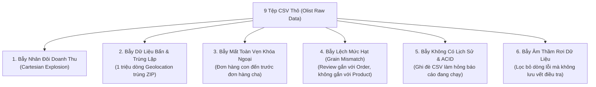

1. **Bẫy nhân đôi doanh thu (Fan-out / Cartesian Explosion):** Một đơn hàng có 3 món hàng (`order_items`) và được thanh toán làm 2 đợt (`order_payments`). Nếu bạn `JOIN` trực tiếp `orders` với `order_items` và `order_payments`, số dòng sẽ nhân lên thành $3 \times 2 = 6$ dòng — làm tổng tiền hàng bị **nhân đôi** và tổng tiền thanh toán bị **nhân ba**!
2. **Bẫy trùng lặp định danh khách hàng:** Trong Olist, mỗi lần khách đặt một đơn hàng mới, hệ thống sinh ra một `customer_id` mới. Nếu đếm `customer_id`, bạn sẽ tưởng nhầm không có khách hàng nào quay lại mua lần 2! Phải ánh xạ về `customer_unique_id` mới biết được hành vi mua lặp lại (RFM).
3. **Bẫy dữ liệu bẩn và vi phạm logic thời gian:** Có những đơn hàng ghi nhận ngày giao hàng trước cả ngày đặt hàng, giá trị âm, mã bưu chính sai định dạng, hoặc hơn 1.000.000 dòng tọa độ địa lý bị trùng lặp mã ZIP và lệch ra ngoài lãnh thổ Brazil.
4. **Bẫy âm thầm vứt bỏ dữ liệu (Silent Drop):** Các pipeline nghiệp dư thường dùng `WHERE price > 0 AND order_id IS NOT NULL` rồi vứt luôn các dòng lỗi. Trong hệ thống tài chính, việc mất dữ liệu mà không biết nguyên nhân là tối kỵ. Hệ thống của chúng ta áp dụng triết lý **Zero Silent Drop**: dòng hợp lệ đi vào `silver.*`, dòng lỗi phải được đóng dấu lý do (`rejection_reason`) và đưa vào khu cách ly `quarantine.*`.

---

### 1.3. Giải pháp: Kiến trúc Data Lakehouse Hiện Đại là gì?
Hệ thống kết hợp ưu điểm của **Data Lake** (lưu trữ tệp Parquet giá rẻ, mở rộng vô hạn trên Object Storage MinIO S3) và **Data Warehouse** (giao dịch nguyên tử ACID, kiểm soát schema, Time Travel bằng **Apache Iceberg**, truy vấn SQL siêu tốc qua **Trino**):

| Thành phần kiến trúc | Công nghệ sử dụng trong dự án | Vai trò cốt lõi (Giải thích dễ hiểu) |
| :--- | :--- | :--- |
| **Object Storage (Hồ chứa vật lý)** | **MinIO (S3-compatible)** | Nơi cất giữ toàn bộ tệp CSV thô (`s3://raw`) và các tệp dữ liệu cột Parquet + tệp siêu dữ liệu Iceberg (`s3://lakehouse`). |
| **Table Format (Định dạng bảng ACID)** | **Apache Iceberg v2** | Biến các tệp Parquet rời rạc trên MinIO thành các bảng SQL thực thụ hỗ trợ `MERGE INTO`, `CREATE OR REPLACE TABLE`, phân vùng ẩn (Hidden Partitioning) và đọc/ghi cô lập (Snapshot Isolation). |
| **Metadata Catalog (Danh bạ bảng)** | **PostgreSQL 16 (JDBC Catalog)** | Lưu con trỏ trạng thái hiện tại của từng bảng Iceberg (bảng nào đang trỏ tới tệp `metadata.json` nào trên MinIO) và cung cấp khóa nguyên tử `pg_advisory_lock`. |
| **Distributed Compute (Động cơ chế biến)** | **Apache Spark 3.5.9** | Cụm tính toán phân tán đọc dữ liệu thô, làm sạch, tách cách ly lỗi, xây dựng mô hình Star Schema và kiểm định chất lượng dữ liệu. |
| **MPP Query Engine (Động cơ truy vấn)** | **Trino 468** | Động cơ truy vấn SQL phân tán tốc độ cao dành cho người dùng phân tích và BI, đọc trực tiếp bảng Iceberg mà không làm ảnh hưởng tới cụm Spark ETL. |
| **Workflow Orchestrator (Nhạc trưởng)** | **Apache Airflow 2.11.2** | Điều phối thứ tự chạy các tác vụ, quản lý giới hạn tài nguyên qua Pool `lakehouse_writes` (2 slots), tự động thử lại (retry) và gửi email cảnh báo khi có sự cố. |
| **BI & Visualization (Trực quan hóa)** | **Apache Superset** | Giao diện bảng điều khiển (Dashboard) kết nối qua Trino để hiển thị biểu đồ doanh thu, phễu giao hàng, phân tích người bán và sản phẩm. |
| **Observability (Giám sát & Cảnh báo)** | **Prometheus + Grafana + Blackbox + Custom Exporter + Gmail SMTP** | Theo dõi sức khỏe toàn bộ 12 dịch vụ theo thời gian thực, đo đạc số dòng/độ trễ pipeline và bắn cảnh báo tự động. |

---

## PHẦN 2: KIẾN TRÚC HẠ TẦNG 4 PHÂN TẦNG & 12 DỊCH VỤ DOCKER

Toàn bộ hệ thống được đóng gói thành **4 tệp Docker Compose mô-đun hóa**, ghép lại qua script [`scripts/_compose.sh`](file:///run/media/tamdae/04C8A69DC8A68C8C/Users/LENOVO/Documents/TL_Kỳ_1_năm_4/Big_Data/rebuild/scripts/_compose.sh) và khởi chạy chỉ bằng một lệnh duy nhất [`./scripts/up.sh`](file:///run/media/tamdae/04C8A69DC8A68C8C/Users/LENOVO/Documents/TL_Kỳ_1_năm_4/Big_Data/rebuild/scripts/up.sh):

1. [`docker-compose.core.yml`](file:///run/media/tamdae/04C8A69DC8A68C8C/Users/LENOVO/Documents/TL_Kỳ_1_năm_4/Big_Data/rebuild/docker-compose.core.yml): Tầng Lưu trữ, Danh mục & Động cơ Tính toán/Truy vấn (`minio`, `minio-init`, `postgres`, `spark-master`, `spark-worker`, `trino`).
2. [`docker-compose.orchestration.yml`](file:///run/media/tamdae/04C8A69DC8A68C8C/Users/LENOVO/Documents/TL_Kỳ_1_năm_4/Big_Data/rebuild/docker-compose.orchestration.yml): Tầng Điều phối (`airflow-init`, `airflow-scheduler`, `airflow-webserver`).
3. [`docker-compose.bi.yml`](file:///run/media/tamdae/04C8A69DC8A68C8C/Users/LENOVO/Documents/TL_Kỳ_1_năm_4/Big_Data/rebuild/docker-compose.bi.yml): Tầng Phân tích BI (`superset-init`, `superset`).
4. [`docker-compose.monitoring.yml`](file:///run/media/tamdae/04C8A69DC8A68C8C/Users/LENOVO/Documents/TL_Kỳ_1_năm_4/Big_Data/rebuild/docker-compose.monitoring.yml): Tầng Giám sát (`prometheus`, `grafana`, `blackbox-exporter`, `pipeline-metrics`).

### 2.1. Sơ đồ Kiến trúc Tổng thể Hệ thống (System Topology Diagram)

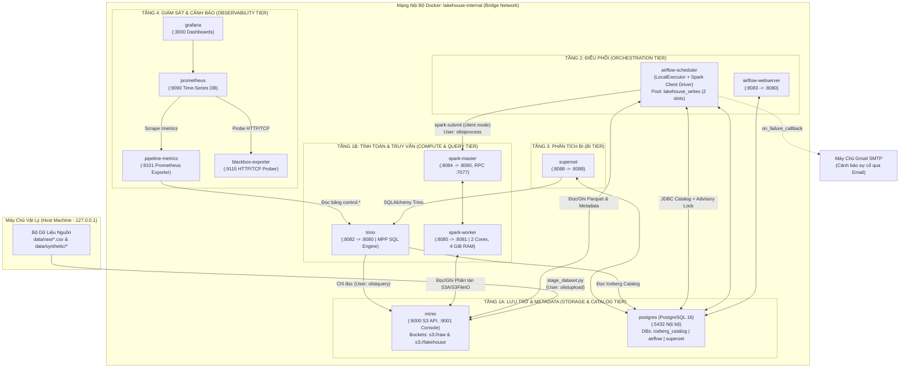

### 2.2. Thứ tự khởi chạy phụ thuộc (Startup Dependency Chain)
Khi bạn gõ `./scripts/up.sh`, Docker Compose không bật ngẫu nhiên mà tuân thủ đồ thị phụ thuộc (`depends_on` kết hợp `service_healthy` và `service_completed_successfully`):

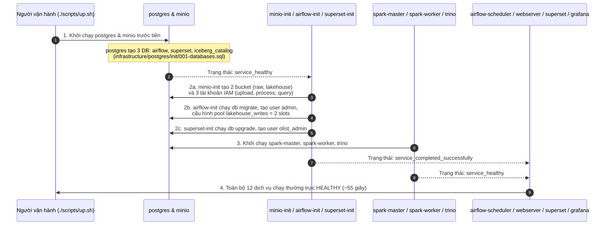

---

## PHẦN 3: PHÂN QUYỀN BẢO MẬT ĐA TẦNG (LEAST-PRIVILEGE IAM & NETWORK ISOLATION)

Một điểm cộng rất lớn của hệ thống này (chuẩn Production-grade) là **không dùng chung tài khoản `root` của MinIO cho mọi dịch vụ**. Trong [`infrastructure/minio/create-buckets.sh`](file:///run/media/tamdae/04C8A69DC8A68C8C/Users/LENOVO/Documents/TL_Kỳ_1_năm_4/Big_Data/rebuild/infrastructure/minio/create-buckets.sh), container `minio-init` thiết lập **3 tài khoản dịch vụ riêng biệt** với 3 chính sách IAM JSON trong [`infrastructure/minio/policies/`](file:///run/media/tamdae/04C8A69DC8A68C8C/Users/LENOVO/Documents/TL_Kỳ_1_năm_4/Big_Data/rebuild/infrastructure/minio/policies/):

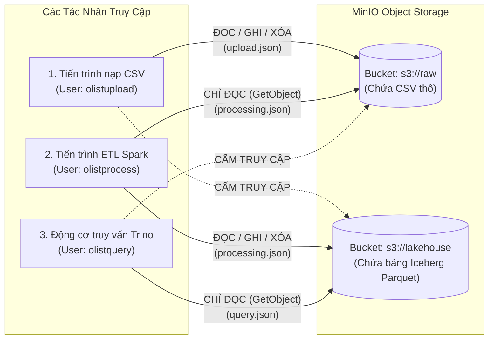

1. **Tài khoản `olistupload` ([`upload.json`](file:///run/media/tamdae/04C8A69DC8A68C8C/Users/LENOVO/Documents/TL_Kỳ_1_năm_4/Big_Data/rebuild/infrastructure/minio/policies/upload.json)):** Chỉ được phép đọc/ghi vào bucket `s3://raw`. Không có bất kỳ quyền nào trên `s3://lakehouse`.
2. **Tài khoản `olistprocess` ([`processing.json`](file:///run/media/tamdae/04C8A69DC8A68C8C/Users/LENOVO/Documents/TL_Kỳ_1_năm_4/Big_Data/rebuild/infrastructure/minio/policies/processing.json)):** Dùng cho Spark ETL. Chỉ có quyền **đọc** (`s3:GetObject`) trên `s3://raw` (đảm bảo Spark không bao giờ vô tình xóa hay sửa tệp CSV gốc) và toàn quyền đọc/ghi trên `s3://lakehouse`.
3. **Tài khoản `olistquery` ([`query.json`](file:///run/media/tamdae/04C8A69DC8A68C8C/Users/LENOVO/Documents/TL_Kỳ_1_năm_4/Big_Data/rebuild/infrastructure/minio/policies/query.json)):** Dùng cho Trino (`infrastructure/trino/catalog/lakehouse.properties`). Chỉ có quyền **đọc** (`s3:GetObject`, `s3:ListBucket`) trên `s3://lakehouse`. Dù ai đó có chạy câu lệnh phá hoại trên Trino/Superset, lớp lưu trữ vật lý MinIO cũng chặn đứng mọi thao tác ghi/xóa tệp Parquet!
4. **Cô lập mạng (Network Binding Security):** Toàn bộ các cổng giao diện Web đều chỉ bind vào `127.0.0.1` (Localhost của máy chủ), riêng PostgreSQL (`:5432`) và Spark RPC (`:7077`) hoàn toàn không mở cổng ra ngoài host mà chỉ giao tiếp bên trong mạng `lakehouse-internal`.

---

## PHẦN 4: KIẾN TRÚC MEDALLION & LUỒNG CHẢY DỮ LIỆU END-TO-END

Hệ thống tổ chức dữ liệu theo **Kiến trúc Medallion 3 tầng kết hợp Khu cách ly (Quarantine) và Tầng Kiểm toán (Control)**, tổng cộng quản lý **37 bảng Iceberg** trong catalog `lakehouse`:

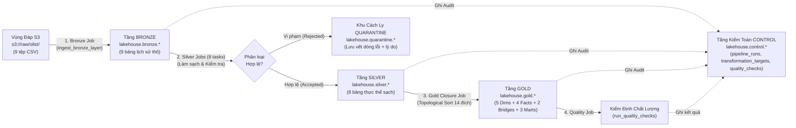

---

### 4.1. Khâu Tiếp Nhận (Staging & Validation)
- **Mã nguồn:** [`scripts/stage_dataset.py`](file:///run/media/tamdae/04C8A69DC8A68C8C/Users/LENOVO/Documents/TL_Kỳ_1_năm_4/Big_Data/rebuild/scripts/stage_dataset.py), [`ingestion/validate_dataset.py`](file:///run/media/tamdae/04C8A69DC8A68C8C/Users/LENOVO/Documents/TL_Kỳ_1_năm_4/Big_Data/rebuild/ingestion/validate_dataset.py), [`ingestion/upload_to_minio.py`](file:///run/media/tamdae/04C8A69DC8A68C8C/Users/LENOVO/Documents/TL_Kỳ_1_năm_4/Big_Data/rebuild/ingestion/upload_to_minio.py).
- **Cơ chế hoạt động:**
  1. Trước khi tải lên MinIO, `validate_dataset.py` kiểm tra thư mục nguồn phải có đủ 9 tệp CSV bắt buộc và đối chiếu danh sách cột tiêu đề (header) của từng tệp CSV với hợp đồng dữ liệu gốc.
  2. Nếu hợp lệ, `upload_to_minio.py` sử dụng tài khoản `olistupload` đẩy 9 tệp CSV lên bucket `s3://raw/olist/<tên_bảng>/<tên_file>.csv`.

---

### 4.2. Tầng Bronze (Raw History & Idempotent Batch Ingestion)
- **Mã nguồn chính:** [`transformation/bronze/job.py`](file:///run/media/tamdae/04C8A69DC8A68C8C/Users/LENOVO/Documents/TL_Kỳ_1_năm_4/Big_Data/rebuild/transformation/bronze/job.py), [`transformation/bronze/ingest.py`](file:///run/media/tamdae/04C8A69DC8A68C8C/Users/LENOVO/Documents/TL_Kỳ_1_năm_4/Big_Data/rebuild/transformation/bronze/ingest.py), [`transformation/common/iceberg.py`](file:///run/media/tamdae/04C8A69DC8A68C8C/Users/LENOVO/Documents/TL_Kỳ_1_năm_4/Big_Data/rebuild/transformation/common/iceberg.py).
- **9 bảng tại `lakehouse.bronze`:**
  `orders`, `order_items`, `order_payments`, `order_reviews`, `customers`, `sellers`, `products`, `geolocation`, `category_translation`.
- **Nguyên lý thiết kế Tầng Bronze:**
  1. **Giữ nguyên vẹn dữ liệu nguồn (Raw Fidelity):** Không lọc bỏ bất kỳ dòng nào ở tầng Bronze, nhưng ép kiểu schema tường minh (không dùng `inferSchema` vốn chậm và dễ đoán sai kiểu dữ liệu) và xử lý các tệp CSV có dòng xuống hàng bên trong chuỗi văn bản (`multiLine=True`, `escape='"'` cho bảng `order_reviews`).
  2. **Đóng dấu Siêu dữ liệu truy vết (Lineage Metadata Columns):** Mỗi dòng được gắn thêm các cột kiểm toán:
     - `_batch_id`: Mã định danh lô nạp dữ liệu.
     - `_ingested_at`: Thời điểm nạp (UTC Timestamp).
     - `_source_file`: Đường dẫn tệp S3 nguồn.
  3. **Cơ chế Chống Nhân Đôi Lô Nạp & Khóa Tư Vấn PostgreSQL (`pg_advisory_lock`):**
     Trong [`transformation/common/iceberg.py`](file:///run/media/tamdae/04C8A69DC8A68C8C/Users/LENOVO/Documents/TL_Kỳ_1_năm_4/Big_Data/rebuild/transformation/common/iceberg.py#L85-L130):
     - Ở chế độ `full`: Thay thế nguyên tử toàn bộ bảng (`createOrReplace()`).
     - Ở chế độ `incremental`: Xin khóa `SELECT pg_advisory_lock(key)` trên PostgreSQL dựa trên mã băm SHA-256 của `(qualified_table, batch_id)`. Nếu phát hiện `_batch_id` đã tồn tại trong bảng, hàm `replace_batch()` dùng câu lệnh nguyên tử của Iceberg v2:
       ```sql
       MERGE INTO lakehouse.bronze.orders AS target
       USING bronze_batch_replacement AS source ON FALSE
       WHEN NOT MATCHED THEN INSERT *
       WHEN NOT MATCHED BY SOURCE AND target._batch_id = '<batch_id>' THEN DELETE
       ```
       Nhờ đó, **dù bạn có chạy lại (re-run) một batch 10 lần, dữ liệu trong bảng Bronze cũng không bao giờ bị nhân đôi!**

---

### 💡 GÓC GIẢI NGỐ CHO "VIBE CODER": TẠI SAO CẦN TỚI 4 CÔNG NGHỆ LƯU TRỮ & TÍNH TOÁN KHÁC NHAU?
*(Nếu giảng viên hoặc người phỏng vấn hỏi bạn câu này, hãy trả lời đúng theo sơ đồ tư duy dưới đây — đảm bảo ghi điểm tuyệt đối!)*

Hãy tưởng tượng hệ thống Data Lakehouse này giống như **một chuỗi Nhà hàng 5 sao**:

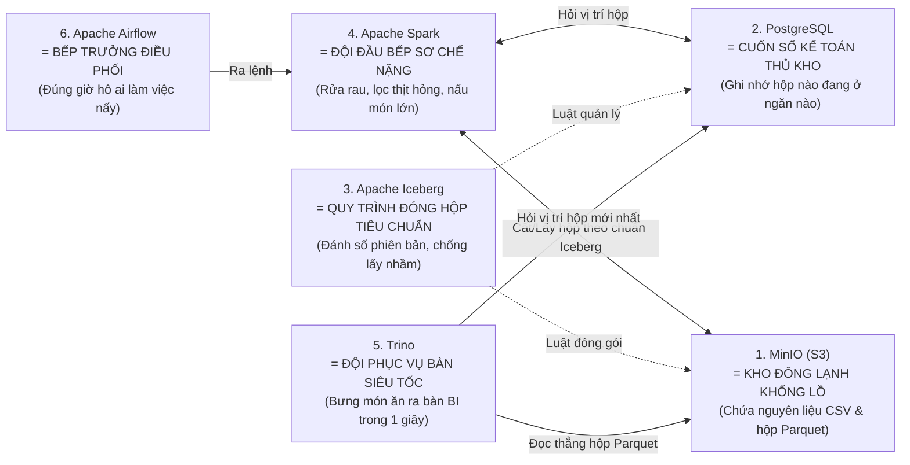

1. **Tại sao có cả PostgreSQL lẫn MinIO? Dữ liệu thật nằm ở đâu?**
   - **Trả lời:** Dữ liệu thật (99.441 đơn hàng, hàng trăm nghìn dòng chi tiết) **KHÔNG nằm trong PostgreSQL** mà nằm dưới dạng các tệp nén cột **Parquet** trong **MinIO (`s3://lakehouse`)**.
   - **PostgreSQL** chỉ đóng vai trò là **"Cuốn sổ danh bạ"** (`iceberg_catalog`): nó chỉ lưu vài dòng chữ cho biết *"Bảng `gold.fact_orders` hiện tại đang dùng phiên bản Snapshot số 5, nằm ở file `metadata.json` nào trên MinIO"*. Nếu lưu hàng tỷ dòng vào PostgreSQL thì ổ cứng và RAM sẽ nổ tung; còn lưu Parquet trên MinIO S3 thì rẻ và mở rộng vô hạn!
2. **Tại sao có cả Spark lẫn Trino? Chẳng phải cả hai đều chạy SQL được sao?**
   - **Trả lời:**
     - **Spark** là **"Đội đầu bếp sơ chế nặng" (Batch ETL Engine)**: chuyên đọc CSV bẩn, lọc hàng triệu dòng, chạy các thuật toán nặng kéo dài hàng phút và chịu lỗi tốt (nếu 1 task lỗi thì tự chạy lại task đó). Nhưng Spark khởi động chậm (mất 5–10 giây để bật JVM Driver).
     - **Trino** là **"Đội phục vụ bàn siêu tốc" (Interactive MPP Query Engine)**: luôn bật sẵn trong RAM, khi người dùng bấm vào biểu đồ trên **Superset**, Trino trả kết quả trong **0.2 – 1 giây**. Nhờ tách riêng Spark (chuyên Ghi/Biến đổi) và Trino (chuyên Đọc/Báo cáo), khi Spark đang cày ải nạp dữ liệu nặng, giám đốc mở Dashboard Superset xem báo cáo vẫn mượt mà, không bị treo!

---

### 4.3. Tầng Silver & Quarantine (Làm Sạch, Chuẩn Hóa & Không Bỏ Sót Dữ Liệu Lỗi)
- **Mã nguồn chính:**
  - Bộ điều phối chung: [`transformation/silver/job.py`](file:///run/media/tamdae/04C8A69DC8A68C8C/Users/LENOVO/Documents/TL_Kỳ_1_năm_4/Big_Data/rebuild/transformation/silver/job.py), [`transformation/silver/_common.py`](file:///run/media/tamdae/04C8A69DC8A68C8C/Users/LENOVO/Documents/TL_Kỳ_1_năm_4/Big_Data/rebuild/transformation/silver/_common.py), [`transformation/common/validation.py`](file:///run/media/tamdae/04C8A69DC8A68C8C/Users/LENOVO/Documents/TL_Kỳ_1_năm_4/Big_Data/rebuild/transformation/common/validation.py).
  - 8 tệp xử lý riêng cho 8 bảng thực thể:
    1. [`customers.py`](file:///run/media/tamdae/04C8A69DC8A68C8C/Users/LENOVO/Documents/TL_Kỳ_1_năm_4/Big_Data/rebuild/transformation/silver/customers.py) $\rightarrow$ `lakehouse.silver.customers`
    2. [`sellers.py`](file:///run/media/tamdae/04C8A69DC8A68C8C/Users/LENOVO/Documents/TL_Kỳ_1_năm_4/Big_Data/rebuild/transformation/silver/sellers.py) $\rightarrow$ `lakehouse.silver.sellers`
    3. [`products.py`](file:///run/media/tamdae/04C8A69DC8A68C8C/Users/LENOVO/Documents/TL_Kỳ_1_năm_4/Big_Data/rebuild/transformation/silver/products.py) (nối luôn với bảng `category_translation` để dịch tên danh mục sang tiếng Anh) $\rightarrow$ `lakehouse.silver.products`
    4. [`geography.py`](file:///run/media/tamdae/04C8A69DC8A68C8C/Users/LENOVO/Documents/TL_Kỳ_1_năm_4/Big_Data/rebuild/transformation/silver/geography.py) (gom 1.000.163 dòng tọa độ nhiễu về đúng **19.015 mã ZIP duy nhất**, lọc bỏ tọa độ rơi ra ngoài biên giới Brazil/Nam Đại Tây Dương) $\rightarrow$ `lakehouse.silver.geography`
    5. [`orders.py`](file:///run/media/tamdae/04C8A69DC8A68C8C/Users/LENOVO/Documents/TL_Kỳ_1_năm_4/Big_Data/rebuild/transformation/silver/orders.py) $\rightarrow$ `lakehouse.silver.orders`
    6. [`order_items.py`](file:///run/media/tamdae/04C8A69DC8A68C8C/Users/LENOVO/Documents/TL_Kỳ_1_năm_4/Big_Data/rebuild/transformation/silver/order_items.py) $\rightarrow$ `lakehouse.silver.order_items`
    7. [`payments.py`](file:///run/media/tamdae/04C8A69DC8A68C8C/Users/LENOVO/Documents/TL_Kỳ_1_năm_4/Big_Data/rebuild/transformation/silver/payments.py) $\rightarrow$ `lakehouse.silver.order_payments`
    8. [`reviews.py`](file:///run/media/tamdae/04C8A69DC8A68C8C/Users/LENOVO/Documents/TL_Kỳ_1_năm_4/Big_Data/rebuild/transformation/silver/reviews.py) $\rightarrow$ `lakehouse.silver.order_reviews`

#### Cơ chế "Chia Luồng Kép" (Dual-Routing: Silver vs. Quarantine) hoạt động thế nào?
Mỗi bảng khi đi qua tầng Silver sẽ được kiểm tra qua một danh sách các quy tắc nghiệp vụ (Validation Rules). Thay vì xóa dòng lỗi, hàm `split_accepted_rejected()` trong [`validation.py`](file:///run/media/tamdae/04C8A69DC8A68C8C/Users/LENOVO/Documents/TL_Kỳ_1_năm_4/Big_Data/rebuild/transformation/common/validation.py) gắn một mảng các lỗi vi phạm vào từng dòng:

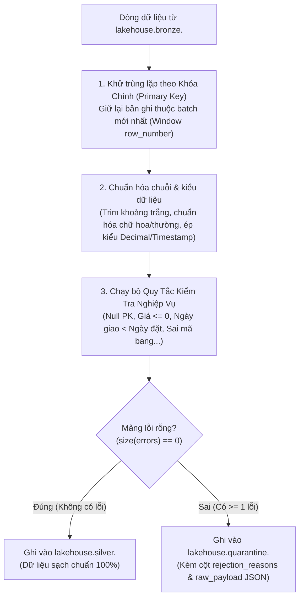

#### Bí mật con số "99.244 + 197 = 99.441" trong `orders` (Cực kỳ quan trọng khi bảo vệ đồ án!)
Nếu ai đó nhìn vào bảng kết quả chạy của bạn và hỏi:
> *"Tại sao dữ liệu gốc có **99.441** đơn hàng, nhưng bảng `silver.orders` chỉ có **99.244** dòng, bảng `quarantine.orders` có **197** dòng, mà sang đến tầng Gold (`gold.fact_orders`) lại khôi phục đủ **99.441** dòng?!"*

**Câu trả lời chuẩn xác 100% từ mã nguồn của bạn:**
1. Trong 99.441 đơn hàng gốc của Kaggle Olist, có đúng **197 đơn hàng vi phạm quy tắc thời gian hợp lệ** ở [`transformation/silver/orders.py`](file:///run/media/tamdae/04C8A69DC8A68C8C/Users/LENOVO/Documents/TL_Kỳ_1_năm_4/Big_Data/rebuild/transformation/silver/orders.py) (ví dụ: ngày giao cho đơn vị vận chuyển `order_delivered_carrier_date` lại nhỏ hơn ngày đặt hàng `order_purchase_timestamp`, hoặc ngày khách nhận hàng nhỏ hơn ngày giao cho bưu cục!).
2. Vì vi phạm logic thời gian, tầng Silver đã **cách ly 197 đơn hàng này sang `quarantine.orders`** và giữ lại **99.244 đơn hàng sạch** trong `silver.orders` ($99.244 + 197 = 99.441$).
3. Tuy nhiên, 197 đơn hàng đó **vẫn có hóa đơn mua hàng hợp lệ trong `silver.order_items` và biên lai thu tiền thật trong `silver.order_payments`**!
4. Khi lên tầng Gold ([`build_fact_orders`](file:///run/media/tamdae/04C8A69DC8A68C8C/Users/LENOVO/Documents/TL_Kỳ_1_năm_4/Big_Data/rebuild/transformation/gold/facts.py#L371-L414)), để đảm bảo nguyên tắc kế toán **"Không làm thất thoát bất kỳ đồng doanh thu nào" (Lossless Accounting / Late-Arriving Parent Handling)**, hàm `build_fact_orders` quét tìm tất cả `order_id` xuất hiện ở bảng con (`order_items`, `order_payments`, `order_reviews`) nhưng vắng mặt ở `silver.orders` (bằng phép `left_anti` join) và tự động tạo lại **197 dòng giữ chỗ (Inferred Stub Orders)** với trạng thái `NULL`, nhờ đó:
   - Tổng số đơn trong `gold.fact_orders` bảo toàn đúng $99.244 + 197 = \mathbf{99.441}$ đơn!
   - Tổng tiền hàng khớp tuyệt đối từng xu giữa `fact_order_items` và `fact_orders`: **13.591.643,70 BRL**!

---

### 4.4. Tầng Gold (Kimball Star Schema, Bridge Tables, Data Marts & Đối Soát Tài Chính)
- **Mã nguồn chính:**
  - Nhạc trưởng tầng Gold: [`transformation/gold/job.py`](file:///run/media/tamdae/04C8A69DC8A68C8C/Users/LENOVO/Documents/TL_Kỳ_1_năm_4/Big_Data/rebuild/transformation/gold/job.py)
  - Sinh khóa đại diện (Surrogate Keys): [`transformation/gold/keys.py`](file:///run/media/tamdae/04C8A69DC8A68C8C/Users/LENOVO/Documents/TL_Kỳ_1_năm_4/Big_Data/rebuild/transformation/gold/keys.py)
  - 5 Bảng Chiều (Dimensions): [`transformation/gold/dimensions.py`](file:///run/media/tamdae/04C8A69DC8A68C8C/Users/LENOVO/Documents/TL_Kỳ_1_năm_4/Big_Data/rebuild/transformation/gold/dimensions.py)
  - 4 Bảng Sự Kiện (Facts): [`transformation/gold/facts.py`](file:///run/media/tamdae/04C8A69DC8A68C8C/Users/LENOVO/Documents/TL_Kỳ_1_năm_4/Big_Data/rebuild/transformation/gold/facts.py)
  - 2 Bảng Cầu Nối (Bridges): [`transformation/gold/bridges.py`](file:///run/media/tamdae/04C8A69DC8A68C8C/Users/LENOVO/Documents/TL_Kỳ_1_năm_4/Big_Data/rebuild/transformation/gold/bridges.py)
  - 3 Bảng Chợ Dữ Liệu (Data Marts): [`transformation/gold/marts.py`](file:///run/media/tamdae/04C8A69DC8A68C8C/Users/LENOVO/Documents/TL_Kỳ_1_năm_4/Big_Data/rebuild/transformation/gold/marts.py)

#### 4.4.1. Sơ đồ Mô hình Quan hệ Thực thể Tầng Gold (Star Schema + Bridges + Marts)

```mermaid
erDiagram
    DIM_DATE {
        int date_key PK "YYYYMMDD (hoặc 0 = Unknown)"
        date full_date
        int year
        int quarter
        int month
        string day_name
        boolean is_weekend
    }
    DIM_GEOGRAPHY {
        bigint geography_key PK "SHA-256 Surrogate Key (0 = Unknown)"
        string zip_code_prefix NK
        string city
        string state_code
        string region "Norte, Nordeste, Sudeste, Sul, Centro-Oeste"
        double latitude
        double longitude
    }
    DIM_CUSTOMER {
        bigint customer_key PK "SHA-256 Surrogate Key (0 = Unknown)"
        string customer_unique_id NK
        bigint geography_key FK
        string customer_city
        string customer_state
        string customer_region
    }
    DIM_SELLER {
        bigint seller_key PK "SHA-256 Surrogate Key (0 = Unknown)"
        string seller_id NK
        bigint geography_key FK
        string seller_city
        string seller_state
        string seller_region
    }
    DIM_PRODUCT {
        bigint product_key PK "SHA-256 Surrogate Key (0 = Unknown)"
        string product_id NK
        string product_category_name
        string product_category_name_english
        int product_weight_g
        int product_volume_cm3
    }

    FACT_ORDERS {
        string order_id PK "Hạt: 1 dòng / 1 đơn hàng (99,441 dòng)"
        bigint customer_key FK
        int purchase_date_key FK
        int approval_date_key FK
        int carrier_date_key FK
        int delivered_date_key FK
        int estimated_delivery_date_key FK
        bigint total_items
        decimal item_revenue "Tổng = 13,591,643.70"
        decimal freight_total "Tổng = 2,251,909.54"
        decimal payment_total "Tổng = 16,008,872.12"
        boolean is_late_delivery
        decimal average_review_score
    }
    FACT_ORDER_ITEMS {
        string order_id PK "Hạt: (order_id, order_item_id)"
        int order_item_id PK
        bigint customer_key FK
        bigint product_key FK
        bigint seller_key FK
        int order_date_key FK
        decimal price "Tổng = 13,591,643.70"
        decimal freight_value "Tổng = 2,251,909.54"
    }
    FACT_PAYMENTS {
        string order_id PK "Hạt: (order_id, payment_sequential)"
        int payment_sequential PK
        bigint customer_key FK
        int order_date_key FK
        string payment_type
        int payment_installments
        decimal payment_value "Tổng = 16,008,872.12"
    }
    FACT_REVIEWS {
        string review_id PK "Hạt: (review_id, order_id)"
        string order_id PK
        bigint customer_key FK
        int review_date_key FK
        int review_score
    }

    BRIDGE_REVIEW_PRODUCTS {
        string review_id PK
        string order_id PK
        bigint product_key PK
        int item_count
        decimal allocation_weight "Tỷ trọng phân bổ = 1 / số SP trong đơn"
    }
    BRIDGE_REVIEW_SELLERS {
        string review_id PK
        string order_id PK
        bigint seller_key PK
        int item_count
        decimal allocation_weight "Tỷ trọng phân bổ = 1 / số Seller trong đơn"
    }

    DIM_GEOGRAPHY ||--o{ DIM_CUSTOMER : "định vị"
    DIM_GEOGRAPHY ||--o{ DIM_SELLER : "định vị"
    DIM_CUSTOMER ||--o{ FACT_ORDERS : "đặt"
    DIM_DATE ||--o{ FACT_ORDERS : "5 vai trò ngày"
    DIM_CUSTOMER ||--o{ FACT_ORDER_ITEMS : "mua"
    DIM_PRODUCT ||--o{ FACT_ORDER_ITEMS : "thuộc về"
    DIM_SELLER ||--o{ FACT_ORDER_ITEMS : "bán bởi"
    DIM_DATE ||--o{ FACT_ORDER_ITEMS : "ngày đặt & hạn giao"
    DIM_CUSTOMER ||--o{ FACT_PAYMENTS : "thanh toán"
    DIM_CUSTOMER ||--o{ FACT_REVIEWS : "đánh giá"
    FACT_REVIEWS ||--o{ BRIDGE_REVIEW_PRODUCTS : "nối N-N"
    DIM_PRODUCT ||--o{ BRIDGE_REVIEW_PRODUCTS : "được đánh giá"
    FACT_REVIEWS ||--o{ BRIDGE_REVIEW_SELLERS : "nối N-N"
    DIM_SELLER ||--o{ BRIDGE_REVIEW_SELLERS : "được đánh giá"
```

#### 4.4.2. Giải mã 4 Kỹ thuật Thiết kế Đắt Giá Nhất ở Tầng Gold
1. **Khóa đại diện tất định (Deterministic Surrogate Keys - [`keys.py`](file:///run/media/tamdae/04C8A69DC8A68C8C/Users/LENOVO/Documents/TL_Kỳ_1_năm_4/Big_Data/rebuild/transformation/gold/keys.py)):**
   - Trong Olist, khóa tự nhiên (`product_id`, `customer_unique_id`) là chuỗi UUID dài 32 ký tự (`"8629a7..."`), rất tốn RAM và làm chậm phép JOIN.
   - Thay vì dùng `monotonically_increasing_id()` của Spark (mỗi lần chạy lại sẽ sinh ra một số khác nhau làm gãy khóa ngoại!), [`keys.py`](file:///run/media/tamdae/04C8A69DC8A68C8C/Users/LENOVO/Documents/TL_Kỳ_1_năm_4/Big_Data/rebuild/transformation/gold/keys.py) băm chuỗi khóa tự nhiên bằng thuật toán **SHA-256** rồi lấy 63-bit dương (`bigint`). Nhờ đó: **cùng một khách hàng dù chạy lại 1.000 lần vẫn ra đúng một mã số `customer_key` duy nhất!**
   - Đồng thời, mọi bảng Dimension đều có sẵn một dòng mặc định mang **khóa bằng `0` (`Unknown Member`)**. Bất kỳ bảng Fact nào không tìm thấy khóa ngoại đều được gán về `0` thay vì `NULL`, giúp phép `INNER JOIN` trên BI không bao giờ làm rớt dòng!
2. **Kỹ thuật Chiều Đóng Nhiều Vai Trò (Role-Playing Dimension - `dim_date`):**
   - Một đơn hàng trong `fact_orders` có tới 5 mốc ngày: Ngày mua (`purchase_date_key`), Ngày duyệt (`approval_date_key`), Ngày giao bưu cục (`carrier_date_key`), Ngày giao tận tay (`delivered_date_key`), và Ngày hẹn giao (`estimated_delivery_date_key`).
   - Hệ thống chỉ tạo **1 bảng `dim_date` duy nhất**, nhưng dùng hàm `_with_date_roles()` để `Broadcast Hash Join` 5 lần vào `fact_orders`.
3. **Kỹ thuật Bảng Cầu Nối (Bridge Tables - [`bridges.py`](file:///run/media/tamdae/04C8A69DC8A68C8C/Users/LENOVO/Documents/TL_Kỳ_1_năm_4/Big_Data/rebuild/transformation/gold/bridges.py)):**
   - Khách hàng đánh giá (`review_score`) cho **cả đơn hàng (`order_id`)**, chứ Olist không có cột đánh giá riêng cho từng sản phẩm trong đơn. Nếu một đơn hàng mua 2 sản phẩm A và B và bị chấm 1 sao, ta làm sao tính điểm đánh giá trung bình cho từng sản phẩm/người bán mà không làm phình bảng `fact_reviews`?
   - Giải pháp chuẩn Kimball: Giữ `fact_reviews` ở mức hạt `(review_id, order_id)` nguyên bản, và tạo 2 bảng cầu nối `bridge_review_products` và `bridge_review_sellers` kèm trọng số phân bổ (`allocation_weight`)!
4. **Sắp xếp Thứ tự Thực thi bằng Thuật toán Kahn (Topological Sort) & Đối soát Tài chính Tuyệt đối ([`gold/job.py`](file:///run/media/tamdae/04C8A69DC8A68C8C/Users/LENOVO/Documents/TL_Kỳ_1_năm_4/Big_Data/rebuild/transformation/gold/job.py)):**
   - Thay vì viết cứng thứ tự chạy 14 bảng Gold, hàm `gold_target_order()` dùng thuật toán đồ thị Kahn để tự động suy diễn bảng nào không có phụ thuộc chạy trước (`dim_date`, `dim_geography`, `dim_product`), bảng nào phụ thuộc chạy sau (`dim_customer` $\rightarrow$ `fact_orders` $\rightarrow$ `mart_seller_performance`).
   - Trước khi ghi xuống đĩa, hàm `_reconcile_outputs()` cộng tổng tiền hàng (`item_revenue`) và phí vận chuyển (`freight_total`) của cả 5 bảng (`fact_order_items`, `fact_orders`, `mart_daily_revenue`, `mart_seller_performance`, `mart_product_performance`). **Nếu lệch nhau dù chỉ 0.01 BRL, toàn bộ job Gold lập tức dừng khẩn cấp và không ghi đè dữ liệu bẩn!**

---

## PHẦN 5: HỆ THỐNG KIỂM TOÁN HAI TẦNG (CONTROL AUDIT PLANE) & CỔNG CHẤT LƯỢNG DỮ LIỆU (QUALITY GATE)

### 5.1. Kiểm toán Hai Tầng (`lakehouse.control.*` - [`transformation/common/audit.py`](file:///run/media/tamdae/04C8A69DC8A68C8C/Users/LENOVO/Documents/TL_Kỳ_1_năm_4/Big_Data/rebuild/transformation/common/audit.py))
Mọi lần chạy của bất kỳ tầng nào (Bronze, Silver, Gold, Quality, Maintenance) đều tự động ghi nhật ký giao dịch vào 3 bảng Iceberg trong schema `lakehouse.control`:

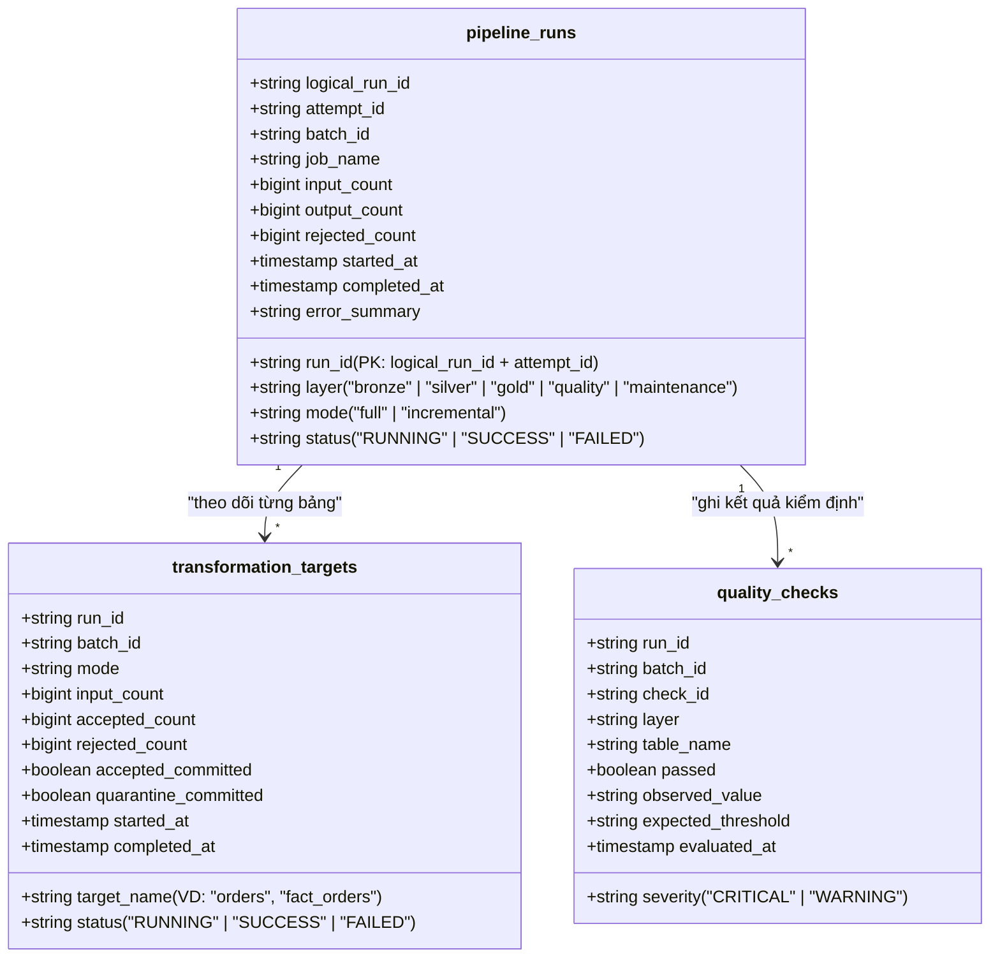

- **Tại sao gọi là Kiểm toán Hai Tầng (Two-Tier Audit)?**
  - **Tầng 1 (`pipeline_runs`):** Cho biết tổng thể một job (ví dụ `gold_transformation`) đang chạy (`RUNNING`), thành công (`SUCCESS`) hay thất bại (`FAILED`), tổng số dòng đầu vào/đầu ra là bao nhiêu.
  - **Tầng 2 (`transformation_targets`):** Đi sâu vào từng bảng con bên trong job đó, kèm 2 cờ cực kỳ quan trọng là `accepted_committed` và `quarantine_committed`. Nếu hệ thống mất điện đúng lúc vừa ghi xong `silver.orders` nhưng chưa kịp ghi `quarantine.orders`, lần chạy lại (retry) tiếp theo sẽ đọc bảng `transformation_targets` để biết chính xác phần nào đã ghi rồi và chỉ hoàn thiện phần còn thiếu!

### 5.2. Cổng Kiểm Định Chất Lượng Tự Động ([`transformation/quality/job.py`](file:///run/media/tamdae/04C8A69DC8A68C8C/Users/LENOVO/Documents/TL_Kỳ_1_năm_4/Big_Data/rebuild/transformation/quality/job.py) & [`checks.py`](file:///run/media/tamdae/04C8A69DC8A68C8C/Users/LENOVO/Documents/TL_Kỳ_1_năm_4/Big_Data/rebuild/transformation/quality/checks.py))
Sau khi tầng Gold chạy xong, task `run_quality_checks` được kích hoạt để đóng vai trò **"Người gác cổng cuối cùng"**:
1. **Kiểm tra độ đầy đủ (Completeness & Non-Empty):** Không bảng nào ở Bronze, Silver, Gold được phép rỗng (`count > 0`).
2. **Kiểm tra tính duy nhất của Khóa chính (Primary Key Uniqueness):** Kiểm tra không có bất kỳ dòng trùng lặp khóa chính nào lọt qua Silver hoặc Gold.
3. **Kiểm tra Toàn vẹn Tham chiếu (Referential Integrity):** Mọi khóa ngoại (`customer_key`, `product_key`, `seller_key`, `date_key`) trong các bảng Fact đều phải khớp 100% với bảng Dimension tương ứng, và tỷ lệ rơi vào khóa `0` (`Unknown Member`) không được vượt ngưỡng cho phép.
4. **Kiểm tra Tỷ lệ Cách ly (Quarantine Rate Threshold):** Nếu một lô dữ liệu mới nạp vào có tỷ lệ dòng bị đẩy vào `quarantine.*` hoặc tỷ lệ vi phạm khóa ngoại vượt ngưỡng an toàn (như ở bài test `05_integrity_violations` và `06_duplicates`), `quality/job.py` lập tức trả về **mã lỗi `exit code 2`** để báo động đỏ trên Airflow và bắn Email cảnh báo!

---

## PHẦN 6: ĐIỀU PHỐI TỰ ĐỘNG HÓA BẰNG APACHE AIRFLOW (4 DAGS & CƠ CHẾ BẤT BIẾN)

Trong thư mục [`orchestration/dags/`](file:///run/media/tamdae/04C8A69DC8A68C8C/Users/LENOVO/Documents/TL_Kỳ_1_năm_4/Big_Data/rebuild/orchestration/dags/), hệ thống được thiết kế gồm **4 DAGs chuyên biệt** dùng chung bộ khung bảo vệ tại [`common.py`](file:///run/media/tamdae/04C8A69DC8A68C8C/Users/LENOVO/Documents/TL_Kỳ_1_năm_4/Big_Data/rebuild/orchestration/dags/common.py):

### 6.1. Sơ đồ Luồng Thực Thi của DAG Nhạc Trưởng (`olist_daily_pipeline`)

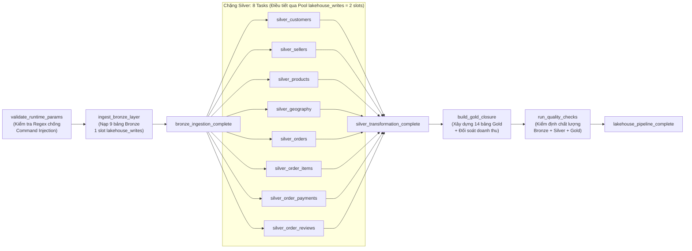

### 6.2. Vai trò của 4 DAGs trong hệ thống
| Tên DAG | Tệp mã nguồn | Mục đích sử dụng thực tế |
| :--- | :--- | :--- |
| **`olist_daily_pipeline`** | [`olist_daily_pipeline.py`](file:///run/media/tamdae/04C8A69DC8A68C8C/Users/LENOVO/Documents/TL_Kỳ_1_năm_4/Big_Data/rebuild/orchestration/dags/olist_daily_pipeline.py) | **DAG Nhạc trưởng End-to-End** chạy từ đầu đến cuối: `Bronze` $\rightarrow$ `8 Silver song song` $\rightarrow$ `Gold` $\rightarrow$ `Quality Checks`. |
| **`olist_transformation`** | [`olist_transformation.py`](file:///run/media/tamdae/04C8A69DC8A68C8C/Users/LENOVO/Documents/TL_Kỳ_1_năm_4/Big_Data/rebuild/orchestration/dags/olist_transformation.py) | Chỉ chạy riêng phần biến đổi `Silver` $\rightarrow$ `Gold` rồi tự động kích hoạt sang `olist_quality` bằng toán tử bất biến `IdempotentTriggerDagRunOperator`. Hữu ích khi dữ liệu đã nằm sẵn ở Bronze và bạn chỉ muốn chạy lại logic làm sạch/mô hình hóa. |
| **`olist_quality`** | [`olist_quality.py`](file:///run/media/tamdae/04C8A69DC8A68C8C/Users/LENOVO/Documents/TL_Kỳ_1_năm_4/Big_Data/rebuild/orchestration/dags/olist_quality.py) | Chạy độc lập bộ kiểm định chất lượng dữ liệu bất cứ lúc nào để kiểm tra sức khỏe Lakehouse. |
| **`olist_maintenance`** | [`olist_maintenance.py`](file:///run/media/tamdae/04C8A69DC8A68C8C/Users/LENOVO/Documents/TL_Kỳ_1_năm_4/Big_Data/rebuild/orchestration/dags/olist_maintenance.py) | Chạy định kỳ hàng tuần (`@weekly`) để dọn dẹp và tối ưu hóa các tệp vật lý của Apache Iceberg. |

---

## PHẦN 7: BẢO TRÌ BẢNG APACHE ICEBERG TỰ ĐỘNG (COMPACTION, SNAPSHOT EXPIRATION, ORPHAN CLEANUP)

- **Mã nguồn:** [`transformation/maintenance/job.py`](file:///run/media/tamdae/04C8A69DC8A68C8C/Users/LENOVO/Documents/TL_Kỳ_1_năm_4/Big_Data/rebuild/transformation/maintenance/job.py) & [`orchestration/dags/olist_maintenance.py`](file:///run/media/tamdae/04C8A69DC8A68C8C/Users/LENOVO/Documents/TL_Kỳ_1_năm_4/Big_Data/rebuild/orchestration/dags/olist_maintenance.py).
- **Tại sao Lakehouse cần có DAG Bảo trì riêng?**
  Khi chạy các lô nạp tăng dần (`incremental`) liên tục nhiều lần trong ngày, mỗi lần ghi mới sẽ tạo ra thêm các tệp Parquet nhỏ vài trăm KB (gọi là **Small File Problem** — ví dụ sau 6 bài test tăng dần, tổng số tệp Parquet tăng từ 15 lên 691 tệp!), đồng thời giữ lại các phiên bản Snapshot cũ và các tệp mồ côi (Orphan files) do các task thất bại để lại.
- **Quy trình 4 bước bảo trì an toàn tuyệt đối của `olist_maintenance`:**

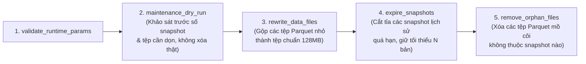

> **Cơ chế an toàn:** Trong `olist_maintenance.py`, các task ghi/xóa bảo trì yêu cầu chiếm trọn **toàn bộ 2/2 slots của pool `lakehouse_writes` (`write_pool_slots=2`)**. Nhờ vậy, khi bảo trì đang chạy thì không có bất kỳ job ETL nào được phép ghi chen ngang, và ngược lại!

---

## PHẦN 8: HÀNH TRÌNH TỐI ƯU HÓA SPARK & AIRFLOW (V1 $\rightarrow$ V2 $\rightarrow$ V3 SENIOR)

Đây là phần "ăn tiền" nhất của dự án khi bạn trình bày về mặt kỹ thuật hệ thống (System Engineering). Toàn bộ số liệu dưới đây đã được đo đạc thực nghiệm trực tiếp trên máy tính của bạn:

### 8.1. Sơ đồ Tiến Hóa 3 Phiên Bản (V1 $\rightarrow$ V2 $\rightarrow$ V3)

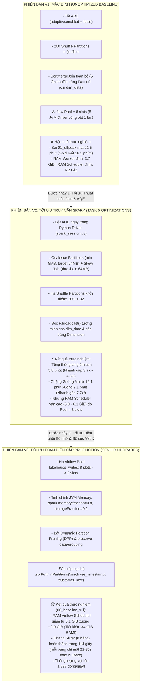

### 8.2. Bảng Đối Soát Thực Nghiệm Toàn Diện 8 Kịch Bản (V1 vs. V2 vs. V3)

| Bài đo (Scenario) | V1: Mặc định | V2: Task 5 | V3: Senior | Silver Max (V1 / V2 / **V3**) | Gold Closure (V1 / V2 / **V3**) | RAM Scheduler Đỉnh (V1 / V2 / **V3**) |
| :--- | :---: | :---: | :---: | :---: | :---: | :---: |
| **`00_baseline_full`** | 1,006.0s | 332.6s | **335.4s** | 159.3s / 114.6s / **35.9s** | 713.0s / 124.3s / **127.9s** | 6,133 / 5,009 / **3,112 MiB** |
| **`01_offpeak`** | 1,288.1s | 346.5s | **337.5s** | 178.7s / 129.4s / **31.2s** | 963.9s / 125.0s / **131.2s** | 6,195 / 6,144 / **3,283 MiB** |
| **`02_flash_sale`** | 1,303.6s | 348.0s | **358.7s** | 207.1s / 124.0s / **33.4s** | 957.1s / 126.0s / **130.1s** | 6,051 / 6,407 / **3,212 MiB** |
| **`03_catchup`** | 1,289.0s | 347.8s | **346.6s** | 188.6s / 121.4s / **32.8s** | 959.9s / 130.5s / **132.7s** | 6,400 / 6,601 / **3,122 MiB** |
| **`04_dirty_metadata`** | 1,300.2s | 348.8s | **351.0s** | 192.5s / 125.5s / **33.5s** | 957.8s / 125.5s / **129.5s** | 6,926 / 6,527 / **3,197 MiB** |
| **`05_integrity_violations`** | 1,551.3s | 602.6s | **612.3s** | 199.2s / 127.6s / **32.8s** | 971.0s / 125.2s / **136.9s** | 6,613 / 6,418 / **3,322 MiB** |
| **`06_duplicates`** | 2,605.2s | 602.2s | **608.8s** | 197.3s / 126.3s / **38.5s** | 972.1s / 126.4s / **129.2s** | 6,510 / 6,924 / **3,247 MiB** |
| **`07_baseline_restore`** | *Failed* | 332.0s | **362.9s** | — / 126.5s / **35.1s** | — / 125.9s / **128.8s** | — / 6,897 / **3,324 MiB** |

> **3 Điểm Nhấn Vàng Từ Bảng Số Liệu Thực Nghiệm:**
> 1. **Tốc độ toàn trình (Wall-Clock):** V2 và V3 nhanh gấp **3.0x – 4.3x** so với V1 (đặc biệt bài `06_duplicates` giảm từ **43.4 phút** xuống chỉ còn **10.1 phút**).
> 2. **Tốc độ từng task Silver:** Ở V3, nhờ hạ Pool từ 8 xuống 2, mỗi bảng Silver chạy mất **31–38 giây** thay vì **125–207 giây** ở V1/V2 (**nhanh gấp 4–5 lần trên mỗi task**).
> 3. **Tiết kiệm bộ nhớ RAM & Tệp Parquet:** V3 cắt giảm **~3.6 GiB RAM đỉnh** trên `airflow-scheduler` (từ ~6.9 GiB xuống ~3.2 GiB) và giảm số tệp Parquet ở bài 06 từ **691 tệp (V1)** xuống **189 tệp (V3)**, sau đó khôi phục gọn gàng về đúng **15 tệp** ở bài 07!

### 8.3. Tại sao đặt cấu hình trong `spark-defaults.conf` của container Spark lại KHÔNG có tác dụng, mà bắt buộc phải đặt trong `transformation/common/spark_session.py`?
*(Câu hỏi "sát thủ" để phân biệt người hiểu thật và người chỉ copy code!)*
- Trong [`docker-compose.orchestration.yml`](file:///run/media/tamdae/04C8A69DC8A68C8C/Users/LENOVO/Documents/TL_Kỳ_1_năm_4/Big_Data/rebuild/docker-compose.orchestration.yml), Airflow gọi `spark-submit` ở chế độ **`--deploy-mode client`**.
- Ở chế độ `client`, tiến trình **Spark Driver** (bộ não chịu trách nhiệm phân tích câu lệnh SQL, bật AQE, quyết định dùng Broadcast Join hay SortMergeJoin) chạy **bên trong container `airflow-scheduler`**, chứ không chạy trong container `spark-master`!
- Container `airflow-scheduler` không hề chứa file `/opt/spark/conf/spark-defaults.conf` của container Spark. Do đó, mọi cấu hình tối ưu truy vấn (`spark.sql.adaptive.*`, `spark.memory.*`, `spark.sql.optimizer.dynamicPartitionPruning.enabled`) bắt buộc phải được khai báo trực tiếp trong hàm [`build_spark_session()`](file:///run/media/tamdae/04C8A69DC8A68C8C/Users/LENOVO/Documents/TL_Kỳ_1_năm_4/Big_Data/rebuild/transformation/common/spark_session.py) và [`SPARK_SUBMIT_CONF`](file:///run/media/tamdae/04C8A69DC8A68C8C/Users/LENOVO/Documents/TL_Kỳ_1_năm_4/Big_Data/rebuild/orchestration/dags/common.py) thì bộ não Driver mới thực sự nhận được!

---

## PHẦN 9: HỆ THỐNG QUAN SÁT (OBSERVABILITY), CẢNH BÁO EMAIL & KIỂM THỬ HỖN LOẠN (CHAOS BENCHMARK)

### 9.1. Giám sát đa chiều với Prometheus, Grafana, Blackbox & Custom Exporter
Hệ thống giám sát không chỉ đo xem container còn sống hay chết, mà còn đo sâu vào bên trong nghiệp vụ Lakehouse:
1. **`blackbox-exporter` (`:9115`):** Liên tục bắn gói tin thăm dò HTTP/TCP tới toàn bộ các cổng giao diện (Airflow, Trino, Superset, MinIO, Spark Master, Spark Worker).
2. **`pipeline-metrics` (`:9101` - [`infrastructure/monitoring/`](file:///run/media/tamdae/04C8A69DC8A68C8C/Users/LENOVO/Documents/TL_Kỳ_1_năm_4/Big_Data/rebuild/infrastructure/monitoring/)):** Một dịch vụ Python Exporter tùy chỉnh truy vấn trực tiếp các bảng kiểm toán `lakehouse.control.*` và `gold.*` qua Trino để xuất ra các chỉ số Prometheus độc quyền:
   - Thời gian chạy gần nhất của từng tầng (`bronze`, `silver`, `gold`, `quality`).
   - Số lượng dòng được chấp nhận (`accepted_count`) và bị cách ly (`rejected_count`).
   - Trạng thái sức khỏe của lần chạy gần nhất.
3. **Cảnh báo Email tự động ([`infrastructure/alerts/email_alert.py`](file:///run/media/tamdae/04C8A69DC8A68C8C/Users/LENOVO/Documents/TL_Kỳ_1_năm_4/Big_Data/rebuild/infrastructure/alerts/email_alert.py)):**
   - Được gắn trực tiếp vào `on_failure_callback` của mọi task trong 4 DAGs Airflow.
   - Khi có bất kỳ task nào thất bại (sau khi đã hết lượt retry), hệ thống tự động lọc bỏ các thông tin nhạy cảm (mật khẩu, khóa bí mật), ghi nhận sự kiện vào `/opt/airflow/logs/failures.ndjson` và gửi email báo động qua SMTP (Gmail của bạn cấu hình trong `.env`).

### 9.2. Bộ 8 Kịch Bản Kiểm Thử Tải & Hỗn Loạn (Load & Chaos Benchmark Suite)
Được sinh tự động bởi [`scripts/generate_load_datasets.py`](file:///run/media/tamdae/04C8A69DC8A68C8C/Users/LENOVO/Documents/TL_Kỳ_1_năm_4/Big_Data/rebuild/scripts/generate_load_datasets.py) và [`scripts/generate_chaos_datasets.py`](file:///run/media/tamdae/04C8A69DC8A68C8C/Users/LENOVO/Documents/TL_Kỳ_1_năm_4/Big_Data/rebuild/scripts/generate_chaos_datasets.py):

| Mã kịch bản | Chế độ | Quy mô dữ liệu | Mục đích thử thách hệ thống | Kết quả kỳ vọng chuẩn |
| :--- | :---: | :--- | :--- | :---: |
| **`00_baseline_full`** | `full` | 99.441 đơn gốc Kaggle | Đo hiệu năng nạp toàn량 từ đầu (Cold Baseline). | **SUCCESS** |
| **`01_offpeak`** | `incremental` | 500 đơn hàng nhỏ | Kiểm tra chi phí điều phối (Scheduling Overhead) khi lô nhỏ. | **SUCCESS** |
| **`02_flash_sale`** | `incremental` | 40.000 đơn dồn vào 1 khung giờ & vài sản phẩm hot | Thử thách khả năng chống lệch dữ liệu (**AQE Skew Join**) và chịu tải đột biến. | **SUCCESS** |
| **`03_catchup`** | `incremental` | 7.544 đơn hàng bù | Mô phỏng kịch bản hệ thống nghỉ bảo trì rồi nạp bù nhiều ngày. | **SUCCESS** |
| **`04_dirty_metadata`** | `incremental` | 2.000 đơn cài bẫy định dạng bẩn, khoảng trắng, sai danh mục | Kiểm tra khả năng tự động chuẩn hóa & cách ly sang `quarantine.*` (+527 dòng cách ly). | **SUCCESS** |
| **`05_integrity_violations`**| `incremental` | 2.000 đơn cài bẫy mất khóa ngoại, ngày giao < ngày đặt | Kiểm tra `quarantine.*` bắt lỗi và **Quality Gate báo động đỏ** khi tỷ lệ vi phạm vượt ngưỡng. | **FAILED (Tại Quality Gate)** |
| **`06_duplicates`** | `incremental` | 2.600 đơn cố tình nhân bản khóa chính & bản ghi trùng | Kiểm tra khử trùng lặp ở Silver, cách ly dòng lặp và **Quality Gate chặn đứng**. | **FAILED (Tại Quality Gate)** |
| **`07_baseline_restore`** | `full` | 99.441 đơn gốc Kaggle | Khôi phục toàn bộ bảng Iceberg về trạng thái chuẩn ban đầu. | **SUCCESS** |

---

## PHẦN 10: BẢN ĐỒ THƯ MỤC MÃ NGUỒN & BỘ GIÁP HỎI-ĐÁP BẢO VỆ ĐỒ ÁN

### 10.1. Bản Đồ Thư Mục "Nhìn 5 Giây Là Biết Mở File Nào"
Khi ai đó yêu cầu bạn mở code giải thích một tính năng, hãy tra cứu ngay bảng này:

```text
rebuild/
├── docker-compose.core.yml          # Định nghĩa MinIO, Postgres, Spark Master/Worker, Trino
├── docker-compose.orchestration.yml # Định nghĩa Airflow Init, Scheduler, Webserver
├── docker-compose.bi.yml            # Định nghĩa Apache Superset
├── docker-compose.monitoring.yml    # Định nghĩa Prometheus, Grafana, Blackbox, Pipeline-Metrics
│
├── ingestion/                       # [KHÂU TIẾP NHẬN CSV]
│   ├── validate_dataset.py          # Kiểm tra đủ 9 file CSV và đúng tên cột trước khi upload
│   └── upload_to_minio.py           # Đẩy CSV từ máy chủ lên bucket s3://raw/olist/
│
├── transformation/                  # [TRÁI TIM XỬ LÝ PYSPARK & ICEBERG]
│   ├── common/
│   │   ├── spark_session.py         # ★ Nơi bật AQE, Memory 0.8/0.2, DPP, Iceberg Catalog
│   │   ├── iceberg.py               # ★ Nơi cài đặt pg_advisory_lock, MERGE INTO, create_or_replace
│   │   ├── validation.py            # ★ Hàm chia tách dòng sạch (Silver) vs dòng lỗi (Quarantine)
│   │   └── audit.py                 # ★ Ghi nhật ký 2 tầng vào lakehouse.control.*
│   ├── bronze/
│   │   ├── ingest.py                # Đọc CSV từ s3://raw, gắn _batch_id, _ingested_at
│   │   └── job.py                   # Điểm chạy CLI của tầng Bronze
│   ├── silver/
│   │   ├── orders.py, customers.py, order_items.py, payments.py, reviews.py, products.py, sellers.py, geography.py
│   │   └── job.py                   # Điểm chạy CLI của tầng Silver (xử lý từng bảng độc lập)
│   ├── gold/
│   │   ├── keys.py                  # ★ Băm SHA-256 sinh khóa đại diện (Surrogate Key) + Unknown Key = 0
│   │   ├── dimensions.py            # ★ Xây dựng 5 bảng Chiều (dim_date, dim_customer, dim_geography...)
│   │   ├── facts.py                 # ★ Xây dựng 4 bảng Sự kiện + F.broadcast() + sortWithinPartitions
│   │   ├── bridges.py               # ★ Xây dựng 2 bảng Cầu nối giải quyết lệch hạt Review-Product/Seller
│   │   ├── marts.py                 # ★ Xây dựng 3 bảng Data Mart tổng hợp cho BI
│   │   └── job.py                   # ★ Thuật toán Kahn Topological Sort 14 bảng + Đối soát doanh thu
│   ├── quality/
│   │   ├── checks.py                # Định nghĩa các bài kiểm tra chất lượng dữ liệu
│   │   └── job.py                   # Chạy kiểm định, trả mã lỗi 2 nếu phát hiện dữ liệu bẩn vượt ngưỡng
│   └── maintenance/
│       └── job.py                   # Gộp file nhỏ (Compaction), xóa snapshot cũ & orphan files
│
├── orchestration/dags/              # [NHẠC TRƯỞNG AIRFLOW]
│   ├── common.py                    # Cấu hình SparkSubmitOperator, Pool lakehouse_writes, Regex Guard
│   ├── olist_daily_pipeline.py      # ★ DAG chính chạy toàn trình Bronze -> Silver -> Gold -> Quality
│   ├── olist_transformation.py      # DAG chạy riêng Silver -> Gold -> trigger Quality
│   ├── olist_quality.py             # DAG chạy riêng Quality Checks
│   └── olist_maintenance.py         # DAG bảo trì Iceberg hàng tuần
│
└── scripts/                         # [CÔNG CỤ VẬN HÀNH & BENCHMARK]
    ├── up.sh / down.sh              # Bật / Tắt toàn bộ hệ thống (down.sh -v để xóa sạch volume)
    ├── verify_stack.sh              # Kiểm tra tự động 100% container, cổng web, DAG, doanh thu Trino
    ├── run_benchmark.py             # Đo thời gian, lấy mẫu CPU/RAM 3 giây/lần và đếm file Parquet
    ├── run_benchmarks.sh            # Chạy tự động chuỗi 8 bài benchmark (00 -> 07)
    └── watchdog_guard.sh            # Vệ sĩ canh gác RAM/Swap bảo vệ máy tính không bao giờ treo OS
```

---

### 10.2. Bộ Giáp Hỏi - Đáp Bảo Vệ Đồ Án (Top 5 Câu Hỏi Khó Nhất & Cách Trả Lời Ngắn Gọn)

1. **Hỏi: *"Tại sao ở bài test `05_integrity_violations` và `06_duplicates`, kết quả DAG lại báo `FAILED`? Có phải code của em bị lỗi không?"***
   - **Đáp:** Dạ không phải lỗi code, mà đó là **tính năng bảo vệ chủ động (Circuit Breaker / Quality Gate)** hoạt động đúng thiết kế! Ở bài 05 và 06, chúng em cố tình bơm dữ liệu phá hoại (vi phạm khóa ngoại và nhân bản khóa chính với số lượng lớn). Tầng Bronze, Silver và Gold vẫn chạy thành công (`SUCCESS`) và đẩy toàn bộ dòng bẩn sang bảng `quarantine.*`. Nhưng đến bước cuối cùng là `run_quality_checks`, hệ thống phát hiện tỷ lệ dữ liệu bất thường vượt ngưỡng an toàn nên chủ động đánh `FAILED` để phát cảnh báo cho kỹ sư dữ liệu và ngăn không cho xuất bản báo cáo sai lệch.

2. **Hỏi: *"Làm sao em đảm bảo tổng doanh thu không bị nhân đôi khi một đơn hàng có nhiều món hàng và nhiều lần thanh toán?"***
   - **Đáp:** Trong hàm `build_fact_orders` ([`transformation/gold/facts.py`](file:///run/media/tamdae/04C8A69DC8A68C8C/Users/LENOVO/Documents/TL_Kỳ_1_năm_4/Big_Data/rebuild/transformation/gold/facts.py#L434-L466)), chúng em tuyệt đối không JOIN trực tiếp các bảng chi tiết với nhau. Chúng em áp dụng kỹ thuật **Pre-Aggregation (Tổng hợp độc lập trước khi nối)**: gom nhóm `order_items` theo `order_id` trước, gom nhóm `payments` theo `order_id` trước, gom nhóm `reviews` theo `order_id` trước để cả 3 bảng đều về đúng mức hạt `1 dòng / 1 order_id`, sau đó mới `LEFT JOIN` 1-1 vào bảng đơn hàng. Cuối cùng, hàm `_reconcile_outputs` kiểm tra tổng doanh thu giữa `fact_order_items`, `fact_orders` và 3 bảng `mart_*` phải khớp nhau tuyệt đối đến từng xu (`13.591.643,70 BRL`).

3. **Hỏi: *"Tại sao việc hạ Airflow Pool `lakehouse_writes` từ 8 xuống 2 ở bản V3 lại giúp giảm hơn 4 GB RAM mà thời gian chạy Silver lại không bị chậm đi?"***
   - **Đáp:** Vì máy tính có số nhân CPU vật lý giới hạn (Spark Worker được cấp 2 cores). Khi để Pool = 8 ở V1/V2, Airflow khởi chạy cùng lúc 8 tiến trình `spark-submit` ở chế độ `client`, tạo ra 8 máy ảo Java (JVM Driver) ngốn tới **6.1 GiB RAM** trong container Scheduler, trong khi 8 job đó vẫn phải xếp hàng tranh nhau 2 cores trên Spark Worker nên mỗi task bị kéo dài tới ~159 giây. Khi hạ Pool xuống 2 ở V3, tại mỗi thời điểm chỉ có đúng 2 JVM Driver chạy (RAM Scheduler giảm còn **~2.0 GiB**), không bị tranh chấp CPU và ngữ cảnh (Context Switching), nên mỗi cặp bảng Silver chạy vèo trong 22–35 giây!

4. **Hỏi: *"Nếu đang chạy dở pipeline mà mất mạng hoặc chạy lại cùng một batch dữ liệu thì có bị trùng dữ liệu không?"***
   - **Đáp:** Hoàn toàn không bị trùng nhờ 3 lớp bảo vệ bất biến (Idempotency):
     - **Ở tầng Bronze:** Dùng khóa tư vấn PostgreSQL `pg_advisory_lock` kết hợp `MERGE INTO ... WHEN NOT MATCHED BY SOURCE AND target._batch_id = '<batch_id>' THEN DELETE` để thay thế nguyên tử đúng lô dữ liệu đó.
     - **Ở tầng Silver:** Khử trùng lặp theo khóa chính ưu tiên bản ghi mới nhất và ghi đè nguyên tử (`createOrReplace`) từng phân vùng/bảng.
     - **Ở tầng Gold:** Dùng khóa đại diện tất định băm SHA-256 (`keys.py`) nên chạy lại bao nhiêu lần vẫn ra đúng khóa ngoại và số liệu như cũ.

5. **Hỏi: *"Các câu lệnh vận hành nhanh nhất để kiểm tra toàn bộ hệ thống khi demo là gì?"***
   - **Đáp:**
     ```bash
     # 1. Khởi động toàn bộ 12 dịch vụ Lakehouse:
     ./scripts/up.sh

     # 2. Kiểm tra sức khỏe tự động từ A-Z (Container, Web UI, DAG, đối soát doanh thu Trino, Prometheus):
     ./scripts/verify_stack.sh

     # 3. Chạy thử 1 bài benchmark và xem báo cáo tổng hợp:
     ./scripts/run_benchmarks.sh --only 01_offpeak
     python3 scripts/summarize_benchmarks.py

     # 4. Tắt hệ thống an toàn (giữ nguyên dữ liệu):
     ./scripts/down.sh
     ```
