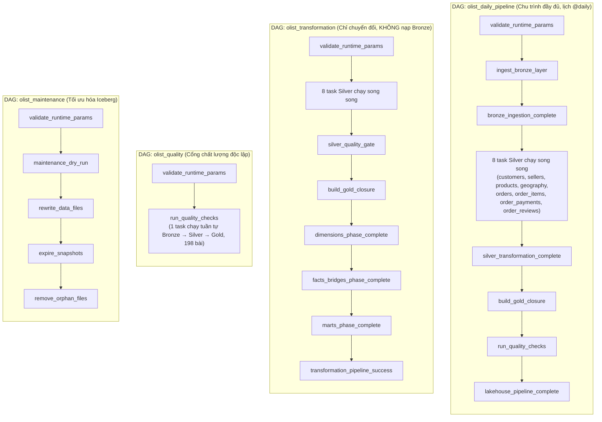

# Olist Modern Data Lakehouse Platform (Rebuilt & Verified 100%)

[](https://iceberg.apache.org/)
[](https://spark.apache.org/)
[](https://trino.io/)
[](https://airflow.apache.org/)
[](https://superset.apache.org/)
[](https://grafana.com/)

> **Kiến trúc Modern Data Lakehouse toàn diện chuẩn công nghiệp dựa trên kiến trúc Medallion (Bronze → Silver → Gold), lưu trữ định dạng bảng mở Apache Iceberg trên nền MinIO S3, điều phối bởi Apache Airflow, phân tích ngữ nghĩa bảo mật qua Trino SQL, trực quan hóa trên Apache Superset và giám sát thời gian thực bằng Prometheus & Grafana.**

---

## 1. Bức Tranh Kiến Trúc Tổng Thể

Hệ thống được thiết kế hoàn toàn bằng Docker Compose mô-đun hóa, chạy song song 13 containers độc lập, phân tầng rành mạch và kiểm định chặt chẽ:

```
┌──────────────────────────────────────────────────────────────────────────────────────────────────┐
│                                       INGESTION & LAKE STORAGE                                   │
│  9 Kaggle CSVs ──► Apache Spark Ingestion ──► Apache Iceberg (lakehouse.bronze.* on MinIO S3)   │
└───────────────────────────────────────────────┬──────────────────────────────────────────────────┘
                                                │
                                                ▼
┌──────────────────────────────────────────────────────────────────────────────────────────────────┐
│                                    SILVER & QUALITY QUARANTINE                                   │
│  Validation & Cleaning ──► lakehouse.silver.* (8 tables) + lakehouse.quarantine.* (Quarantined)  │
└───────────────────────────────────────────────┬──────────────────────────────────────────────────┘
                                                │
                                                ▼
┌──────────────────────────────────────────────────────────────────────────────────────────────────┐
│                                   GOLD STAR SCHEMA & DATA MARTS                                  │
│  5 Dimensions + 2 Bridges + 4 Facts + 3 Marts (Conservation of Revenue: $16,008,872.12 exact)   │
└───────────────────────────────────────────────┬──────────────────────────────────────────────────┘
                                                │
                     ┌──────────────────────────┴──────────────────────────┐
                     ▼                                                     ▼
┌──────────────────────────────────────────────┐ ┌─────────────────────────────────────────────────┐
│          ANALYTICS & BI SERVING              │ │            QUALITY & MAINTENANCE                │
│  - Trino Query Engine (Port 8082)            │ │  - Great Expectations Engine (198 checks)       │
│  - 4 Semantic Views (Least Privilege)        │ │  - Iceberg Maintenance (Compaction, Expire)     │
│  - Apache Superset BI (Port 8088)            │ │  - Audit Logs in lakehouse.control.*            │
└──────────────────────────────────────────────┘ └─────────────────────────────────────────────────┘
                     │                                                     │
                     └──────────────────────────┬──────────────────────────┘
                                                │
                                                ▼
┌──────────────────────────────────────────────────────────────────────────────────────────────────┐
│                                    OBSERVABILITY & MONITORING                                    │
│  - Prometheus Server (Port 9090) ── Scrapes 9/9 targets (MinIO, Spark, Trino, Airflow, Superset) │
│  - Custom Pipeline Exporter (Port 9101) ── Real-time Lakehouse Metrics from Iceberg              │
│  - Grafana Dashboards (Port 3000) ── Infrastructure, Pipeline Operations & Data Quality Hub      │
└──────────────────────────────────────────────────────────────────────────────────────────────────┘
```

---

## 2. Bảng Danh Mục Dịch Vụ & Cổng Truy Cập (Host Ports)

Tất cả các dịch vụ công bố ra máy Host đều được cố định vào địa chỉ loopback `127.0.0.1` nhằm đảm bảo an ninh mạng:

| Cổng Host | Dịch vụ Container | Thông tin đăng nhập mặc định | Mục đích / Giao diện |
|:---:|:---|:---|:---|
| **`8083`** | `airflow-webserver` | `admin` / `admin` | Giao diện điều phối, quản trị và kích hoạt 4 DAGs |
| **`8082`** | `trino` | `trino` (không mật khẩu) | Trino Web UI & API truy vấn SQL phân tán |
| **`8088`** | `superset` | `olist_admin` / `admin` | Business Intelligence & 5 bộ Dashboards kinh doanh |
| **`9000`** | `minio` | `root` / `admin_root` | MinIO S3 Storage API (truy cập PySpark, Trino) |
| **`9001`** | `minio` | `root` / `admin_root` | MinIO Web Console quản lý Buckets và Data Files |
| **`8084`** | `spark-master` | *(Công khai)* | Spark Web UI theo dõi cụm Master và Jobs |
| **`8085`** | `spark-worker` | *(Công khai)* | Spark Web UI theo dõi Executor và Tài nguyên Worker |
| **`9090`** | `prometheus` | *(Công khai)* | Prometheus Server, kiểm tra Targets và Alert Rules |
| **`3000`** | `grafana` | `admin` / `admin` | Grafana Dashboards giám sát toàn diện hệ sinh thái |
| **`8025`** | `mailhog` | *(Công khai)* | Hộp thư nhận email cảnh báo sự cố (SMTP giả lập) |

*Ghi chú: Các cổng nội bộ (`5432` PostgreSQL, `7077` Spark Master RPC, `9101` Pipeline Metrics, `9115` Blackbox, `1025` SMTP của MailHog) chỉ trao đổi trong mạng Docker `lakehouse-internal`.*

---

## 3. Khởi Động Nhanh (Quickstart Guide)

### 3.1. Yêu cầu Tiên quyết
* Hệ điều hành: Linux (Ubuntu/Debian, Fedora, Arch) hoặc WSL2 trên Windows.
* Docker Engine 24.0+ & Docker Compose v2.20+.
* RAM khả dụng tối thiểu: **4.0 GiB** (hệ thống vận hành mượt mà ở mức 4 - 6 GiB RAM).

### 3.2. Bật toàn bộ Hệ sinh thái (Linux / WSL2 / Windows)
Tại thư mục `rebuild`, sử dụng trực tiếp bộ kịch bản vận hành tự động (tự động chờ toàn bộ dịch vụ đạt trạng thái `healthy`):
```bash
# Trên Linux / macOS / WSL2:
./scripts/up.sh

# Hoặc trên Windows PowerShell:
.\scripts\up.ps1
```

### 3.3. Kiểm tra sức khỏe toàn diện tự động (60 giây)
```bash
# Kiểm tra toàn bộ Container, cổng Web UI, 4 DAGs, 4 chỉ số doanh thu Trino và Prometheus targets:
./scripts/verify_stack.sh
```

### 3.4. Dừng hệ thống giải phóng RAM (Giữ nguyên toàn bộ dữ liệu)
```bash
# Dừng an toàn, bảo toàn dữ liệu trong Docker volumes:
./scripts/down.sh

# Nếu muốn xóa sạch toàn bộ dữ liệu (volumes) để dựng lại từ đầu:
./scripts/down.sh -v
```

---

## 4. Cấu Trúc Thư Mục Dự Án (Repository Structure — Phiên Bản V3 Senior)

```text
rebuild/
├── CAM_NANG_KIEN_TRUC_TOAN_DIEN_OLIST_LAKEHOUSE_V3.md # ★ Cẩm nang giải phẫu kiến trúc từ A-Z (Mermaid + Hỏi Đáp)
├── KE_HOACH_BENCHMARK_TOI_UU_SPARK.md                 # ★ Báo cáo & Ma trận đối soát thực nghiệm V1 vs V2 vs V3
├── HUONG_DAN_THAM_QUAN_HE_THONG.md                    # Cẩm nang thực hành khám phá từng dịch vụ (Hands-on Tour)
├── huong_dan_su_dung.md                               # Hướng dẫn vận hành nhanh & kịch bản demo 10 phút
├── CAI_DAT_CHO_NHOM.md                                # Hướng dẫn cài đặt nhanh cho thành viên nhóm từ file .tar
├── NHAT_KY_REBUILD_LAKEHOUSE.md                       # Nhật ký kỹ thuật chi tiết các chặng xây dựng hệ thống
├── data/
│   ├── raw/                       # 9 tập dữ liệu gốc Olist CSV từ Kaggle
│   └── synthetic/                 # 6 bộ dữ liệu kiểm thử tải & chaos sinh từ dữ liệu thật
├── data_quality/
│   ├── gx/gx.yml                  # Cấu hình Great Expectations context
│   ├── suites/                    # 3 bộ quy tắc kiểm định: bronze.json, silver.json, gold.json
│   └── run_checks.py              # Điểm vào chạy kiểm định chất lượng
├── dashboards/superset/           # Cấu hình Superset xuất bản tự động (14 charts, 5 dashboards)
├── docs/                          # Hệ thống tài liệu kỹ thuật chuyên sâu
│   ├── architecture/              # Kiến trúc phân tầng Medallion & Luồng dữ liệu
│   ├── data_model/                # Star Schema chuẩn Kimball, từ điển cột, data contracts
│   ├── operations/                # Runbook vận hành, kịch bản demo
│   ├── reports/                   # Báo cáo nghiệm thu, lộ trình Production & kết quả Benchmark (V1, V2, V3)
│   └── security/                  # Ghi chú về ranh giới tin cậy và phân quyền cục bộ
├── infrastructure/
│   ├── alerts/email_alert.py      # Module gửi email cảnh báo sự cố qua SMTP (Gmail / MailHog)
│   ├── docker/                    # Dockerfile của airflow, spark, superset, minio, mc + init pool (2 slots)
│   ├── minio/                     # Script tạo bucket & 3 chính sách phân quyền IAM (upload, process, query)
│   ├── monitoring/                # Cấu hình Prometheus, Grafana (3 dashboards), Blackbox exporter
│   ├── postgres/init/             # Init SQL tạo role và database cho Iceberg/Airflow/Superset
│   ├── superset/                  # Cấu hình và script khởi tạo Superset
│   └── trino/                     # Catalog Iceberg, cấu hình JVM và script xuất bản 4 semantic views
├── ingestion/
│   ├── validate_dataset.py        # Thẩm định đúng 9 file CSV và khớp header với registry
│   └── upload_to_minio.py         # Nạp dữ liệu đã thẩm định lên MinIO bucket raw/
├── monitoring/exporters/
│   └── pipeline_metrics.py        # Exporter metrics Lakehouse cho Prometheus (cổng 9101)
├── orchestration/dags/            # 4 Airflow DAGs chuẩn hóa
│   ├── common.py                  # SparkSubmitOperator, Pool lakehouse_writes (2 slots), JVM Memory 0.8/0.2
│   ├── olist_daily_pipeline.py    # DAG tổng: Bronze -> Silver -> Gold -> Quality
│   ├── olist_transformation.py    # DAG chuyển đổi: 8 bảng Silver -> Gold
│   ├── olist_quality.py           # DAG kiểm định chất lượng (198 checks)
│   └── olist_maintenance.py       # DAG bảo trì Iceberg: nén tệp, dọn snapshot, xóa orphan
├── scripts/                       # Bộ công cụ vận hành (Bash .sh & PowerShell .ps1) + Benchmark
│   ├── up.sh / up.ps1             # Bật toàn cụm và chờ healthcheck
│   ├── down.sh / down.ps1         # Tắt cụm an toàn (hỗ trợ cờ -v để xóa volumes)
│   ├── verify_stack.sh / .ps1     # Kiểm tra sức khỏe toàn diện tự động trong 60 giây
│   ├── start_core.sh              # Build images & khởi động riêng tầng Core (MinIO, Postgres, Spark)
│   ├── run_benchmarks.sh / .ps1   # Chạy tự động chuỗi 8 kịch bản benchmark (00 -> 07)
│   ├── run_benchmark.py           # Đo thời gian, lấy mẫu CPU/RAM 3 giây/lần và đếm file Parquet
│   ├── summarize_benchmarks.py    # Kết xuất bảng tổng hợp Markdown từ các file JSON benchmark
│   ├── watchdog_guard.sh          # Vệ sĩ canh gác RAM/Swap bảo vệ hệ điều hành không bị treo OOM
│   ├── generate_load_datasets.py  # Sinh 3 bộ dữ liệu test tải (01_offpeak, 02_flash_sale, 03_catchup)
│   ├── generate_chaos_datasets.py # Sinh 3 bộ dữ liệu test chịu lỗi (04_dirty, 05_integrity, 06_duplicates)
│   └── stage_dataset.py           # Đẩy một bộ dữ liệu bất kỳ lên s3://raw/olist/
├── sql/
│   ├── analysis/                  # 6 truy vấn phân tích nghiệp vụ mẫu
│   └── trino/                     # create_views.sql (4 semantic views), reconciliation, integrity_matrix
├── transformation/
│   ├── bronze/                    # Spark Ingestion tạo 9 bảng Iceberg Bronze (khóa pg_advisory_lock)
│   ├── silver/                    # Spark Transform tạo 8 bảng Silver + 8 bảng cách ly Quarantine
│   ├── gold/                      # Spark Modeling 14 bảng Gold (Broadcast Join + SortWithinPartitions)
│   ├── maintenance/               # Spark Maintenance nén file 128MB & dọn snapshot Iceberg
│   ├── quality/                   # Spark Quality chạy 198 bài kiểm định
│   └── common/                    # SparkSession V3 (AQE, DPP, Memory 0.8/0.2), audit, iceberg, validation
└── remove/                        # Thư mục lưu trữ các tệp lịch sử/bản nháp cũ đã dọn dẹp
```

---

## 5. Quy Trình Vận Hành 4 Airflow DAGs

Hệ sinh thái được tự động hóa hoàn toàn thông qua 4 DAGs trên Airflow (`http://localhost:8083`):



> [!NOTE]
> `olist_daily_pipeline` là DAG **tự chứa**: nó khai báo trực tiếp toàn bộ các task từ nạp Bronze
> đến kiểm định chất lượng, **không** kích hoạt hai DAG còn lại. `olist_transformation` và
> `olist_quality` là hai DAG **độc lập**, dùng khi cần chạy lại riêng một phần của quy trình
> mà không phải nạp lại dữ liệu thô. Lưu ý `olist_transformation` **không có bước nạp Bronze** —
> nó đọc thẳng từ các bảng `lakehouse.bronze.*` đã tồn tại.

### Cách Kích Hoạt DAGs qua CLI (Không cần mở Web UI):
```bash
# 1. Chạy chu trình toàn diện Ingestion -> Transformation -> Quality
docker exec olist-lakehouse-airflow-scheduler-1 airflow dags trigger olist_daily_pipeline

# 2. Chạy độc lập kiểm định chất lượng (198 checks)
docker exec olist-lakehouse-airflow-scheduler-1 airflow dags trigger olist_quality

# 3. Chạy tối ưu hóa và dọn dẹp Iceberg (Compaction & Orphan cleanup)
docker exec olist-lakehouse-airflow-scheduler-1 airflow dags trigger olist_maintenance
```

---

## 6. Các Chỉ Số Chất Lượng Đã Được Xác Minh (100% Verified)

* **Bảo toàn Doanh thu Tiền tệ (Conservation of Revenue):**

  | Chỉ số | Giá trị | Nguồn gốc |
  |:---|---:|:---|
  | `total_orders` | **99,441** đơn hàng | `olist_orders_dataset.csv` |
  | `item_revenue` = `sum(price)` | **$13,591,643.70** | `olist_order_items_dataset.csv` |
  | `freight_total` = `sum(freight_value)` | **$2,251,909.54** | `olist_order_items_dataset.csv` |
  | `payment_total` = `sum(payment_value)` | **$16,008,872.12** | `olist_order_payments_dataset.csv` |

  > [!IMPORTANT]
  > **Đọc đúng ý nghĩa của "bảo toàn doanh thu".** Ba tổng tiền trên đến từ **ba tập tin nguồn
  > khác nhau**, nên chúng **không cộng trừ ra nhau được**:
  > `13,591,643.70 + 2,251,909.54 = 15,843,553.24 ≠ 16,008,872.12` (lệch $165,318.88).
  >
  > Khoản lệch này là **đặc tính có thật của bộ dữ liệu Olist gốc**, không phải lỗi pipeline:
  > bảng thanh toán bao gồm phần trả góp có làm tròn, voucher, và cả những đơn không có dòng hàng
  > tương ứng. Có thể tự kiểm chứng ngay trên CSV thô bằng `pandas` mà không cần chạy Lakehouse.
  >
  > Vậy **"bảo toàn" ở đây nghĩa là gì?** Nghĩa là mỗi tổng tiền ở tầng Gold khớp **tuyệt đối
  > từng cent** với chính tổng tiền tương ứng trong file CSV nguồn của nó — tức pipeline đi qua
  > ba tầng Bronze → Silver → Gold mà không đánh rơi hay nhân thêm một đồng nào. Đối chiếu giữa
  > Facts, Marts và Semantic Views cũng cho sai số **0.00**.
* **Kiểm định Chất lượng Dữ liệu:**
  * **198/198** bài kiểm tra Great Expectations đạt chuẩn (Bronze: 36, Silver: 52, Gold: 110).
  * **52/52** bài kiểm tra ma trận toàn vẹn (Integrity Matrix Tests) vượt qua.
  * **8/8** bài kiểm tra đối soát chéo (Reconciliation Tests) khớp từng cent doanh thu.
* **Tầng Giám sát:**
  * **10/10** Scrape Targets trên Prometheus hoạt động ở trạng thái `UP` (bổ sung `mailhog-health` giám sát chính kênh cảnh báo).
  * **5/5** Tầng quy trình đều phản ánh trạng thái `SUCCESS = 1`.
  * **3** Dashboards Grafana tự động nạp (Data Quality, Infrastructure, Pipeline).

---

## 7. Bản Đồ Hệ Thống Tài Liệu Chính Thức (Phiên Bản V3 Senior)

* 🌟 [**CẨM NANG KIẾN TRÚC TOÀN DIỆN (ZERO-TO-HERO V3)**](CAM_NANG_KIEN_TRUC_TOAN_DIEN_OLIST_LAKEHOUSE_V3.md): **Đọc đầu tiên để hiểu trọn vẹn hệ thống** — giải thích bình dân mọi thành phần từ Medallion, Kimball Star Schema, khóa nguyên tử Iceberg, thuật toán Kahn, đến tối ưu Spark V3 và bộ câu hỏi-đáp bảo vệ đồ án.
* 📊 [**BÁO CÁO ĐỐI SOÁT THỰC NGHIỆM BENCHMARK (V1 vs. V2 vs. V3)**](KE_HOACH_BENCHMARK_TOI_UU_SPARK.md): Số liệu thực nghiệm 24 lượt chạy chứng minh V3 tăng tốc **3.0x – 4.3x** và cắt giảm **~3.6 GiB RAM** trên Airflow Scheduler:
  * [Bảng tổng hợp V1 (Baseline)](docs/reports/benchmarks/v1_baseline/TONG_HOP_V1.md)
  * [Bảng tổng hợp V2 (Task 5)](docs/reports/benchmarks/v2_current/TONG_HOP_V2.md)
  * [Bảng tổng hợp V3 (Senior)](docs/reports/benchmarks/v3_senior/TONG_HOP_V3.md)
* 🧭 [**HƯỚNG DẪN SỬ DỤNG NHANH & DEMO 10 PHÚT**](huong_dan_su_dung.md): Cách bật/tắt cụm, chạy pipeline, truy vấn Trino, kịch bản demo 10 phút và bảng tra sự cố thường gặp.
* 🛠️ [**CẨM NANG THAM QUAN & THỰC HÀNH HỆ THỐNG**](HUONG_DAN_THAM_QUAN_HE_THONG.md): Hướng dẫn thực hành chuyên sâu từng dịch vụ trên Linux/Ubuntu.
* 📦 [**HƯỚNG DẪN CÀI ĐẶT CHO NHÓM**](CAI_DAT_CHO_NHOM.md): 5 bước dựng lại toàn bộ hệ thống trên máy mới từ gói `olist-lakehouse-images.tar`.
* 🏁 [**BÁO CÁO NGHIỆM THU TOÀN DIỆN**](docs/reports/BAO_CAO_HOAN_THANH_TOAN_DIEN_LAKEHOUSE.md) & [**ĐÁNH GIÁ LỘ TRÌNH PRODUCTION**](docs/reports/DANH_GIA_HIEN_TRANG_VA_LO_TRINH_PRODUCTION.md).
* 📖 [**So Sánh Chi Tiết Bản Cũ vs. Bản Mới**](docs/SO_SANH_BAN_CU_VA_MOI.md) & [**Nhật Ký Rebuild Toàn Diện**](NHAT_KY_REBUILD_LAKEHOUSE.md).
