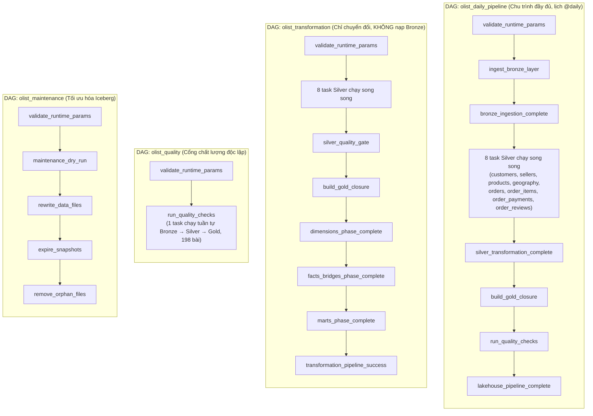

# Olist Modern Data Lakehouse Platform (Rebuilt & Verified 100%)

[](https://iceberg.apache.org/)
[](https://spark.apache.org/)
[](https://trino.io/)
[](https://airflow.apache.org/)
[](https://superset.apache.org/)
[](https://grafana.com/)

> **Kiến trúc Modern Data Lakehouse toàn diện chuẩn công nghiệp dựa trên kiến trúc Medallion (Bronze → Silver → Gold), lưu trữ định dạng bảng mở Apache Iceberg trên nền MinIO S3, điều phối bởi Apache Airflow, phân tích ngữ nghĩa bảo mật qua Trino SQL, trực quan hóa trên Apache Superset và giám sát thời gian thực bằng Prometheus & Grafana.**

---

## 1. Bức Tranh Kiến Trúc Tổng Thể

Hệ thống được thiết kế hoàn toàn bằng Docker Compose mô-đun hóa, chạy song song 13 containers độc lập, phân tầng rành mạch và kiểm định chặt chẽ:

```
┌──────────────────────────────────────────────────────────────────────────────────────────────────┐
│                                       INGESTION & LAKE STORAGE                                   │
│  9 Kaggle CSVs ──► Apache Spark Ingestion ──► Apache Iceberg (lakehouse.bronze.* on MinIO S3)   │
└───────────────────────────────────────────────┬──────────────────────────────────────────────────┘
                                                │
                                                ▼
┌──────────────────────────────────────────────────────────────────────────────────────────────────┐
│                                    SILVER & QUALITY QUARANTINE                                   │
│  Validation & Cleaning ──► lakehouse.silver.* (8 tables) + lakehouse.quarantine.* (Quarantined)  │
└───────────────────────────────────────────────┬──────────────────────────────────────────────────┘
                                                │
                                                ▼
┌──────────────────────────────────────────────────────────────────────────────────────────────────┐
│                                   GOLD STAR SCHEMA & DATA MARTS                                  │
│  5 Dimensions + 2 Bridges + 4 Facts + 3 Marts (Conservation of Revenue: $16,008,872.12 exact)   │
└───────────────────────────────────────────────┬──────────────────────────────────────────────────┘
                                                │
                     ┌──────────────────────────┴──────────────────────────┐
                     ▼                                                     ▼
┌──────────────────────────────────────────────┐ ┌─────────────────────────────────────────────────┐
│          ANALYTICS & BI SERVING              │ │            QUALITY & MAINTENANCE                │
│  - Trino Query Engine (Port 8082)            │ │  - Great Expectations Engine (198 checks)       │
│  - 4 Semantic Views (Least Privilege)        │ │  - Iceberg Maintenance (Compaction, Expire)     │
│  - Apache Superset BI (Port 8088)            │ │  - Audit Logs in lakehouse.control.*            │
└──────────────────────────────────────────────┘ └─────────────────────────────────────────────────┘
                     │                                                     │
                     └──────────────────────────┬──────────────────────────┘
                                                │
                                                ▼
┌──────────────────────────────────────────────────────────────────────────────────────────────────┐
│                                    OBSERVABILITY & MONITORING                                    │
│  - Prometheus Server (Port 9090) ── Scrapes 9/9 targets (MinIO, Spark, Trino, Airflow, Superset) │
│  - Custom Pipeline Exporter (Port 9101) ── Real-time Lakehouse Metrics from Iceberg              │
│  - Grafana Dashboards (Port 3000) ── Infrastructure, Pipeline Operations & Data Quality Hub      │
└──────────────────────────────────────────────────────────────────────────────────────────────────┘
```

---

## 2. Bảng Danh Mục Dịch Vụ & Cổng Truy Cập (Host Ports)

Tất cả các dịch vụ công bố ra máy Host đều được cố định vào địa chỉ loopback `127.0.0.1` nhằm đảm bảo an ninh mạng:

| Cổng Host | Dịch vụ Container | Thông tin đăng nhập mặc định | Mục đích / Giao diện |
|:---:|:---|:---|:---|
| **`8083`** | `airflow-webserver` | `admin` / `admin` | Giao diện điều phối, quản trị và kích hoạt 4 DAGs |
| **`8082`** | `trino` | `trino` (không mật khẩu) | Trino Web UI & API truy vấn SQL phân tán |
| **`8088`** | `superset` | `olist_admin` / `admin` | Business Intelligence & 5 bộ Dashboards kinh doanh |
| **`9000`** | `minio` | `root` / `admin_root` | MinIO S3 Storage API (truy cập PySpark, Trino) |
| **`9001`** | `minio` | `root` / `admin_root` | MinIO Web Console quản lý Buckets và Data Files |
| **`8084`** | `spark-master` | *(Công khai)* | Spark Web UI theo dõi cụm Master và Jobs |
| **`8085`** | `spark-worker` | *(Công khai)* | Spark Web UI theo dõi Executor và Tài nguyên Worker |
| **`9090`** | `prometheus` | *(Công khai)* | Prometheus Server, kiểm tra Targets và Alert Rules |
| **`3000`** | `grafana` | `admin` / `admin` | Grafana Dashboards giám sát toàn diện hệ sinh thái |
| **`8025`** | `mailhog` | *(Công khai)* | Hộp thư nhận email cảnh báo sự cố (SMTP giả lập) |

*Ghi chú: Các cổng nội bộ (`5432` PostgreSQL, `7077` Spark Master RPC, `9101` Pipeline Metrics, `9115` Blackbox, `1025` SMTP của MailHog) chỉ trao đổi trong mạng Docker `lakehouse-internal`.*

---

## 3. Khởi Động Nhanh (Quickstart Guide)

### 3.1. Yêu cầu Tiên quyết
* Hệ điều hành: Linux (Ubuntu/Debian, Fedora, Arch) hoặc WSL2 trên Windows.
* Docker Engine 24.0+ & Docker Compose v2.20+.
* RAM khả dụng tối thiểu: **4.0 GiB** (hệ thống vận hành mượt mà ở mức 4 - 6 GiB RAM).

### 3.2. Bật toàn bộ Hệ sinh thái (13 Containers)
Tại thư mục `rebuild`:
```bash
docker compose --project-name olist-lakehouse \
  -f docker-compose.yml \
  -f docker-compose.query.yml \
  -f docker-compose.orchestration.yml \
  -f docker-compose.bi.yml \
  -f docker-compose.monitoring.yml \
up -d
```

### 3.3. Kiểm tra trạng thái sức khỏe các Container
```bash
docker compose --project-name olist-lakehouse \
  -f docker-compose.yml \
  -f docker-compose.query.yml \
  -f docker-compose.orchestration.yml \
  -f docker-compose.bi.yml \
  -f docker-compose.monitoring.yml \
ps
```
*Tất cả 13 container chính phải ở trạng thái `healthy` hoặc `running`.*

### 3.4. Dừng hệ thống giải phóng RAM (Giữ nguyên toàn bộ dữ liệu)
```bash
docker compose --project-name olist-lakehouse \
  -f docker-compose.yml \
  -f docker-compose.query.yml \
  -f docker-compose.orchestration.yml \
  -f docker-compose.bi.yml \
  -f docker-compose.monitoring.yml \
down --remove-orphans
```

---

## 4. Cấu Trúc Thư Mục Dự Án (Repository Structure)

```text
rebuild/
├── data/
│   ├── raw/                       # 9 tập dữ liệu gốc Olist CSV từ Kaggle
│   └── synthetic/                 # 6 bộ dữ liệu kiểm thử sinh từ dữ liệu thật (xem scripts/)
├── data_quality/
│   ├── gx/gx.yml                  # Cấu hình Great Expectations context
│   ├── suites/                    # 3 bộ quy tắc kiểm định: bronze.json, silver.json, gold.json
│   └── run_checks.py              # Điểm vào chạy kiểm định Great Expectations
├── dashboards/superset/           # Cấu hình Superset xuất bản tự động
│   ├── charts/                    # 14 biểu đồ (gồm phễu chuyển đổi vòng đời đơn hàng)
│   ├── dashboards/                # 5 dashboards kinh doanh
│   ├── datasets/                  # 8 virtual datasets trỏ vào Trino
│   └── databases/trino.yaml       # Kết nối Superset -> Trino
├── docs/                          # Hệ thống tài liệu kiến trúc và vận hành
│   ├── architecture/              # Kiến trúc phân tầng Medallion & Luồng dữ liệu
│   ├── data_model/                # Star Schema, từ điển cột, data contracts
│   ├── operations/                # Runbook vận hành, demo guide
│   ├── reports/                   # Báo cáo nghiệm thu + số liệu benchmark (JSON)
│   ├── security/                  # Ghi chú về ranh giới tin cậy khi chạy cục bộ
│   └── superpowers/               # Lưu trữ các bản spec & plan của những đợt làm trước
├── infrastructure/
│   ├── alerts/email_alert.py      # Module gửi email cảnh báo sự cố qua SMTP
│   ├── docker/                    # Dockerfile của airflow, spark, superset, minio, mc
│   ├── minio/                     # Script tạo bucket & 3 chính sách phân quyền
│   ├── monitoring/                # Cấu hình Prometheus, Grafana, Blackbox exporter
│   ├── postgres/init/             # Init SQL tạo role và database cho Iceberg/Airflow/Superset
│   ├── superset/                  # Cấu hình và script khởi tạo Superset
│   └── trino/                     # Catalog Iceberg, cấu hình JVM và script xuất bản views
├── ingestion/
│   ├── validate_dataset.py        # Thẩm định đúng 9 file CSV và khớp header với registry
│   └── upload_to_minio.py         # Nạp dữ liệu đã thẩm định lên MinIO bucket raw/
├── monitoring/exporters/
│   └── pipeline_metrics.py        # Exporter metrics Lakehouse cho Prometheus (cổng 9101)
├── orchestration/dags/            # 4 Airflow DAGs
│   ├── common.py                  # Thư viện dùng chung, resource pool, failure callback + email
│   ├── olist_daily_pipeline.py    # DAG tổng: Bronze -> Silver -> Gold -> Quality
│   ├── olist_transformation.py    # DAG chuyển đổi: 8 bảng Silver song song -> Gold
│   ├── olist_quality.py           # DAG kiểm định chất lượng Great Expectations
│   └── olist_maintenance.py       # DAG bảo trì Iceberg: nén tệp, dọn snapshot, xóa orphan
├── scripts/                       # Bộ công cụ sinh dữ liệu kiểm thử & vận hành
│   ├── generate_load_datasets.py  # Sinh 3 bộ dữ liệu test tải và xử lý tăng dần
│   ├── generate_chaos_datasets.py # Sinh 3 bộ dữ liệu test khả năng chịu lỗi
│   ├── olist_dataset_common.py    # Thư viện dùng chung của 2 script sinh dữ liệu
│   ├── stage_dataset.py           # Đẩy một bộ dữ liệu lên MinIO raw/olist/
│   ├── run_benchmark.py           # Chạy một bài benchmark và ghi số liệu đo được
│   ├── up.ps1 / down.ps1          # Bật / tắt cụm container (PowerShell)
│   ├── verify_stack.ps1           # Kiểm tra sức khỏe toàn diện trong 60 giây
│   ├── run_benchmarks.ps1         # Chạy trọn chuỗi benchmark 8 bài
│   └── logs.ps1                   # Xem log của một dịch vụ bất kỳ
├── sql/
│   ├── analysis/                  # 6 truy vấn phân tích nghiệp vụ mẫu
│   └── trino/                     # create_views.sql (4 semantic views), reconciliation, benchmark
├── transformation/
│   ├── bronze/job.py              # Spark Ingestion tạo 9 bảng Iceberg Bronze
│   ├── silver/job.py              # Spark Transform tạo 8 bảng Silver + vùng cách ly
│   ├── gold/job.py                # Spark Modeling tạo 14 bảng Gold Star Schema & Marts
│   ├── maintenance/job.py         # Spark Maintenance nén file & dọn snapshot Iceberg
│   ├── quality/job.py             # Spark Quality chạy 198 bài kiểm định
│   └── common/                    # Catalog, audit logging, SparkSession, validation
├── docker-compose.yml             # Hạ tầng lõi: MinIO, PostgreSQL, Spark Master & Worker
├── docker-compose.query.yml       # Tầng truy vấn phân tán: Trino Query Engine
├── docker-compose.orchestration.yml # Tầng điều phối: Airflow Webserver, Scheduler & Pools
├── docker-compose.bi.yml          # Tầng phân tích kinh doanh: Apache Superset BI
├── docker-compose.monitoring.yml  # Giám sát: Prometheus, Grafana, Blackbox, MailHog
├── NHAT_KY_REBUILD_LAKEHOUSE.md   # Nhật ký kỹ thuật chi tiết 12 chặng rebuild thực tế
└── pyproject.toml                 # Cấu hình gói và phụ thuộc Python chuẩn
```

---

## 5. Quy Trình Vận Hành 4 Airflow DAGs

Hệ sinh thái được tự động hóa hoàn toàn thông qua 4 DAGs trên Airflow (`http://localhost:8083`):



> [!NOTE]
> `olist_daily_pipeline` là DAG **tự chứa**: nó khai báo trực tiếp toàn bộ các task từ nạp Bronze
> đến kiểm định chất lượng, **không** kích hoạt hai DAG còn lại. `olist_transformation` và
> `olist_quality` là hai DAG **độc lập**, dùng khi cần chạy lại riêng một phần của quy trình
> mà không phải nạp lại dữ liệu thô. Lưu ý `olist_transformation` **không có bước nạp Bronze** —
> nó đọc thẳng từ các bảng `lakehouse.bronze.*` đã tồn tại.

### Cách Kích Hoạt DAGs qua CLI (Không cần mở Web UI):
```bash
# 1. Chạy chu trình toàn diện Ingestion -> Transformation -> Quality
docker exec olist-lakehouse-airflow-scheduler-1 airflow dags trigger olist_daily_pipeline

# 2. Chạy độc lập kiểm định chất lượng (198 checks)
docker exec olist-lakehouse-airflow-scheduler-1 airflow dags trigger olist_quality

# 3. Chạy tối ưu hóa và dọn dẹp Iceberg (Compaction & Orphan cleanup)
docker exec olist-lakehouse-airflow-scheduler-1 airflow dags trigger olist_maintenance
```

---

## 6. Các Chỉ Số Chất Lượng Đã Được Xác Minh (100% Verified)

* **Bảo toàn Doanh thu Tiền tệ (Conservation of Revenue):**

  | Chỉ số | Giá trị | Nguồn gốc |
  |:---|---:|:---|
  | `total_orders` | **99,441** đơn hàng | `olist_orders_dataset.csv` |
  | `item_revenue` = `sum(price)` | **$13,591,643.70** | `olist_order_items_dataset.csv` |
  | `freight_total` = `sum(freight_value)` | **$2,251,909.54** | `olist_order_items_dataset.csv` |
  | `payment_total` = `sum(payment_value)` | **$16,008,872.12** | `olist_order_payments_dataset.csv` |

  > [!IMPORTANT]
  > **Đọc đúng ý nghĩa của "bảo toàn doanh thu".** Ba tổng tiền trên đến từ **ba tập tin nguồn
  > khác nhau**, nên chúng **không cộng trừ ra nhau được**:
  > `13,591,643.70 + 2,251,909.54 = 15,843,553.24 ≠ 16,008,872.12` (lệch $165,318.88).
  >
  > Khoản lệch này là **đặc tính có thật của bộ dữ liệu Olist gốc**, không phải lỗi pipeline:
  > bảng thanh toán bao gồm phần trả góp có làm tròn, voucher, và cả những đơn không có dòng hàng
  > tương ứng. Có thể tự kiểm chứng ngay trên CSV thô bằng `pandas` mà không cần chạy Lakehouse.
  >
  > Vậy **"bảo toàn" ở đây nghĩa là gì?** Nghĩa là mỗi tổng tiền ở tầng Gold khớp **tuyệt đối
  > từng cent** với chính tổng tiền tương ứng trong file CSV nguồn của nó — tức pipeline đi qua
  > ba tầng Bronze → Silver → Gold mà không đánh rơi hay nhân thêm một đồng nào. Đối chiếu giữa
  > Facts, Marts và Semantic Views cũng cho sai số **0.00**.
* **Kiểm định Chất lượng Dữ liệu:**
  * **198/198** bài kiểm tra Great Expectations đạt chuẩn (Bronze: 36, Silver: 52, Gold: 110).
  * **52/52** bài kiểm tra ma trận toàn vẹn (Integrity Matrix Tests) vượt qua.
  * **8/8** bài kiểm tra đối soát chéo (Reconciliation Tests) khớp từng cent doanh thu.
* **Tầng Giám sát:**
  * **10/10** Scrape Targets trên Prometheus hoạt động ở trạng thái `UP` (bổ sung `mailhog-health` giám sát chính kênh cảnh báo).
  * **5/5** Tầng quy trình đều phản ánh trạng thái `SUCCESS = 1`.
  * **3** Dashboards Grafana tự động nạp (Data Quality, Infrastructure, Pipeline).

---

## 7. Tài Liệu Kế Thừa & Hướng Dẫn Chi Tiết

Mời bạn tham khảo hệ thống tài liệu chuyên sâu trong thư mục [`docs/`](docs/):
* 🧭 [**HƯỚNG DẪN SỬ DỤNG**](huong_dan_su_dung.md): **đọc đầu tiên nếu bạn muốn vận hành hệ thống** —
  bật/tắt cụm, chạy pipeline, truy vấn, kịch bản demo 10 phút, bảng tra sự cố thường gặp.
* 🏁 [**BÁO CÁO NGHIỆM THU TOÀN DIỆN**](docs/reports/BAO_CAO_HOAN_THANH_TOAN_DIEN_LAKEHOUSE.md): tài liệu
  **quan trọng nhất** — kết quả 5 task, số liệu benchmark đo thực tế trên 8 bài chạy, danh sách 53 sai
  sót tài liệu đã sửa, 8 phát hiện ngoài phạm vi nhiệm vụ và 9 ý tưởng nâng cấp trình Sếp duyệt.
* 📖 [**Bản So Sánh Chi Tiết Bản Cũ vs. Bản Rebuild**](docs/SO_SANH_BAN_CU_VA_MOI.md): Làm rõ các điểm over-engineering đã loại bỏ và tính ưu việt của kiến trúc mới.
* 🚀 [**Đề Xuất Nâng Cấp Kỹ Thuật (Recommend Updates)**](docs/RECOMMEND_UPDATES.md): Hướng dẫn sinh 6 tập dataset test tải/chịu lỗi, cấu hình cảnh báo Email SMTP, và tối ưu hóa Spark/BI.
* 📋 [**Tài Liệu Bàn Giao Dành Cho Agent Kế Thừa**](docs/AGENT_HANDOFF_TASKS.md): Quy chuẩn lập trình, danh sách task ưu tiên, yêu cầu viết báo cáo sau khi hoàn thành.
* 💡 [**Ý Tưởng Nâng Cấp Dài Hạn**](docs/Y_TUONG_NANG_CAP_DU_AN.md): Bản thiết kế kiến trúc Streaming Real-time, dbt-core, Data Governance & Cloud Migration.
* 📝 [**Nhật Ký Rebuild Toàn Diện**](NHAT_KY_REBUILD_LAKEHOUSE.md): Ghi chép 12 chặng triển khai thực tế từ con số 0.
