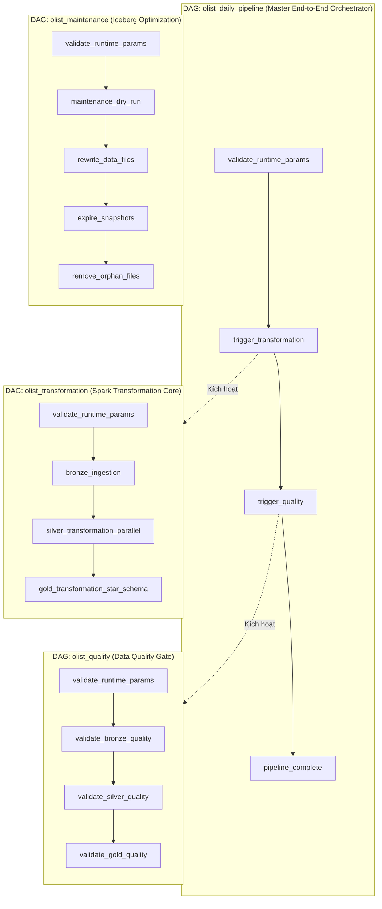

# Olist Modern Data Lakehouse Platform (Rebuilt & Verified 100%)

[](https://iceberg.apache.org/)
[](https://spark.apache.org/)
[](https://trino.io/)
[](https://airflow.apache.org/)
[](https://superset.apache.org/)
[](https://grafana.com/)

> **Kiến trúc Modern Data Lakehouse toàn diện chuẩn công nghiệp dựa trên kiến trúc Medallion (Bronze → Silver → Gold), lưu trữ định dạng bảng mở Apache Iceberg trên nền MinIO S3, điều phối bởi Apache Airflow, phân tích ngữ nghĩa bảo mật qua Trino SQL, trực quan hóa trên Apache Superset và giám sát thời gian thực bằng Prometheus & Grafana.**

---

## 1. Bức Tranh Kiến Trúc Tổng Thể

Hệ thống được thiết kế hoàn toàn bằng Docker Compose mô-đun hóa, chạy song song 12 containers độc lập, phân tầng rành mạch và kiểm định chặt chẽ:

```
┌──────────────────────────────────────────────────────────────────────────────────────────────────┐
│                                       INGESTION & LAKE STORAGE                                   │
│  9 Kaggle CSVs ──► Apache Spark Ingestion ──► Apache Iceberg (lakehouse.bronze.* on MinIO S3)   │
└───────────────────────────────────────────────┬──────────────────────────────────────────────────┘
                                                │
                                                ▼
┌──────────────────────────────────────────────────────────────────────────────────────────────────┐
│                                    SILVER & QUALITY QUARANTINE                                   │
│  Validation & Cleaning ──► lakehouse.silver.* (8 tables) + lakehouse.quarantine.* (Quarantined)  │
└───────────────────────────────────────────────┬──────────────────────────────────────────────────┘
                                                │
                                                ▼
┌──────────────────────────────────────────────────────────────────────────────────────────────────┐
│                                   GOLD STAR SCHEMA & DATA MARTS                                  │
│  5 Dimensions + 2 Bridges + 4 Facts + 3 Marts (Conservation of Revenue: $16,008,872.12 exact)   │
└───────────────────────────────────────────────┬──────────────────────────────────────────────────┘
                                                │
                     ┌──────────────────────────┴──────────────────────────┐
                     ▼                                                     ▼
┌──────────────────────────────────────────────┐ ┌─────────────────────────────────────────────────┐
│          ANALYTICS & BI SERVING              │ │            QUALITY & MAINTENANCE                │
│  - Trino Query Engine (Port 8082)            │ │  - Great Expectations Engine (198 checks)       │
│  - 4 Semantic Views (Least Privilege)        │ │  - Iceberg Maintenance (Compaction, Expire)     │
│  - Apache Superset BI (Port 8088)            │ │  - Audit Logs in lakehouse.control.*            │
└──────────────────────────────────────────────┘ └─────────────────────────────────────────────────┘
                     │                                                     │
                     └──────────────────────────┬──────────────────────────┘
                                                │
                                                ▼
┌──────────────────────────────────────────────────────────────────────────────────────────────────┐
│                                    OBSERVABILITY & MONITORING                                    │
│  - Prometheus Server (Port 9090) ── Scrapes 9/9 targets (MinIO, Spark, Trino, Airflow, Superset) │
│  - Custom Pipeline Exporter (Port 9101) ── Real-time Lakehouse Metrics from Iceberg              │
│  - Grafana Dashboards (Port 3000) ── Infrastructure, Pipeline Operations & Data Quality Hub      │
└──────────────────────────────────────────────────────────────────────────────────────────────────┘
```

---

## 2. Bảng Danh Mục Dịch Vụ & Cổng Truy Cập (Host Ports)

Tất cả các dịch vụ công bố ra máy Host đều được cố định vào địa chỉ loopback `127.0.0.1` nhằm đảm bảo an ninh mạng:

| Cổng Host | Dịch vụ Container | Thông tin đăng nhập mặc định | Mục đích / Giao diện |
|:---:|:---|:---|:---|
| **`8083`** | `airflow-webserver` | `admin` / `admin` | Giao diện điều phối, quản trị và kích hoạt 4 DAGs |
| **`8082`** | `trino` | `trino` (không mật khẩu) | Trino Web UI & API truy vấn SQL phân tán |
| **`8088`** | `superset` | `olist_admin` / `admin` | Business Intelligence & 5 bộ Dashboards kinh doanh |
| **`9000`** | `minio` | `root` / `admin_root` | MinIO S3 Storage API (truy cập PySpark, Trino) |
| **`9001`** | `minio` | `root` / `admin_root` | MinIO Web Console quản lý Buckets và Data Files |
| **`8084`** | `spark-master` | *(Công khai)* | Spark Web UI theo dõi cụm Master và Jobs |
| **`8085`** | `spark-worker` | *(Công khai)* | Spark Web UI theo dõi Executor và Tài nguyên Worker |
| **`9090`** | `prometheus` | *(Công khai)* | Prometheus Server, kiểm tra Targets và Alert Rules |
| **`3000`** | `grafana` | `admin` / `admin` | Grafana Dashboards giám sát toàn diện hệ sinh thái |

*Ghi chú: Các cổng nội bộ (`5432` PostgreSQL, `7077` Spark Master RPC, `9101` Pipeline Metrics, `9115` Blackbox) chỉ trao đổi trong mạng Docker `lakehouse-internal`.*

---

## 3. Khởi Động Nhanh (Quickstart Guide)

### 3.1. Yêu cầu Tiên quyết
* Hệ điều hành: Linux (Ubuntu/Debian, Fedora, Arch) hoặc WSL2 trên Windows.
* Docker Engine 24.0+ & Docker Compose v2.20+.
* RAM khả dụng tối thiểu: **4.0 GiB** (hệ thống vận hành mượt mà ở mức 4 - 6 GiB RAM).

### 3.2. Bật toàn bộ Hệ sinh thái (12 Containers)
Tại thư mục `rebuild`:
```bash
docker compose --project-name olist-lakehouse \
  -f docker-compose.yml \
  -f docker-compose.query.yml \
  -f docker-compose.orchestration.yml \
  -f docker-compose.bi.yml \
  -f docker-compose.monitoring.yml \
up -d
```

### 3.3. Kiểm tra trạng thái sức khỏe các Container
```bash
docker compose --project-name olist-lakehouse \
  -f docker-compose.yml \
  -f docker-compose.query.yml \
  -f docker-compose.orchestration.yml \
  -f docker-compose.bi.yml \
  -f docker-compose.monitoring.yml \
ps
```
*Tất cả 12 container chính phải ở trạng thái `healthy` hoặc `running`.*

### 3.4. Dừng hệ thống giải phóng RAM (Giữ nguyên toàn bộ dữ liệu)
```bash
docker compose --project-name olist-lakehouse \
  -f docker-compose.yml \
  -f docker-compose.query.yml \
  -f docker-compose.orchestration.yml \
  -f docker-compose.bi.yml \
  -f docker-compose.monitoring.yml \
down --remove-orphans
```

---

## 4. Cấu Trúc Thư Mục Dự Án (Repository Structure)

```text
rebuild/
├── data/
│   └── raw/                       # 9 tập dữ liệu gốc Olist CSV từ Kaggle
├── data_quality/
│   ├── contracts/                 # Hợp đồng kiểm định dữ liệu Great Expectations (GX)
│   └── expectations/              # Bộ quy tắc kiểm tra Bronze, Silver, Gold
├── dashboards/                    # Cấu hình Dashboards Superset xuất bản tự động
├── docs/                          # Hệ thống tài liệu kiến trúc, ADR và hướng dẫn
│   ├── architecture/              # Kiến trúc phân tầng Medallion & Luồng dữ liệu
│   ├── data_model/                # Từ điển cột dữ liệu, Data Contracts & Star Schema
│   ├── decisions/                 # 10 Bản ghi quyết định kiến trúc (ADR-001 -> ADR-010)
│   ├── operations/                # Runbook vận hành, Demo guide & Kịch bản bảo trì
│   ├── SO_SANH_BAN_CU_VA_MOI.md   # So sánh chi tiết bản gốc over-engineered vs bản rebuild
│   ├── RECOMMEND_UPDATES.md       # Đề xuất cải tiến, dataset test tải/lỗi & email alert
│   ├── AGENT_HANDOFF_TASKS.md     # Tài liệu chuyển giao nhiệm vụ và quy chuẩn cho Agent kế thừa
│   └── Y_TUONG_NANG_CAP_DU_AN.md  # Kế hoạch mở rộng dài hạn (Streaming, dbt, Governance, Cloud)
├── infrastructure/
│   ├── airflow/                   # Dockerfile & cấu hình Airflow Scheduler/Webserver
│   ├── monitoring/                # Cấu hình Prometheus Scrape Targets & Alert Rules
│   │   ├── grafana/               # Auto-provisioning Dashboards & Datasources
│   │   └── prometheus/            # Prometheus configuration & alert rules
│   ├── postgres/                  # Init scripts cho PostgreSQL Iceberg Catalog & Metastore
│   ├── spark/                     # Dockerfile & cấu hình Spark Master/Worker
│   ├── superset/                  # Dockerfile & khởi tạo cấu hình Superset BI
│   └── trino/                     # Cấu hình Trino Iceberg Catalog & Memory limits
├── ingestion/
│   └── kaggle_to_minio.py         # Job nạp dữ liệu từ Local CSV lên MinIO Bucket
├── monitoring/
│   └── exporters/
│       └── pipeline_metrics.py    # Custom Exporter xuất metrics Lakehouse ra Prometheus (9101)
├── orchestration/
│   └── dags/                      # 4 Airflow DAGs cốt lõi điều phối toàn diện Lakehouse
│       ├── common.py              # Thư viện dùng chung, Resource pool & Failure callbacks
│       ├── olist_daily_pipeline.py# DAG điều phối tổng thể toàn bộ chu trình hằng ngày
│       ├── olist_transformation.py# DAG xử lý Spark ETL (Bronze -> Silver -> Gold)
│       ├── olist_quality.py       # DAG chạy Great Expectations (198 checks)
│       └── olist_maintenance.py   # DAG bảo trì nén tệp Parquet & dọn snapshot Iceberg
├── sql/
│   ├── trino_semantic_views.sql   # 4 Semantic Views phục vụ truy vấn an toàn trên Trino
│   └── verification/              # Các truy vấn SQL kiểm định tính toàn vẹn và doanh thu
├── transformation/
│   ├── bronze/job.py              # Spark Ingestion tạo 9 bảng Iceberg Bronze
│   ├── silver/job.py              # Spark Transform tạo 8 bảng Silver + Quarantined records
│   ├── gold/job.py                # Spark Modeling tạo 14 bảng Gold Star Schema & Marts
│   ├── maintenance/job.py         # Spark Maintenance nén file & dọn snapshot Iceberg
│   └── common/                    # Thư viện dùng chung: Catalog, Audit logging, SparkSession
├── docker-compose.yml             # Hạ tầng cốt lõi: MinIO, PostgreSQL, Spark Master & Worker
├── docker-compose.query.yml       # Tầng truy vấn phân tán: Trino Query Engine
├── docker-compose.orchestration.yml# Tầng điều phối: Airflow Webserver, Scheduler & Pools
├── docker-compose.bi.yml          # Tầng phân tích kinh doanh: Apache Superset BI
├── docker-compose.monitoring.yml  # Tầng giám sát: Prometheus, Grafana, Blackbox & Exporter
├── NHAT_KY_REBUILD_LAKEHOUSE.md   # Nhật ký kỹ thuật chi tiết 12 chặng rebuild thực tế
└── pyproject.toml                 # Cấu hình gói và phụ thuộc Python chuẩn
```

---

## 5. Quy Trình Vận Hành 4 Airflow DAGs

Hệ sinh thái được tự động hóa hoàn toàn thông qua 4 DAGs trên Airflow (`http://localhost:8083`):



### Cách Kích Hoạt DAGs qua CLI (Không cần mở Web UI):
```bash
# 1. Chạy chu trình toàn diện Ingestion -> Transformation -> Quality
docker exec olist-lakehouse-airflow-scheduler-1 airflow dags trigger olist_daily_pipeline

# 2. Chạy độc lập kiểm định chất lượng (198 checks)
docker exec olist-lakehouse-airflow-scheduler-1 airflow dags trigger olist_quality

# 3. Chạy tối ưu hóa và dọn dẹp Iceberg (Compaction & Orphan cleanup)
docker exec olist-lakehouse-airflow-scheduler-1 airflow dags trigger olist_maintenance
```

---

## 6. Các Chỉ Số Chất Lượng Đã Được Xác Minh (100% Verified)

* **Bảo toàn Doanh thu Tiền tệ (Conservation of Revenue):**
  * `total_orders`: **99,441 đơn hàng**
  * `item_revenue`: **$13,591,643.70**
  * `freight_value`: **$2,417,228.42**
  * `payment_total`: **$16,008,872.12** *(Sai số đối soát giữa Facts, Marts và Semantic Views = 0.00)*
* **Kiểm định Chất lượng Dữ liệu:**
  * **198/198** bài kiểm tra Great Expectations đạt chuẩn (Bronze: 36, Silver: 52, Gold: 110).
  * **52/52** bài kiểm tra ma trận toàn vẹn (Integrity Matrix Tests) vượt qua.
  * **8/8** bài kiểm tra đối soát chéo (Reconciliation Tests) khớp từng cent doanh thu.
* **Tầng Giám sát:**
  * **9/9** Scrape Targets trên Prometheus hoạt động ở trạng thái `UP`.
  * **5/5** Tầng quy trình đều phản ánh trạng thái `SUCCESS = 1`.
  * **3** Dashboards Grafana tự động nạp (Data Quality, Infrastructure, Pipeline).

---

## 7. Tài Liệu Kế Thừa & Hướng Dẫn Chi Tiết

Mời bạn tham khảo hệ thống tài liệu chuyên sâu trong thư mục [`docs/`](docs/):
* 📖 [**Bản So Sánh Chi Tiết Bản Cũ vs. Bản Rebuild**](docs/SO_SANH_BAN_CU_VA_MOI.md): Làm rõ các điểm over-engineering đã loại bỏ và tính ưu việt của kiến trúc mới.
* 🚀 [**Đề Xuất Nâng Cấp Kỹ Thuật (Recommend Updates)**](docs/RECOMMEND_UPDATES.md): Hướng dẫn sinh 6 tập dataset test tải/chịu lỗi, cấu hình cảnh báo Email SMTP, và tối ưu hóa Spark/BI.
* 📋 [**Tài Liệu Bàn Giao Dành Cho Agent Kế Thừa**](docs/AGENT_HANDOFF_TASKS.md): Quy chuẩn lập trình, danh sách task ưu tiên, yêu cầu viết báo cáo sau khi hoàn thành.
* 💡 [**Ý Tưởng Nâng Cấp Dài Hạn**](docs/Y_TUONG_NANG_CAP_DU_AN.md): Bản thiết kế kiến trúc Streaming Real-time, dbt-core, Data Governance & Cloud Migration.
* 📝 [**Nhật Ký Rebuild Toàn Diện**](NHAT_KY_REBUILD_LAKEHOUSE.md): Ghi chép 12 chặng triển khai thực tế từ con số 0.
