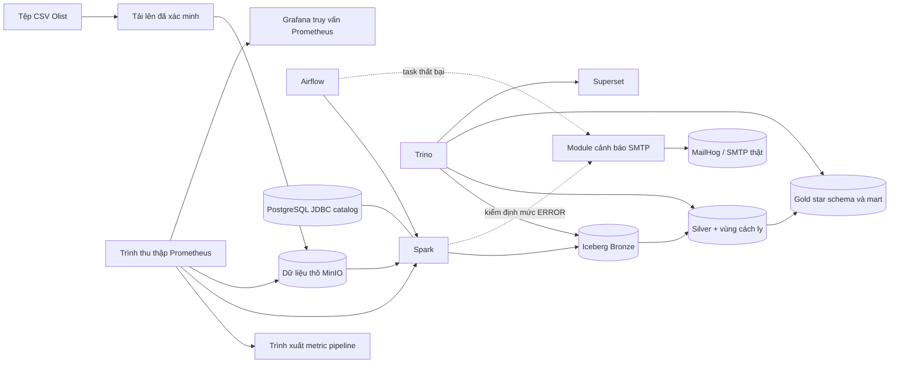

# Kiến trúc

Cụm gồm **13 container**. Mọi tệp dữ liệu Iceberg nằm trong bucket MinIO `lakehouse`. PostgreSQL lưu metadata của Iceberg catalog cùng cơ sở dữ liệu ứng dụng Airflow và Superset. Môi trường chạy dùng một Spark master và một worker có hai core, 4 GiB. Các lớp phủ Compose bổ sung truy vấn, điều phối, BI và giám sát mà không nhân đôi trạng thái cốt lõi.

Cảnh báo sự cố đi qua một đường duy nhất: `infrastructure/alerts/email_alert.py` được gọi từ
`failure_callback` của Airflow và từ cổng chất lượng trong `transformation/quality/job.py`. Mặc
định module này gửi tới container MailHog nội bộ; đổi các biến `ALERT_SMTP_*` trong `.env` là
chuyển sang máy chủ SMTP thật mà không phải sửa code.

Các ranh giới tin cậy được thu hẹp có chủ đích: chỉ công bố những port loopback; các dịch vụ trong container dùng chung mạng nội bộ. Cấu hình này không cung cấp khả năng cô lập giữa các đối tượng thuê. Xem [bảo mật cục bộ](../security/local_security.md) và [runbook](../operations/runbook.md).
