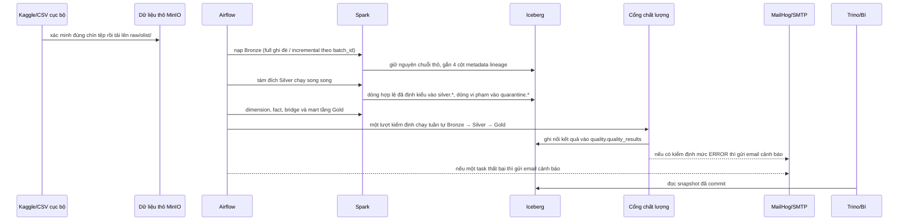

# Luồng dữ liệu

> [!IMPORTANT]
> **Cổng chất lượng chạy MỘT LƯỢT DUY NHẤT ở cuối chu trình, không phải nhiều cổng xen giữa các tầng.**
> Trong `olist_daily_pipeline`, task `run_quality_checks` đứng **sau** `build_gold_closure` và tự nó
> chạy tuần tự cả ba tầng Bronze → Silver → Gold trong cùng một tiến trình Spark. Thiết kế này
> đổi lấy việc "phát hiện lỗi sớm" để lấy sự đơn giản và tiết kiệm: khởi tạo một SparkSession mất
> khoảng 15-20 giây, nên gọi ba lần riêng lẻ sẽ lãng phí gần một phút mỗi lần chạy pipeline.
> Bù lại, nếu tầng Bronze có lỗi mức `ERROR`, vòng lặp kiểm định sẽ **dừng ngay (break)** mà không
> chạy tiếp Silver và Gold — nên vẫn không tốn công kiểm định trên dữ liệu đã hỏng từ gốc.

## Bảng kiểm toán và cơ chế chặn

Các bản ghi kiểm toán dùng `control.ingestion_batches`, `control.pipeline_runs`,
`control.transformation_targets` và `control.maintenance_results`. Kết quả chất lượng được ghi
nối vào `quality.quality_results`.

Một cổng mức `ERROR` sẽ làm job thoát với mã khác không, khiến task Airflow chuyển FAILED và chặn
toàn bộ công việc hạ nguồn; kết quả mức `WARN` vẫn được ghi lại và hiển thị trên Grafana nhưng
không làm batch thất bại.
