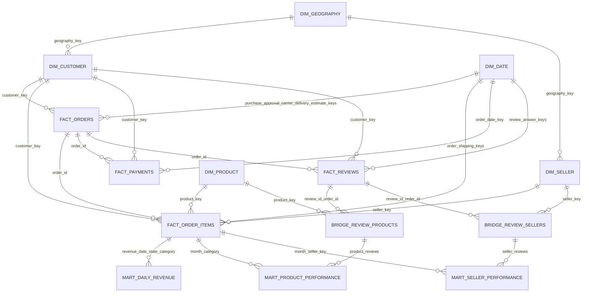

# Gold star schema — BẢN CŨ ĐÃ LOẠI BỎ (lưu lại để đối chiếu)

> [!WARNING]
> **ĐÂY KHÔNG PHẢI MÔ HÌNH HIỆN HÀNH.** Tài liệu này chỉ được giữ lại làm tư liệu đối chiếu.
> Mô hình đúng đang áp dụng nằm ở [`star_schema.md`](star_schema.md).
>
> **Sơ đồ ERD dưới đây sai bản chất mô hình Kimball ở hai điểm:**
> 1. **Vẽ Fact nối trực tiếp với Fact** (`FACT_ORDERS ||--o{ FACT_ORDER_ITEMS`,
>    `FACT_ORDERS ||--o{ FACT_PAYMENTS`, `FACT_ORDERS ||--o{ FACT_REVIEWS`). Trong Star Schema,
>    các bảng Fact **không bao giờ** liên kết với nhau bằng khóa ngoại. Chúng gắn kết qua các
>    **Conformed Dimension** dùng chung (`DIM_DATE`, `DIM_CUSTOMER`), còn `order_id` chỉ đóng vai
>    trò **Degenerate Dimension** nằm sẵn trong từng Fact để đối soát chéo.
> 2. **Nhét bảng Mart vào sơ đồ ERD quan hệ khóa ngoại.** Mart là bảng tổng hợp dẫn xuất
>    (materialized summary), không có quan hệ khóa ngoại với Fact. Chúng phải được vẽ ở một
>    sơ đồ **Data Lineage** riêng.

Năm dimension gồm ngày, khách hàng, sản phẩm, người bán và địa lý. Bốn fact giữ nguyên grain của đơn hàng, dòng đơn hàng, chuỗi thanh toán và `(review_id, order_id)`. Dimension ngày đóng nhiều vai trò: đơn hàng có các khóa ngày mua, phê duyệt, giao cho đơn vị vận chuyển, giao đến khách và dự kiến giao; item có khóa ngày đặt hàng và giới hạn giao; thanh toán có ngày đặt hàng; đánh giá có ngày đánh giá và phản hồi. Cả dimension khách hàng và người bán đều liên kết đến địa lý.

Khóa xác định `0` là thành viên chưa biết trong mọi dimension. Các bridge sản phẩm và người bán ánh xạ mỗi quan hệ đánh giá-đơn hàng đến các sản phẩm và người bán riêng biệt mà không nhân các đại lượng đánh giá. Ba mart hiện thực hóa doanh thu theo ngày, hiệu quả sản phẩm theo tháng và hiệu quả người bán theo tháng tại các khóa được khai báo trong [từ điển column](column_dictionary.md). Các yêu cầu có thể thực thi nằm trong [data contract](data_contracts.md).
