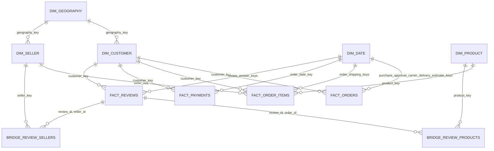
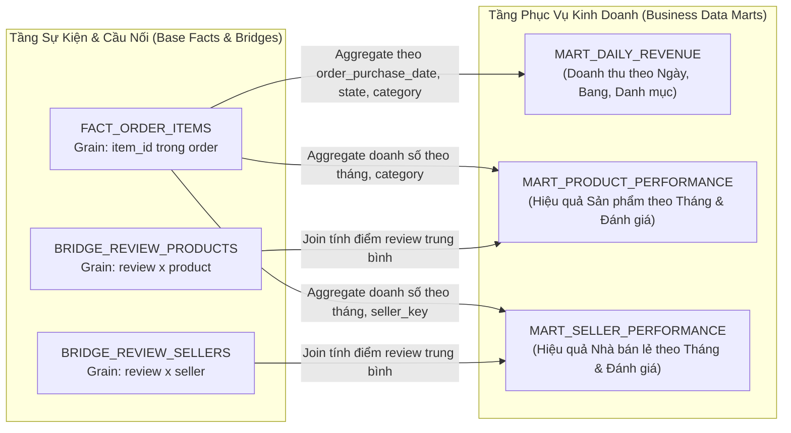

# Gold Star Schema & Dimensional Modeling

Tài liệu này định nghĩa mô hình dữ liệu chiều (Kimball Dimensional Modeling) tầng Gold của hệ thống Olist Lakehouse, bao gồm các bảng chiều (Dimensions), bảng sự kiện (Facts), bảng cầu nối (Bridge tables) và các bảng dữ liệu tổng hợp phục vụ kinh doanh (Data Marts).

---

## 1. Sơ Đồ Thực Thể Chiều Chuẩn (Star Schema / Fact Constellation ERD)

Theo chuẩn thiết kế Kimball, các bảng Fact **không liên kết trực tiếp với Fact** qua quan hệ khóa ngoại (Foreign Key) mà liên kết đa chiều thông qua các **Conformed Dimensions** (`DIM_DATE`, `DIM_CUSTOMER`) và sử dụng mã định danh đơn hàng `order_id` như một **Degenerate Dimension (DD)** nằm trực tiếp trong từng Fact.

> [!NOTE]
> * **Degenerate Dimension (DD):** `order_id` đóng vai trò là chiều thoái hóa xuất hiện đồng thời trong `FACT_ORDERS`, `FACT_ORDER_ITEMS`, `FACT_PAYMENTS` và `FACT_REVIEWS` nhằm cho phép đối soát chéo mà không phá vỡ tính độc lập về Grain giữa các Fact.
> * **Conformed Dimensions:** `DIM_DATE` và `DIM_CUSTOMER` là các chiều dùng chung xuyên suốt toàn bộ 4 bảng Fact.
> * Khóa xác định `0` (`Unknown Key`) được gán cho các trường hợp dữ liệu nguồn bị thiếu hoặc chưa thể xác định trong các Dimensions.

---

## 2. Luồng Tổng Hợp & Quan Hệ Dữ Liệu Tầng Marts (Data Marts Lineage)

Các bảng Data Marts là bảng dẫn xuất tổng hợp (Aggregated Materialized Views) phục vụ các bài toán phân tích kinh doanh cụ thể, không tham gia vào quan hệ ràng buộc khóa ngoại của Star Schema ERD. Luồng tổng hợp được minh họa qua biểu đồ Data Lineage dưới đây:

---

## 3. Danh Mục Chi Tiết 14 Bảng Tầng Gold

1. **5 Bảng Chiều (Dimensions):**
   * `dim_date`: Lịch ngày chuẩn hóa đóng nhiều vai trò (Role-playing dimension).
   * `dim_customer`: Thông tin khách hàng và mã vùng địa lý.
   * `dim_product`: Thông tin danh mục, trọng lượng, kích thước sản phẩm.
   * `dim_seller`: Thông tin nhà bán hàng và vị trí địa lý.
   * `dim_geography`: Chuẩn hóa tọa độ, thành phố, bang của Brazil.
2. **4 Bảng Sự Kiện (Facts):**
   * `fact_orders`: Mức hạt (grain) 1 dòng / 1 đơn hàng (theo dõi trạng thái, mốc thời gian, doanh thu đơn).
   * `fact_order_items`: Mức hạt 1 dòng / 1 mặt hàng trong đơn (doanh thu chi tiết, tiền cước).
   * `fact_payments`: Mức hạt 1 dòng / 1 lần thanh toán (hình thức, số kỳ trả góp, số tiền).
   * `fact_reviews`: Mức hạt 1 dòng / 1 đánh giá của khách hàng (điểm sao 1-5, ngày gửi).
3. **2 Bảng Cầu Nối (Bridges):**
   * `bridge_review_products`: Bóc tách quan hệ đa-đa giữa một đánh giá đơn hàng với các sản phẩm trong đơn.
   * `bridge_review_sellers`: Bóc tách quan hệ đa-đa giữa một đánh giá đơn hàng với các nhà bán hàng trong đơn.
4. **3 Bảng Data Marts:**
   * `mart_daily_revenue`: Phục vụ báo cáo tài chính, tổng hợp doanh thu theo ngày.
   * `mart_product_performance`: Phục vụ phân tích danh mục hàng hóa và mức độ hài lòng khách hàng.
   * `mart_seller_performance`: Phục vụ đánh giá SLA và năng lực của các đối tác bán hàng.
