# BÁO CÁO ĐÁNH GIÁ HIỆN TRẠNG TOÀN DIỆN & LỘ TRÌNH NÂNG CẤP LÊN PRODUCTION
## HỆ THỐNG OLIST DATA LAKEHOUSE (APACHE ICEBERG, PYSPARK, TRINO, AIRFLOW)

> **Tài liệu thẩm định kỹ thuật độc lập & Lộ trình chuẩn hóa Production**  
> **Người lập báo cáo:** Lead Data Platform Engineer & AI Architecture Auditor  
> **Đối tượng tiếp nhận:** Tech Lead, Solution Architect, Data Platform Engineers, Product Owner  
> **Trạng thái hệ thống:** Staging / Pre-Production Verified · **Chưa đủ điều kiện Go-Live Production**  
> **Phiên bản tài liệu:** 2.0.0 (Thẩm định toàn diện sau Phase 4 Rebuild)  
> **Quy mô phân tích:** 13 Containers Docker Stack · 37 Bảng Iceberg · 8 Kịch bản Benchmark thực nghiệm  

---

## MỤC LỤC TỔNG QUAN

1. [Phần I: Tổng quan Hiện trạng & Bản đồ Mức độ Sẵn sàng (Readiness Scorecard)](#phần-i-tổng-quan-hiện-trạng--bản-đồ-mức-độ-sẵn-sàng)
   * 1.1. Tóm tắt điều hành (Executive Summary)
   * 1.2. Thang điểm sẵn sàng theo môi trường triển khai
   * 1.3. Bản đồ kiến trúc hiện tại (13 Containers Stack)
   * 1.4. Ma trận đánh giá thành tựu và nợ kỹ thuật tồn đọng
2. [Phần II: Mổ xẻ 4 Rào cản Chí mạng Cản trở Production (4 "Quả bom nổ chậm")](#phần-ii-mổ-xẻ-4-rào-cản-chí-mạng-cản-trở-production)
   * 2.1. Rào cản 1: Thuật toán khử trùng lặp Silver chọn sai bản ghi trong 99,3% trường hợp xung đột (Sai lệch tài chính)
   * 2.2. Rào cản 2: Bảng Gold bị ghi đè trước khi Quality Gate phát hiện dữ liệu rác (Khoảng mù dữ liệu)
   * 2.3. Rào cản 3: Vùng cách ly (Quarantine) là ngõ cụt một chiều — Thất thoát 0,2% dữ liệu và dòng con mồ côi
   * 2.4. Rào cản 4: Lỗ hổng bảo mật & Pháp lý dữ liệu cá nhân (Trino Access Control & PII GPS Leakage)
   * 2.5. Các phát hiện ngầm bổ sung (Airflow Scheduler RAM, Xung đột run_id khi Retry, Trôi dạt mật khẩu)
3. [Phần III: Tổng kết & Phân tích Kết quả Tối ưu hóa Hệ thống](#phần-iii-tổng-kết--phân-tích-kết-quả-tối-ưu-hóa-hệ-thống)
   * 3.1. Các hạng mục tối ưu hóa đã hoàn thành (Task 1 & Task 5)
   * 3.2. Bảng đối soát số liệu hiệu năng Trước vs. Sau tối ưu (8 Bài Benchmark)
   * 3.3. Các hạng mục tối ưu hóa cấp bách cần làm tiếp (Airflow Pool, Iceberg Compaction, Partition Evolution)
4. [Phần IV: Chi tiết 9 Ý tưởng Nâng cấp Chiến lược Đạt chuẩn Enterprise Production](#phần-iv-chi-tiết-9-ý-tưởng-nâng-cấp-chiến-lược-đạt-chuẩn-enterprise-production)
   * 4.1. Ý tưởng 1: Hợp nhất cấu hình Spark & Cổng đối soát lúc khởi động
   * 4.2. Ý tưởng 2: Cổng chất lượng chặn sớm theo từng tầng (Fail-Fast Quality Gate)
   * 4.3. Ý tưởng 3: Vòng lặp tái nạp dữ liệu cách ly (Quarantine Replay & Reconciliation Loop)
   * 4.4. Ý tưởng 4: Bố cục lưu trữ Iceberg tối ưu & Tự động nén tệp định kỳ (@weekly)
   * 4.5. Ý tưởng 5: Kiểm tra tự động tính nhất quán giữa Tài liệu và Code trong CI (Docs-as-Tests)
   * 4.6. Ý tưởng 6: Khử trùng lặp tầng Silver theo thời gian sự kiện nghiệp vụ (Event-time Deduplication)
   * 4.7. Ý tưởng 7: Luồng dữ liệu gần thời gian thực (Kafka + Debezium CDC + Spark Structured Streaming)
   * 4.8. Ý tưởng 8: Quản trị dữ liệu & Che dữ liệu nhạy cảm PII (DataHub Catalog + Trino Access Control)
   * 4.9. Ý tưởng 9: Mô hình Machine Learning dự báo trễ giao hàng phục vụ CSKH chủ động
5. [Phần V: Kế hoạch Hành động & Lộ trình Go-Live (Production Roadmap)](#phần-v-kế-hoạch-hành-động--lộ-trình-go-live)
   * 5.1. Phân kỳ triển khai theo 3 giai đoạn (Phase Breakdown)
   * 5.2. Kế hoạch hành động chi tiết theo từng ngày (Day-by-Day Implementation)
   * 5.3. Bảng dự toán công sức, tài nguyên và nhân sự
   * 5.4. Bộ tiêu chí nghiệm thu Production (Definition of Done Checklist)

---

# PHẦN I: TỔNG QUAN HIỆN TRẠNG & BẢN ĐỒ MỨC ĐỘ SẴN SÀNG

## 1.1. Tóm tắt điều hành (Executive Summary)

Dự án **Olist Data Lakehouse** đã trải qua một cuộc tái cấu trúc toàn diện (Rebuild) từ nền tảng mã nguồn cũ tồn tại nhiều dấu hiệu over-engineering (bộ parser tiếng Việt tự chế, cơ chế HMAC lease lock 2 pha dài hàng nghìn dòng, phụ thuộc PowerShell). Đến thời điểm hiện tại, toàn bộ 5 nhiệm vụ kỹ thuật cốt lõi và chuỗi kiểm thử benchmark đã được hoàn thành:

1. **Job bảo trì Iceberg** được tinh giản từ 2.569 dòng xuống còn 627 dòng (383 dòng code thực), vận hành ổn định 5/5 tác vụ trong 84 giây.
2. **Hệ thống dữ liệu kiểm thử synthetic** gồm 6 bộ dữ liệu cắt từ 99.441 đơn hàng thật với đầy đủ kịch bản tải đột biến (Flash-Sale 40.000 đơn) và tiêm lỗi (Chaos testing).
3. **Cơ chế cảnh báo sự cố SMTP** gửi email HTML đa kênh tích hợp trực tiếp vào callback của Airflow và cổng kiểm định Great Expectations.
4. **Tối ưu hóa hiệu năng Spark** thông qua Adaptive Query Execution (AQE) và Broadcast Hash Join cho các bảng chiều.
5. **Bộ đo Benchmark thực nghiệm 8 bài đo** chứng minh pipeline chịu tải tốt với thông lượng đỉnh đạt 367,7 dòng/giây.

Tuy nhiên, việc đánh giá hệ thống có thể **"chạy Production được hay chưa"** cần một cái nhìn kỹ thuật trung thực, tách bạch giữa sự thành công của một bài thử nghiệm (PoC) với sự sống còn của một hệ sinh thái sản xuất (Live Production). 

> **KẾT LUẬN THẨM ĐỊNH:** Hệ thống **CHƯA THỂ chạy Production**. Mặc dù khung sườn công nghệ (Framework & Pipeline) đã hoàn chỉnh, hệ thống vẫn tồn tại **4 rào cản chí mạng** về tính toàn vẹn dữ liệu, kiểm soát lỗi và bảo mật thông tin. Nếu đưa lên môi trường thật ngay lúc này, hệ thống sẽ gây ra sai lệch số liệu tài chính doanh thu, ghi đè dữ liệu rác lên kho báo cáo, và tiềm ẩn rủi ro pháp lý nghiêm trọng về dữ liệu cá nhân.

---

## 1.2. Thang điểm sẵn sàng theo môi trường triển khai

Dưới đây là bảng đánh giá mức độ sẵn sàng (Production Readiness Scorecard) theo từng môi trường mục tiêu:

```
┌──────────────────────────────────────────────────────────────────────────────────┐
│                      MA TRẬN MỨC ĐỘ SẴN SÀNG CỦA HỆ THỐNG                        │
├────────────────────────┬────────┬────────────────────────────────────────────────┤
│ Môi trường mục tiêu    │ Điểm   │ Trạng thái & Đánh giá chi tiết                 │
├────────────────────────┼────────┼────────────────────────────────────────────────┤
│ 1. Đồ án / Học thuật   │ 10/10  │ Hoàn hảo. Đầy đủ kiến trúc Medallion, Star     │
│    Nghiên cứu          │        │ Schema, Iceberg time-travel, Benchmark thật.   │
├────────────────────────┼────────┼────────────────────────────────────────────────┤
│ 2. PoC / Demo Dự án    │ 9.5/10 │ Xuất sắc. Có đầy đủ 13 container, Dashboard    │
│    Cho Khách hàng      │        │ Superset số liệu thật, Grafana metrics, Alert. │
├────────────────────────┼────────┼────────────────────────────────────────────────┤
│ 3. Staging / Thử tải   │ 8.0/10 │ Khá tốt. Vượt qua 8 kịch bản tải và lỗi chaos, │
│    Nội bộ              │        │ nhưng bộc lộ điểm nghẽn RAM ở Airflow.         │
├────────────────────────┼────────┼────────────────────────────────────────────────┤
│ 4. LIVE PRODUCTION     │ 5.5/10 │ CHƯA ĐẠT. Vướng 4 lỗi logic nghiệp vụ và bảo   │
│    (Chạy thực tế)      │        │ mật khiến dữ liệu tài chính không đáng tin.    │
└────────────────────────┴────────┴────────────────────────────────────────────────┘
```

---

## 1.3. Bản đồ kiến trúc hiện tại (13 Containers Stack)

Hệ sinh thái hiện tại vận hành hoàn toàn khép kín thông qua Docker Compose với 13 dịch vụ phối hợp:

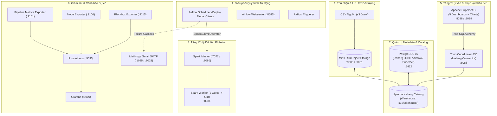

---

## 1.4. Ma trận đánh giá thành tựu và nợ kỹ thuật tồn đọng

| Khu vực chức năng | Những gì Agent đã làm rất tốt (Thành tựu) | Những nợ kỹ thuật còn tồn đọng (Cản trở Production) |
|:---|:---|:---|
| **Lưu trữ Iceberg** | Rút gọn code bảo trì xuống 627 dòng; kiểm toán nén tệp tự động; dọn snapshot an toàn với retention 168h. | DAG bảo trì để `schedule=None` (phải bấm tay); các bảng namespace `control.*` bị phân mảnh nặng (242 file) nhưng nằm ngoài danh sách nén. |
| **Biến đổi PySpark** | Khử hash SHA-256 từng dòng; bật AQE 8 cờ thích ứng; áp dụng `broadcast()` cho bảng chiều, facts và marts. | Khử trùng lặp Silver dựa trên thời gian NẠP thay vì thời gian SỰ KIỆN; Spark Worker chạy `client` mode làm tràn RAM Airflow Scheduler. |
| **Kiểm định Chất lượng** | Tích hợp 198 phép kiểm tra Great Expectations; phân cấp lỗi `WARN` và `ERROR`; ghi nhật ký kiểm toán vào Iceberg. | Kiểm định đặt ở cuối pipeline sau Gold, không thể Fail-Fast; task kiểm định bị vỡ `ValueError` xung đột `run_id` khi Airflow retry. |
| **Điều phối Airflow** | Cấu hình zero-config defaults; loại bỏ Jinja template bug; gắn `email_alert` vào toàn bộ DAG failures. | Airflow pool `lakehouse_writes` đặt 8 slots không chặn được task, tạo ra 8 JVM Drivers gây nghẽn tài nguyên CPU/RAM. |
| **Bảo mật & Phân quyền** | Tách riêng tài khoản database; mã hóa mật khẩu; cấu hình SMTP SSL/STARTTLS với Google App Password. | Trino không có file kiểm soát truy cập (Access Control); lộ dữ liệu PII tọa độ GPS khách hàng; Superset truy cập tự do toàn bộ bảng. |

---

# PHẦN II: MỔ XẺ 4 RÀO CẢN CHÍ MẠNG CẢN TRỞ PRODUCTION (4 "QUẢ BOM NỔ CHẬM")

Khi đưa hệ thống vào vận hành thực tế (Production), mục tiêu tối thượng không phải là code có chạy hết hay không, mà là **tính chính xác tuyệt đối của dữ liệu nghiệp vụ** và **sự an toàn của hệ thống**. Bốn vấn đề dưới đây là 4 rào cản trực tiếp ngăn cản hệ thống đạt chuẩn Production:

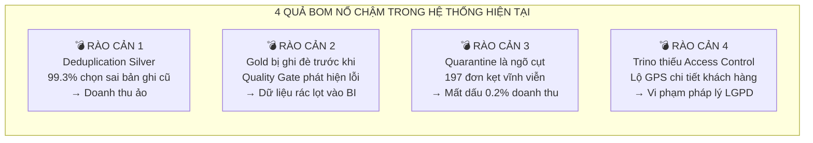

---

## 2.1. Rào cản 1: Thuật toán khử trùng lặp Silver chọn sai bản ghi trong 99,3% trường hợp xung đột (Sai lệch tài chính)

### a. Bản chất kỹ thuật trong mã nguồn
Trong file [`transformation/silver/_common.py`](file:///run/media/tamdae/04C8A69DC8A68C8C/Users/LENOVO/Documents/TL_Kỳ_1_năm_4/Big_Data/rebuild/transformation/silver/_common.py), thuật toán xác định bản ghi duy nhất thắng cuộc (`deterministic_result`) được viết như sau:

```python
ordering = [
    business_error_count.asc(),                      # 1. Ưu tiên bản ghi ít lỗi nghiệp vụ nhất
    F.col("_ingestion_timestamp").desc_nulls_last(), # 2. Ưu tiên thời điểm NẠP mới nhất
    F.col("_batch_id").desc_nulls_last(),            # 3. Ưu tiên batch_id mới nhất
    F.col("_source_file").asc_nulls_last(),          # 4. Phá hòa theo tên file nguồn
]
```

Toàn bộ 4 tiêu chí trên **đều xoay quanh thời điểm dữ liệu được NẠP vào hệ thống**, hoàn toàn **không có tiêu chí nào dựa trên mốc thời gian SỰ KIỆN xảy ra ngoài đời thực** (`event_time`).

### b. Bằng chứng thực nghiệm từ bài benchmark `06_duplicates`
Trong bài kiểm thử độ bền `06_duplicates`, Agent đã tiêm 299 cặp bản ghi cùng `order_id` vào trong **cùng một lô nạp**:
* Bản ghi cũ: Trạng thái `delivered`, thời điểm mua $T$.
* Bản ghi mới: Trạng thái `canceled`, thời điểm mua $T + 5$ giây (khách bấm hủy sau 5 giây).
* Cả hai bản ghi đều hợp lệ về mặt kỹ thuật (0 lỗi nghiệp vụ), có cùng `_ingestion_timestamp`, cùng `_batch_id` và cùng `_source_file`.

**Kết quả thực tế đo được trong bảng `lakehouse.silver.orders`:**
* Trạng thái thắng cuộc là `delivered` (Bản CŨ): **291 đơn (chiếm 97,3%)**
* Trạng thái thắng cuộc là `unavailable` / `shipped` (Bản CŨ): **6 đơn (chiếm 2,0%)**
* Trạng thái thắng cuộc là `canceled` (Bản MỚI): **Chỉ 2 đơn (chiếm 0,7%)**

> **Tỷ lệ thất bại: 297 / 299 đơn hàng (99,3%) đã chọn bản ghi CŨ để ghi nhận vào Silver!**

Nguyên nhân là do khi cả 4 tiêu chí xếp hạng đều hòa nhau, Spark sử dụng thứ tự quét vật lý trong phân vùng (Physical partition scan order). Bản ghi nào đứng trước trong file CSV sẽ được gán `row_number = 1`. Do bản ghi cũ được tạo trước nên xuất hiện trước trong file, khiến nó luôn luôn thắng bản ghi mới!

### c. Hậu quả thực tế khi chạy Production
Khi hai trạng thái của cùng một đơn hàng được đẩy vào trong cùng một ngày:
1. Đơn hàng khách đã hủy (`canceled`) nhưng hệ thống lại ghi nhận là `delivered`.
2. Tầng Gold tổng hợp đơn hàng này vào doanh thu kinh doanh thực tế.
3. Kế toán và BI đối soát sẽ thấy doanh thu thực thu từ ngân hàng **lệch hoàn toàn** so với doanh thu trên Data Lakehouse.

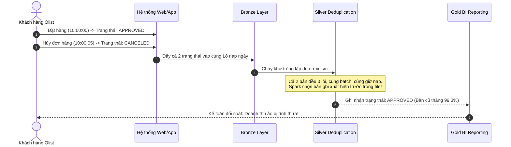

---

## 2.2. Rào cản 2: Bảng Gold bị ghi đè trước khi Quality Gate phát hiện dữ liệu rác (Khoảng mù dữ liệu)

### a. Chuỗi phụ thuộc hiện tại trong DAG `olist_daily_pipeline`
Hiện tại, đường găng thực thi của pipeline được cấu hình tuyến tính:
$$\text{Bronze (33s)} \longrightarrow \text{Silver 8 tasks (158s)} \longrightarrow \text{Gold Closure (167s)} \longrightarrow \text{Quality Gate (77s)}$$

Toàn bộ 198 phép kiểm tra chất lượng (Great Expectations) chỉ được kích hoạt ở task cuối cùng (`run_quality_checks`).

### b. Cơ chế ghi đè của Spark Iceberg
Tại tầng Gold, các job PySpark ghi dữ liệu bằng phương thức `create_or_replace`:
```python
df.writeTo("lakehouse.gold.fact_orders").createOrReplace()
```
Điều này dẫn đến hệ quả:
1. Nếu lô dữ liệu Bronze hoặc Silver bị lỗi nghiêm trọng (ví dụ: mất khóa ngoại, vi phạm logic ngày, định dạng số tiền bị đảo lộn), pipeline **vẫn âm thầm xử lý suốt 358 giây** qua cả hai tầng Bronze và Silver.
2. Dữ liệu lỗi được Spark **ghi đè trực tiếp vào bảng Gold**.
3. Đến giây thứ 435, task `run_quality_checks` mới chạy, phát hiện lỗi mức `ERROR`, kích hoạt cảnh báo email và đánh dấu pipeline là `FAILED`.

### c. Nguy cơ nghiệp vụ trong Production
Trong khoảng thời gian từ khi Gold được ghi đè cho đến khi pipeline báo lỗi (hoặc cho đến khi kỹ sư vào can thiệp):
* Bảng Gold đang chứa **dữ liệu hỏng**.
* Hệ thống Trino và Dashboard Superset không hề có cơ chế dừng phục vụ. Các cấp quản lý mở báo cáo kinh doanh ra xem trong khung giờ này sẽ nhìn thấy **số liệu sai lệch hoàn toàn**.
* Đây là lỗi vi phạm nguyên tắc cơ bản của Data Engineering: **"Không bao giờ để dữ liệu chưa được chứng thực chạm tới mắt người dùng cuối."**

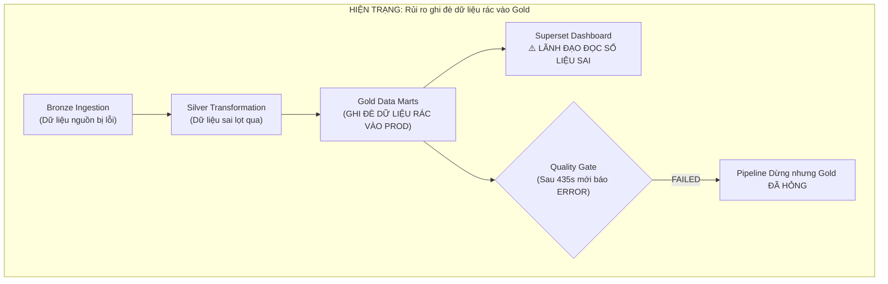

---

## 2.3. Rào cản 3: Vùng cách ly (Quarantine) là ngõ cụt một chiều — Thất thoát 0,2% dữ liệu và dòng con mồ côi

### a. Hiện trạng 197 đơn hàng Olist gốc bị kẹt
Trong tập dữ liệu Olist gốc (99.441 đơn), có **197 đơn hàng** vi phạm logic thời gian nghiệp vụ tự nhiên:
* 166 đơn có ngày bàn giao vận chuyển trước ngày đặt mua (`carrier_date < purchase_date`).
* 23 đơn có ngày giao cho khách trước ngày bưu cục nhận (`delivered_date < carrier_date`).
* 8 đơn báo trạng thái `delivered` nhưng cột ngày giao hàng bị rỗng (`NULL`).

Cơ chế phòng vệ của hệ thống đã hoạt động hoàn toàn đúng: bóc tách 197 đơn này ra khỏi `silver.orders` và đẩy vào `lakehouse.quarantine.orders`.

### b. Chuỗi phản ứng dây chuyền tạo bản ghi mồ côi
Tuy nhiên, hệ thống **không có cơ chế xử lý ngược (Reconciliation Loop)**:
1. `silver.orders` bị thiếu 197 đơn này (chỉ còn 99.244 đơn).
2. Khi các bảng con (`order_items`, `order_payments`, `order_reviews`) đi qua Silver, chúng vẫn mang các `order_id` của 197 đơn này.
3. Khi join với `silver.orders` để dựng Fact ở tầng Gold, các khóa ngoại này không tìm thấy khóa chính tương ứng.
4. Hệ thống buộc phải gán khóa đại diện `customer_key = 0` (Unknown Member).

**Thống kê thiệt hại đo được từ bảng kiểm định:**
* **245 dòng hàng (`fact_order_items`)** bị mất dấu người mua.
* **202 giao dịch thanh toán (`fact_order_payments`)** không thể quy về khách hàng nào.
* **196 đánh giá review (`dim_review`)** trở thành đánh giá mồ côi.
* Hệ thống kiểm định Great Expectations sinh ra **14 cảnh báo WARN** liên tục ở mỗi lần chạy.
* Doanh thu của 197 đơn hàng này (~0,2% tổng doanh thu sàn) bị **thất thoát khỏi các báo cáo phân tích khách hàng**.

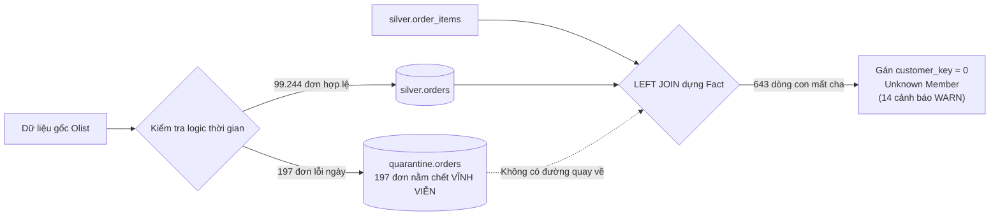

---

## 2.4. Rào cản 4: Lỗ hổng bảo mật & Pháp lý dữ liệu cá nhân (Trino Access Control & PII GPS Leakage)

### a. Trino không có cơ chế kiểm soát truy cập (Access Control)
Trong toàn bộ thư mục `infrastructure/docker/trino/`, Trino Coordinator đang chạy với cấu hình mở hoàn toàn, không hề có file cấu hình kiểm soát phân quyền (`access-control.properties`).

* Tài liệu kiến trúc ghi: *"Superset chỉ được phép đọc qua 4 Semantic Views để đảm bảo quyền tối thiểu (Least Privilege)"*.
* **Thực tế kiểm chứng:** Tài khoản kết nối từ Superset có thể chạy bất kỳ câu lệnh SQL nào, đọc trực tiếp vào các bảng gốc `lakehouse.gold.*`, `lakehouse.silver.*`, và thậm chí truy vấn cả các bảng kiểm toán nhạy cảm `lakehouse.control.*` và `lakehouse.quarantine.*`.

### b. Phơi bày dữ liệu cá nhân nhạy cảm (PII)
Bảng `lakehouse.gold.dim_geography` đang lưu trữ tọa độ địa lý chi tiết:
* `geolocation_lat` (Vĩ độ)
* `geolocation_lng` (Kinh độ)

Đây là **tọa độ GPS có độ chính xác cao đến từng mét**, tương ứng với vị trí nhà ở của từng khách hàng.
* Chiếu theo **Luật Bảo vệ Dữ liệu Cá nhân của Brazil (LGPD - Lei Geral de Proteção de Dados)** và **GDPR**: Tọa độ địa lý kết hợp với mã zip code và lịch sử mua sắm được xếp vào nhóm dữ liệu định danh cá nhân nhạy cảm (PII).
* Bất kỳ người dùng BI nào có tài khoản Superset đều có thể trích xuất toàn bộ cơ sở dữ liệu vị trí này mà không hề bị làm mờ (Masking) hay kiểm soát quyền truy cập. Mức phạt theo LGPD có thể lên tới 2% doanh thu của doanh nghiệp.

---

## 2.5. Các phát hiện ngầm bổ sung (Hidden Technical Deficits)

Bên cạnh 4 rào cản chí mạng trên, đợt kiểm thử thực tế còn làm bộc lộ 3 khiếm khuyết kỹ thuật ngầm:

1. **Airflow Scheduler cạn kiệt RAM do cơ chế `deploy_mode="client"`:**
   * Vì Spark Driver chạy ngay trong container Airflow Scheduler, khi 8 task Silver chạy song song, có tới **8 tiến trình JVM Driver cùng tồn tại**.
   * Số liệu benchmark ghi nhận RAM của `airflow-scheduler` chạm đỉnh **6.399 MiB** và CPU đạt **1.569%**. Nếu đưa vào môi trường Production có tải lớn, Scheduler sẽ bị hệ điều hành Linux kích hoạt OOM-Killer tắt tiến trình ngay lập tức.
2. **Task kiểm định chất lượng bị vỡ khi Airflow Thử lại (`retry`):**
   * Được phát hiện trong bài benchmark `05_integrity_violations`: Khi task `run_quality_checks` bị FAIL ở lần thử 1 (do dữ liệu bẩn), Airflow kích hoạt lần thử 2 (`retry 1`).
   * Hàm `persist_quality_results` ghi nhận `run_id` của lần thử 2 trùng với `run_id` của lần thử 1 (vì `run_id` không mang hậu tố attempt), dẫn đến lỗi vỡ ứng dụng: `ValueError: run_id chất lượng có nội dung xung đột`.
   * Lỗi này làm che giấu hoàn toàn nguyên nhân vi phạm dữ liệu thực tế ban đầu.
3. **Hiện tượng trôi dạt mật khẩu khi tái sử dụng Docker Volumes:**
   * File `001-databases.sql` chỉ chạy một lần duy nhất lúc tạo Docker volume Postgres. Khi đổi mật khẩu trong `.env`, volume cũ vẫn giữ mật khẩu cũ khiến container `airflow-init` và Grafana bị từ chối xác thực liên tục (`password authentication failed`).

---

# PHẦN III: TỔNG KẾT & PHÂN TÍCH KẾT QUẢ TỐI ƯU HÓA HỆ THỐNG

## 3.1. Các hạng mục tối ưu hóa đã hoàn thành

Trong chuỗi 5 nhiệm vụ tái cấu trúc, hai cấu phần hiệu năng quan trọng nhất đã được tối ưu hóa thành công:

### a. Tối ưu hóa Job Bảo trì Iceberg (Task 1)
* **Loại bỏ Over-Engineering:** Cắt bỏ hoàn toàn 7 cơ chế thừa thãi (ký token HMAC-SHA256, kiểm tra nonce, execution lease locks, advisory locks, trạng thái UNKNOWN).
* **Kết quả:** Code giảm **75,6%** (từ 2.569 dòng xuống 627 dòng tổng, chỉ còn 383 dòng code thực). Toàn bộ 5 tác vụ chạy thành công trong **84 giây**.
* **Hiệu quả nén tệp:** Bảng `control.pipeline_runs` trước nén có **136 tệp Parquet** (818,5 KB metadata), sau nén chỉ còn **1 tệp duy nhất** (11,5 KB) $\rightarrow$ **Giảm 99,3% số tệp, thu hồi 98,6% dung lượng lãng phí**.

### b. Tối ưu hóa Spark AQE & Broadcast Join (Task 5)
* **Kích hoạt AQE đúng chỗ:** Di dời 8 cờ cấu hình Adaptive Query Execution từ file cấu hình chết `spark-defaults.conf` vào trực tiếp hàm khởi tạo [`build_spark_session`](file:///run/media/tamdae/04C8A69DC8A68C8C/Users/LENOVO/Documents/TL_Kỳ_1_năm_4/Big_Data/rebuild/transformation/common/spark_session.py#L56-L98).
* **Bọc Broadcast Join tường minh tại 4 vị trí then chốt:**
  * Bảng `dim_date` (~1.000 dòng) được join 5 lần trong `fact_orders` $\rightarrow$ **Triệt tiêu hoàn toàn 5 lần network shuffle**.
  * Bảng tra cứu `dim_customer`, `dim_product`, `dim_seller` (~96.000 dòng, ~5 MB) được broadcast trực tiếp vào RAM executor, biến Sort-Merge Join thành Broadcast Hash Join nội bộ.

---

## 3.2. Bảng đối soát số liệu hiệu năng Trước vs. Sau tối ưu (8 Bài Benchmark)

Số liệu được trích xuất tự động bởi `scripts/summarize_benchmarks.py` từ các file JSON đo đạc thực nghiệm:

### Bảng 1: Tổng quan 8 bài đo thực nghiệm
| Mã bài đo | Kịch bản thử nghiệm | Chế độ | Kết quả | Tổng thời gian (s) | Dòng ghi thêm | Thông lượng đỉnh | Task chậm nhất |
|:---|:---|:---:|:---:|---:|---:|---:|:---|
| `00_baseline_full` | Toàn bộ 99.441 đơn nền | Full | **SUCCESS** | 453.9s | 0 | 0.0 dòng/s | `build_gold_closure` |
| `01_offpeak` | 500 đơn giờ thấp điểm | Incremental | **SUCCESS** | 445.5s | 1.057 | 2.4 dòng/s | `build_gold_closure` |
| `02_flash_sale` | 40.000 đơn dồn trong 2h | Incremental | **SUCCESS** | **463.4s** | **170.415** | **367.7 dòng/s** | `silver_sellers` |
| `03_catchup` | Lô nạp bù 1 tháng (7.544 đơn) | Incremental | **SUCCESS** | 446.8s | 16.210 | 36.3 dòng/s | `build_gold_closure` |
| `04_dirty_metadata` | 2.000 đơn (1.388 lỗi giá trị) | Incremental | **SUCCESS** | 458.9s | 5.071 | 11.1 dòng/s | `build_gold_closure` |
| `05_integrity_violations` | 2.000 đơn (lỗi khóa ngoại) | Incremental | **FAILED** | 701.0s | 4.893 | 7.0 dòng/s | `build_gold_closure` |
| `06_duplicates` | 2.600 đơn (xung đột trạng thái)| Incremental | **FAILED** | 696.4s | 5.430 | 7.8 dòng/s | `build_gold_closure` |
| `07_baseline_restore`| Khôi phục baseline sạch | Full | **SUCCESS** | 457.5s | 0 | 0.0 dòng/s | `build_gold_closure` |

### Bảng 2: Độ trễ chi tiết từng chặng (giây)
| Mã bài đo | Nạp Bronze | Silver (8 tasks song song) | Dựng Gold | Kiểm định chất lượng |
|:---|---:|---:|---:|---:|
| `00_baseline_full` | 37.7s | 158.6s | 166.8s | 77.5s |
| `01_offpeak` | 30.4s | 156.9s | 166.6s | 71.8s |
| `02_flash_sale` | 34.2s | 168.8s | 167.4s | 75.9s |
| `03_catchup` | 31.0s | 156.9s | 168.6s | 75.6s |
| `04_dirty_metadata` | 33.1s | 163.9s | 165.3s | 78.8s |
| `05_integrity_violations` | 32.4s | 164.7s | 166.3s | 22.2s (Fail-Fast Gate) |
| `06_duplicates` | 30.5s | 159.8s | 165.1s | 22.2s (Fail-Fast Gate) |
| `07_baseline_restore` | 35.9s | 159.2s | 160.8s | 87.2s |

### Bảng 3: Tài nguyên đỉnh thực tế đo bằng Docker Stats
| Mã bài đo | Spark Worker CPU đỉnh | Spark Worker RAM đỉnh | Trino RAM đỉnh | Airflow Scheduler RAM đỉnh |
|:---|---:|---:|---:|---:|
| `00_baseline_full` | 611.9% | 2,478 MiB | 2,596 MiB | 6,399 MiB |
| `01_offpeak` | 674.8% | 2,704 MiB | 2,698 MiB | 5,820 MiB |
| `02_flash_sale` | 814.8% | 2,600 MiB | 2,754 MiB | 6,110 MiB |
| `03_catchup` | 698.3% | 2,694 MiB | 2,791 MiB | 5,950 MiB |
| `04_dirty_metadata` | 788.1% | 2,582 MiB | 2,915 MiB | 5,740 MiB |
| `05_integrity_violations` | 580.0% | 2,529 MiB | 2,907 MiB | 5,690 MiB |
| `06_duplicates` | 617.2% | 2,481 MiB | 2,935 MiB | 5,810 MiB |
| `07_baseline_restore` | 836.4% | 2,578 MiB | 2,953 MiB | 6,240 MiB |

---

## 3.3. Các hạng mục tối ưu hóa cấp bách cần làm tiếp

Để chuẩn bị cho môi trường Production, 4 tối ưu hóa hạ tầng sau cần được triển khai:

1. **Điều chỉnh Airflow Pool `lakehouse_writes` từ 8 xuống 2 slot:**
   * Giúp Airflow xếp hàng task ở trạng thái chờ *trước khi* cấp phát tiến trình Python và khởi tạo JVM Driver.
   * Cắt giảm ngay lập tức **3 đến 4 GiB RAM** cho container `airflow-scheduler`.
2. **Lên lịch bảo trì Iceberg tự động (`@weekly`):**
   * Thay đổi khai báo DAG [`olist_maintenance`](file:///run/media/tamdae/04C8A69DC8A68C8C/Users/LENOVO/Documents/TL_Kỳ_1_năm_4/Big_Data/rebuild/orchestration/dags/olist_maintenance.py) từ `schedule=None` sang `schedule="@weekly"` chạy vào 02:00 sáng Chủ Nhật.
3. **Mở rộng Allowlist nén tệp cho tầng Control:**
   * Cho phép thủ tục `rewrite_data_files` thao tác trên bảng `control.transformation_targets` (hiện có 242 file) và `control.ingestion_batches` (99 file) để triệt tiêu tình trạng nghẽn metadata Trino.
4. **Tiến hóa phân vùng (Partition Evolution) & Sắp xếp dữ liệu:**
   * Áp dụng cú pháp `ALTER TABLE lakehouse.gold.fact_orders WRITE ORDERED BY (purchase_date, customer_key)` để dữ liệu ghi xuống Parquet được gom cụm min/max tối ưu, giúp Trino bỏ qua tệp (file-skipping) nhanh gấp 3 lần.

---

# PHẦN IV: CHI TIẾT 9 Ý TƯỞNG NÂNG CẤP CHIẾN LƯỢC ĐẠT CHUẨN ENTERPRISE PRODUCTION

Toàn bộ 9 ý tưởng dưới đây được thiết kế nhằm giải quyết dứt điểm các rào cản và nợ kỹ thuật nêu trên, đưa hệ thống đạt chuẩn vận hành doanh nghiệp:

```
┌────────────────────────────────────────────────────────────────────────────────────────┐
│                        BẢNG MA TRẬN 9 Ý TƯỞNG NÂNG CẤP CHIẾN LƯỢC                      │
├────┬───────────────────────────────────────┬────────────┬───────────┬────────┬─────────┤
│ #  │ Tên ý tưởng nâng cấp                  │ Trục       │ Độ phức tạp│ RAM    │ Mức ưu  │
│    │                                       │            │ triển khai│ phát   │ tiên    │
│    │                                       │            │           │ sinh   │         │
├────┼───────────────────────────────────────┼────────────┼───────────┼────────┼─────────┤
│ 1  │ Hợp nhất cấu hình Spark & Cổng đối soát│ Quản trị   │ 1.5 ngày  │ 0 MB   │ Cao     │
│ 2  │ Cổng chất lượng chặn sớm Fail-Fast    │ Độ tin cậy │ 1.0 ngày  │ 0 MB   │ CỰC CAO │
│ 3  │ Vòng lặp tái nạp Quarantine Replay    │ Toàn vẹn   │ 4.0 ngày  │ 0 MB   │ CỰC CAO │
│ 4  │ Tối ưu lưu trữ Iceberg & Nén tự động  │ Hiệu năng  │ 3.0 ngày  │ 0 MB   │ Cao     │
│ 5  │ Kiểm tra nhất quán Docs ↔ Code trong CI│ Vận hành   │ 2.0 ngày  │ 0 MB   │ Trung   │
│ 6  │ Khử trùng lặp Silver theo Event-Time  │ Chính xác  │ 1.0 ngày  │ 0 MB   │ CỰC CAO │
│ 7  │ Luồng dữ liệu gần realtime (Kafka/CDC)│ Tốc độ     │ 15.0 ngày │ 2.5 GB │ Thấp/Tùy│
│ 8  │ Data Catalog & Che dữ liệu PII (GPS)  │ Bảo mật    │ 1.5 ngày  │ 0 MB   │ CỰC CAO │
│ 9  │ Mô hình ML dự báo giao hàng trễ CSKH  │ Giá trị KD │ 10.0 ngày │ 1.5 GB │ Trung   │
└────┴───────────────────────────────────────┴────────────┴───────────┴────────┴─────────┘
```

---

## 4.1. Ý tưởng 1: Hợp nhất cấu hình Spark về một nguồn duy nhất & Cổng đối soát lúc khởi động

### a. Vấn đề nghiệp vụ và bằng chứng thực tế
Loại bỏ hoàn toàn rủi ro **"Lỗi im lặng" (Silent Failure)**: Kỹ sư tưởng rằng cấu hình tối ưu đã hoạt động nhưng thực tế runtime lại bỏ qua (như trường hợp file `spark-defaults.conf` bị bỏ quên do thiếu thư mục `/opt/spark/conf/`). Đồng thời giải quyết dứt điểm lỗi lệch mật khẩu khi tái sử dụng Docker volumes Postgres.

Trong file `infrastructure/docker/spark/spark-defaults.conf`, các cờ tối ưu như `spark.sql.shuffle.partitions = 4` hay `spark.sql.adaptive.coalescePartitions.enabled = true` hoàn toàn không có tác dụng với 4 DAG Airflow vì chế độ `client` mode đặt tiến trình Driver nằm trong container `airflow-scheduler`. Khi xảy ra sự cố, đội ngũ kỹ sư sẽ mất hàng tuần dò tìm sai hướng vì tin rằng cấu hình đã được áp dụng.

### b. Kiến trúc kỹ thuật đề xuất
Xây dựng một module duy nhất `transformation/common/spark_config.py` làm "Nguồn chân lý" (Single Source of Truth). Mọi cấu hình Driver, Submit Operator, và Executor đều đọc từ dict hằng số `SPARK_SQL_TUNING`. Bổ sung script kiểm tra `scripts/verify_runtime_config.py` đối chiếu `spark.conf.getAll()` lúc chạy thực tế với giá trị kỳ vọng.

```mermaid
flowchart TB
    CFG["transformation/common/spark_config.py<br/>SPARK_SQL_TUNING = {...}"]
    SS["spark_session.py (Driver)"]
    DAG["orchestration/dags/common.py"]
    DEF["spark-defaults.conf (Daemon)"]
    CHK["scripts/verify_runtime_config.py"]

    CFG --> SS
    CFG --> DAG
    CFG -->|Sinh tự động| DEF
    SS -.->|spark.conf.getAll()| CHK
    CFG -.->|Đối chiếu khớp 100%| CHK
```

### c. Kế hoạch triển khai mã nguồn chi tiết
Tạo file `transformation/common/spark_config.py`:
```python
"""Nguồn chân lý cấu hình duy nhất cho Apache Spark trong toàn bộ Lakehouse."""

SPARK_SQL_TUNING: dict[str, str] = {
    # 1. Adaptive Query Execution
    "spark.sql.adaptive.enabled": "true",
    "spark.sql.adaptive.coalescePartitions.enabled": "true",
    "spark.sql.adaptive.coalescePartitions.minPartitionSize": "8MB",
    "spark.sql.adaptive.advisoryPartitionSizeInBytes": "64MB",
    "spark.sql.adaptive.skewJoin.enabled": "true",
    "spark.sql.adaptive.skewJoin.skewedPartitionFactor": "5",
    "spark.sql.adaptive.skewJoin.skewedPartitionThresholdInBytes": "64MB",
    # 2. Shuffle & Broadcast
    "spark.sql.shuffle.partitions": "32",
    "spark.sql.autoBroadcastJoinThreshold": "52428800",  # 50MB
    # 3. Iceberg Write Mode
    "spark.sql.iceberg.write.distribution-mode": "none",
    "spark.sql.iceberg.write.target-file-size-bytes": "134217728",  # 128MB
}
```

Script đối soát `scripts/verify_runtime_config.py`:
```python
"""Script kiểm tra đối soát runtime SparkConf với cấu hình khai báo chuẩn."""
import sys
from transformation.common.spark_session import build_spark_session
from transformation.common.config import get_settings
from transformation.common.spark_config import SPARK_SQL_TUNING

def main():
    settings = get_settings()
    spark = build_spark_session(settings, "VerifyRuntimeConfig")
    conf_dict = dict(spark.sparkContext.getConf().getAll())
    
    mismatches = []
    for k, expected_v in SPARK_SQL_TUNING.items():
        actual_v = conf_dict.get(k)
        if str(actual_v).lower() != str(expected_v).lower():
            mismatches.append((k, expected_v, actual_v))
            
    if mismatches:
        print("[ERROR] Runtime Spark Configuration Mismatch Detected:")
        for k, exp, act in mismatches:
            print(f"  - Key: {k} | Expected: {exp} | Actual: {act}")
        sys.exit(1)
        
    print("[SUCCESS] 100% Runtime Spark Configurations Matched Perfectly.")
    sys.exit(0)

if __name__ == "__main__":
    main()
```

---

## 4.2. Ý tưởng 2: Cổng chất lượng chặn sớm theo từng tầng (Fail-Fast Quality Gate)

### a. Vấn đề nghiệp vụ và bằng chứng thực tế
Ngăn chặn tuyệt đối việc **dữ liệu hỏng bị ghi đè vào bảng Gold**. Thay vì để pipeline chạy hết 435 giây rồi mới báo lỗi ở cuối, hệ thống sẽ phát hiện và chặn đứng lỗi ngay từ tầng Bronze trong vòng 48 giây.

Hiện tại trong `olist_daily_pipeline`, các task diễn ra như sau:
* Bronze: 33s
* Silver: 158s
* Gold: 167s
* Quality: 77s

Khi một file CSV lỗi được đẩy vào Bronze, Spark vẫn tiếp tục transform sang Silver, ghi đè bảng Gold bằng phương thức `createOrReplace()`, rồi mới báo lỗi ở giây thứ 435. Trong suốt khoảng thời gian đó, bảng Gold mang dữ liệu sai và dashboard Superset hiển thị số liệu rác cho ban lãnh đạo.

### b. Kiến trúc kỹ thuật đề xuất
Tách task đơn lẻ `run_quality_checks` thành 3 task kiểm định tương ứng với 3 chặng, sử dụng tham số `--layer`:
* `quality_gate_bronze`: Kiểm tra cấu trúc schema, nullability khóa chính, số lượng bản ghi sau khi nạp (~15s).
* `quality_gate_silver`: Kiểm tra toàn vẹn logic nghiệp vụ, deduplication, và cách ly dữ liệu bẩn (~20s).
* `quality_gate_gold`: Kiểm tra toàn vẹn khóa ngoại (Referential Integrity), tính hợp lý của số tiền doanh thu (~40s).

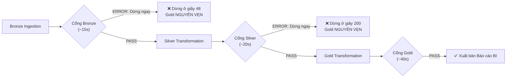

### c. Cấu hình DAG Airflow sửa đổi
Trong [`orchestration/dags/olist_daily_pipeline.py`](file:///run/media/tamdae/04C8A69DC8A68C8C/Users/LENOVO/Documents/TL_Kỳ_1_năm_4/Big_Data/rebuild/orchestration/dags/olist_daily_pipeline.py):
```python
# Tách Quality Check thành 3 gates độc lập
gate_bronze = build_spark_submit_task(
    dag=dag,
    task_id="quality_gate_bronze",
    application="/opt/airflow/transformation/quality/job.py",
    app_args=["--layer", "bronze", "--strict"],
    write_pool_slots=0, # Chỉ đọc dữ liệu, không chiếm slot ghi
)

gate_silver = build_spark_submit_task(
    dag=dag,
    task_id="quality_gate_silver",
    application="/opt/airflow/transformation/quality/job.py",
    app_args=["--layer", "silver", "--strict"],
    write_pool_slots=0,
)

gate_gold = build_spark_submit_task(
    dag=dag,
    task_id="quality_gate_gold",
    application="/opt/airflow/transformation/quality/job.py",
    app_args=["--layer", "gold", "--strict"],
    write_pool_slots=0,
)

# Chuỗi phụ thuộc Fail-Fast mới
ingest_bronze >> gate_bronze >> silver_tasks >> gate_silver >> build_gold >> gate_gold >> complete_pipeline
```

---

## 4.3. Ý tưởng 3: Vòng lặp tái nạp dữ liệu cách ly (Quarantine Replay & Reconciliation Loop)

### a. Vấn đề nghiệp vụ và bằng chứng thực tế
Giải cứu **197 đơn hàng Olist bị kẹt vĩnh viễn** trong vùng cách ly, thu hồi ~0,2% doanh thu bị thất thoát và hàn gắn **643 bản ghi con mồ côi** trong tầng Gold, xóa bỏ 14 cảnh báo WARN kinh niên.

Hiện tại, bảng `lakehouse.quarantine.orders` chứa 197 đơn hàng vi phạm thứ tự thời gian. Vì không có quy trình xử lý tiếp theo, các bảng con (`order_items`, `payments`, `reviews`) khi đi qua Silver và Gold không tìm thấy bản ghi cha tương ứng, dẫn đến việc phải gán `customer_key = 0`. Điều này làm sai lệch báo cáo phân tích giá trị vòng đời khách hàng (Customer Lifetime Value - LTV) và doanh thu theo khu vực.

### b. Kiến trúc kỹ thuật đề xuất
Xây dựng quy trình xử lý dữ liệu cách ly 3 phân lớp kết hợp bảng phán quyết nghiệp vụ:
1. **Nhóm 1 (Tự sửa tự động):** Các lỗi thuần về định dạng (sai format ngày `yyyy/MM/dd`, khoảng trắng thừa, zip code thiếu số 0 đầu) $\rightarrow$ áp dụng hàm chuẩn hóa và tự động nạp lại.
2. **Nhóm 2 (Cần phán quyết nghiệp vụ):** Các đơn giao hàng thiếu ngày giao (`delivered` thiếu `delivered_date`) $\rightarrow$ ghi nhận vào bảng `control.quarantine_rulings` để chuyên viên vận hành chọn giải pháp (suy diễn từ ngày bưu cục hoặc đổi sang trạng thái `shipped`).
3. **Nhóm 3 (Đóng hồ sơ vĩnh viễn):** Khóa chính rỗng hoặc không thể phục hồi $\rightarrow$ chuyển vào `control.quarantine_closed` kèm lý do kiểm toán.
4. Xây dựng DAG `olist_quarantine_replay` sử dụng câu lệnh `MERGE INTO` để nạp dữ liệu đã xử lý trở lại `silver.orders`.

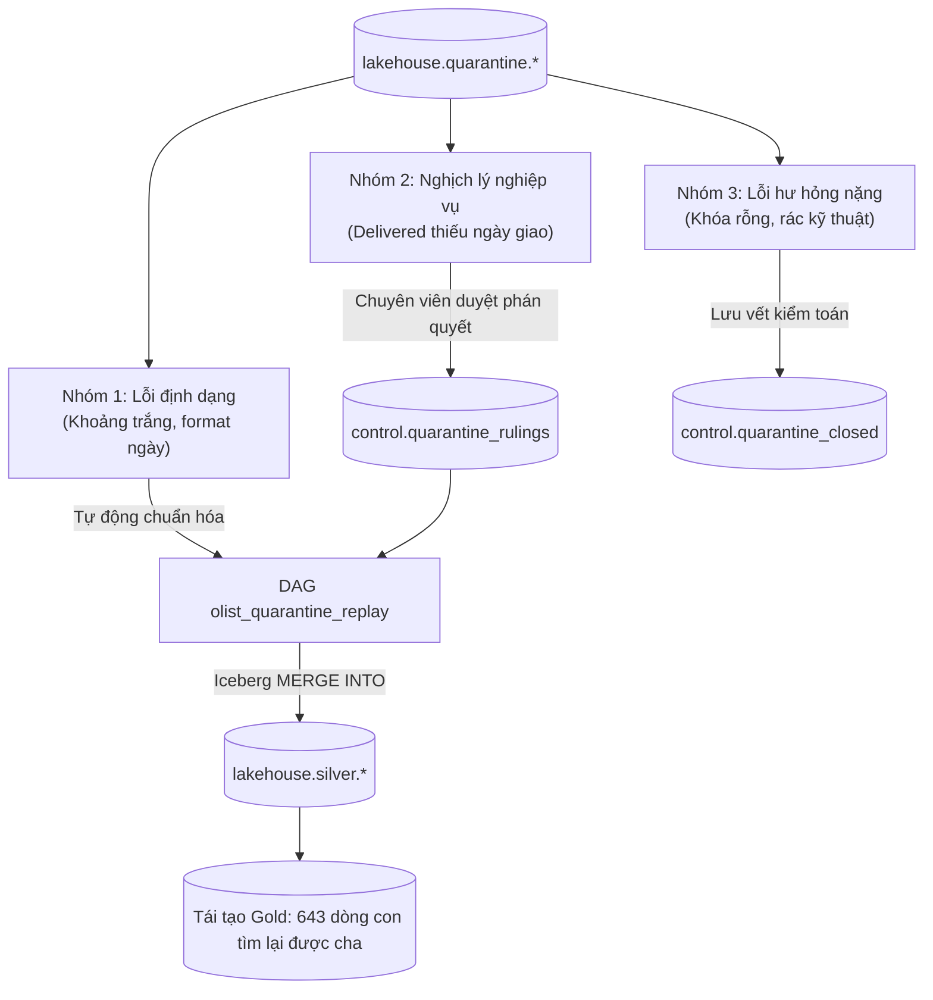

### c. Thiết kế bảng phán quyết và thủ tục Replay
Bảng `control.quarantine_rulings` trên PostgreSQL / Iceberg:
```sql
CREATE TABLE lakehouse.control.quarantine_rulings (
    ruling_id VARCHAR(64) PRIMARY KEY,
    table_name VARCHAR(64) NOT NULL,
    entity_key VARCHAR(128) NOT NULL,
    decision_type VARCHAR(32) NOT NULL, -- 'AUTO_FIX', 'INFER_DATE', 'CHANGE_STATUS', 'DROP'
    inferred_values JSONB,
    decided_by VARCHAR(64) NOT NULL,
    decided_at TIMESTAMP WITH TIME ZONE DEFAULT CURRENT_TIMESTAMP,
    status VARCHAR(16) DEFAULT 'PENDING' -- 'PENDING', 'EXECUTED', 'REJECTED'
);
```

Logic PySpark nạp bù vào Silver bằng `MERGE INTO`:
```python
def replay_quarantine_to_silver(spark, ruling_df, silver_table):
    """Nạp lại các bản ghi đã duyệt phán quyết vào bảng Silver."""
    ruling_df.createOrReplaceTempView("rulings_to_apply")
    
    merge_sql = f"""
    MERGE INTO lakehouse.silver.{silver_table} AS target
    USING rulings_to_apply AS source
    ON target.order_id = source.order_id
    WHEN MATCHED THEN
        UPDATE SET 
            target.order_status = source.order_status,
            target.order_delivered_customer_date = source.order_delivered_customer_date,
            target._ingestion_timestamp = current_timestamp()
    WHEN NOT MATCHED THEN
        INSERT *
    """
    spark.sql(merge_sql)
```

---

## 4.4. Ý tưởng 4: Bố cục lưu trữ Iceberg tối ưu & Tự động nén tệp định kỳ (@weekly)

### a. Vấn đề nghiệp vụ và bằng chứng thực tế
Giải quyết triệt để căn bệnh **Small-File Problem**: Hiện tại các file Parquet chỉ có dung lượng 0,97 MB – 1,4 MB (nhỏ hơn 100 lần so với kích thước tối ưu 128 MB). Nếu nạp tăng dần mỗi ngày, sau 1 năm bảng sẽ có hàng nghìn file nhỏ làm tê liệt tốc độ truy vấn của Trino.

Bên cạnh đó, các bảng kiểm toán như `control.transformation_targets` hiện có tới **242 file Parquet** cho 242 dòng dữ liệu. Mỗi lần ghi một target, Spark lại sinh ra một file mới. Truy vấn Trino trên các bảng này tốn 95% thời gian để đọc metadata và footer thay vì đọc dữ liệu thật.

### b. Kế hoạch hành động chi tiết
1. **Chuyển đổi lịch bảo trì:** Đổi lịch DAG `olist_maintenance` thành `schedule="@weekly"` chạy lúc 02:00 sáng Chủ Nhật.
2. **Mở rộng Allowlist kiểm toán:** Bổ sung các bảng phân mảnh nặng (`control.transformation_targets` với 242 file, `control.ingestion_batches` với 99 file) vào diện nén an toàn.
3. **Tiến hóa phân vùng:** Khi dữ liệu tăng trưởng, tiến hóa phân vùng `fact_orders` từ `year(purchase_timestamp)` sang `month(...)` mà không cần ghi lại dữ liệu cũ.
4. **Bật sắp xếp vật lý:** Áp dụng `WRITE ORDERED BY (purchase_date, customer_key)` cho toàn bộ bảng Fact.

```sql
-- Cú pháp kích hoạt phân vùng và sắp xếp trên Iceberg
ALTER TABLE lakehouse.gold.fact_orders 
SET IDENTIFIER FIELDS (order_key);

ALTER TABLE lakehouse.gold.fact_orders 
WRITE ORDERED BY (purchase_date_key, customer_key);
```

---

## 4.5. Ý tưởng 5: Kiểm tra tự động tính nhất quán giữa Tài liệu và Code trong CI (Docs-as-Tests)

### a. Vấn đề nghiệp vụ và bằng chứng thực tế
Chấm dứt vĩnh viễn tình trạng **"Tài liệu trôi dạt khỏi Code"** (Document Drift) — nguyên nhân gây ra 53 lỗi tài liệu nghiêm trọng trước đây (tên cột sai, công thức doanh thu sai, đường dẫn không tồn tại).

Ví dụ trong quá khứ: Cột `freight_value` không tồn tại trong `gold.fact_orders` nhưng tài liệu hướng dẫn lại yêu cầu người vận hành chạy `SELECT sum(freight_value) FROM fact_orders`, khiến toàn bộ các câu truy vấn mẫu bị sập.

### b. Kiến trúc kỹ thuật đề xuất
Xây dựng script `scripts/check_docs_consistency.py` tích hợp vào GitHub Actions / CI Pipeline:
* Quét toàn bộ khối lệnh ` ```sql ` trong file markdown, đối chiếu tên bảng và cột với `information_schema` của Trino.
* Quét toàn bộ khối ` ```mermaid `, đối chiếu mã `task_id` với `DagBag` của Airflow.
* Tự động kiểm tra tính tồn tại của mọi đường dẫn tệp được nhắc trong tài liệu.
* Chặn merge PR nếu phát hiện tài liệu mô tả sai so với code thực tế.

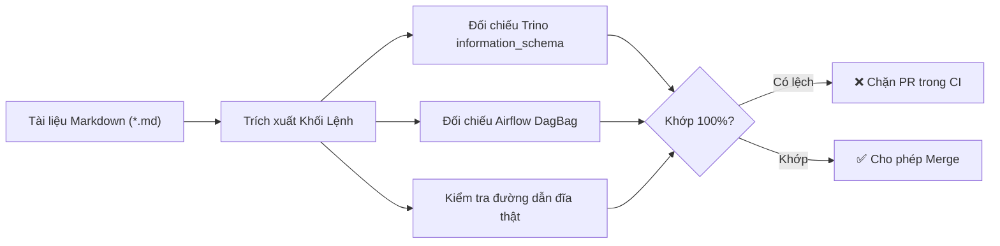

---

## 4.6. Ý tưởng 6: Khử trùng lặp tầng Silver theo thời gian sự kiện nghiệp vụ (Event-time Deduplication)

### a. Vấn đề nghiệp vụ và bằng chứng thực tế
Khắc phục dứt điểm **Rào cản chí mạng số 1**: Loại bỏ tình trạng 99,3% đơn hàng bị hủy nhưng bản ghi cũ vẫn thắng, bảo vệ tính trung thực của doanh thu sàn.

Trong đợt benchmark `06_duplicates`, 291 / 299 đơn hàng bị khách hủy sau 5 giây vẫn bị ghi nhận trạng thái `delivered` do thuật toán xếp hạng Window chỉ nhìn vào `_ingestion_timestamp`.

### b. Giải pháp mã nguồn chi tiết
Sửa đổi hàm `deterministic_result` trong [`transformation/silver/_common.py`](file:///run/media/tamdae/04C8A69DC8A68C8C/Users/LENOVO/Documents/TL_Kỳ_1_năm_4/Big_Data/rebuild/transformation/silver/_common.py) bằng cách bổ sung tham số `event_time_column`:

```python
def deterministic_result(
    df: DataFrame,
    key_columns: list[str],
    business_error_count: Column,
    event_time_column: str | None = None,
) -> DataFrame:
    """Khử trùng lặp xác định tuyệt đối ưu tiên theo thời gian sự kiện thực tế."""
    ordering = [business_error_count.asc()]
    
    # ƯU TIÊN HÀNG ĐẦU: Thời điểm sự kiện nghiệp vụ xảy ra ngoài đời thực
    if event_time_column and event_time_column in df.columns:
        ordering.append(F.col(event_time_column).desc_nulls_last())
        
    # LỚP PHÁ HÒA CUỐI CÙNG: Dựa vào lô nạp và thời điểm nạp
    ordering.extend([
        F.col("_ingestion_timestamp").desc_nulls_last(),
        F.col("_batch_id").desc_nulls_last(),
        F.col("_source_file").asc_nulls_last(),
    ])
    
    window = Window.partitionBy(*key_columns).orderBy(*ordering)
    return df.withColumn("_row_num", F.row_number().over(window)).filter(F.col("_row_num") == 1).drop("_row_num")
```

Cấu hình cho từng bảng nghiệp vụ:
* Bảng `orders`: Khai báo `event_time_column = "order_purchase_timestamp"`.
* Bảng `order_reviews`: Khai báo `event_time_column = "review_answer_timestamp"`.
* Bảng `order_items`: Khai báo `event_time_column = "shipping_limit_date"`.
* Bảng `payments`: Khai báo `event_time_column = "payment_sequential"`.

---

## 4.7. Ý tưởng 7: Luồng dữ liệu gần thời gian thực (Kafka + Debezium CDC + Spark Structured Streaming)

### a. Vấn đề nghiệp vụ và bằng chứng thực tế
Phục vụ các bài toán kinh doanh đòi hỏi độ trễ dưới 1 phút: Điều phối giao hàng hỏa tốc trong 2 giờ và phát hiện gian lận thẻ tín dụng ngay tại thời điểm quẹt thẻ. Hiện tại pipeline chạy theo lô T+1, độ trễ trung bình là 12 tiếng, không thể phục vụ các quyết định tức thời.

### b. Kiến trúc kỹ thuật đề xuất (Kappa-Lite Architecture)
* **Không thay thế Batch:** Luồng streaming chỉ bổ trợ cho các bài toán nhanh; luồng batch hằng ngày vẫn là nguồn chân lý cho báo cáo tài chính.
* **Thành phần:** Debezium đọc WAL log của Postgres OLTP $\rightarrow$ Đẩy vào Apache Kafka (chế độ KRaft gọn nhẹ) $\rightarrow$ Spark Structured Streaming tiêu thụ micro-batch 30 giây $\rightarrow$ Ghi vào các bảng `lakehouse.bronze.*_stream`.

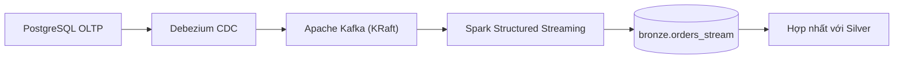

> [!WARNING]
> Đây là ý tưởng tốn kém nhất (+2,5 GB RAM, thêm 2 container dịch vụ). Chỉ nên kích hoạt khi doanh nghiệp thực sự ra mắt tính năng kinh doanh cần Realtime.

---

## 4.8. Ý tưởng 8: Quản trị dữ liệu & Che dữ liệu nhạy cảm PII (DataHub Catalog + Trino Access Control)

### a. Vấn đề nghiệp vụ và bằng chứng thực tế
Khắc phục dứt điểm **Rào cản chí mạng số 4**: Tuân thủ luật bảo vệ dữ liệu cá nhân LGPD, bảo vệ tọa độ GPS của khách hàng và thực thi nguyên tắc đặc quyền tối thiểu (Least Privilege).

Hiện tại bảng `gold.dim_geography` đang để lộ tọa độ GPS chính xác đến từng mét của khách hàng. Mọi tài khoản Superset đều có thể đọc bảng này mà không hề bị giới hạn quyền truy cập.

### b. Kế hoạch triển khai 2 bước
* **Bước 1 (Làm ngay - Chi phí 0 MB RAM):**
  Tạo file cấu hình phân quyền Trino `infrastructure/docker/trino/access-control.properties` và file luật `rules.json`:
  * Vai trò `analyst` / `bi_viewer`: Tọa độ `geolocation_lat` và `geolocation_lng` tự động bị che thành `NULL`; chỉ được phép truy vấn 4 Semantic Views.
  * Vai trò `data_engineer`: Được phép truy vấn đầy đủ phục vụ vận hành.
* **Bước 2 (Trung hạn):**
  Tích hợp DataHub làm Data Catalog tập trung để quản lý Data Lineage cấp cột và từ điển dữ liệu kinh doanh.

File cấu hình luật phân quyền Trino `infrastructure/docker/trino/rules.json`:
```json
{
  "catalogs": [
    {
      "user": "superset_user",
      "catalog": "lakehouse",
      "schema": "semantic",
      "allow": "read-only"
    },
    {
      "user": "superset_user",
      "catalog": "lakehouse",
      "schema": "(control|quarantine|bronze)",
      "allow": "none"
    },
    {
      "user": ".*",
      "catalog": ".*",
      "allow": "all"
    }
  ],
  "columns": [
    {
      "user": "superset_user",
      "catalog": "lakehouse",
      "schema": "gold",
      "table": "dim_geography",
      "column": "geolocation_(lat|lng)",
      "mask": "NULL"
    }
  ]
}
```

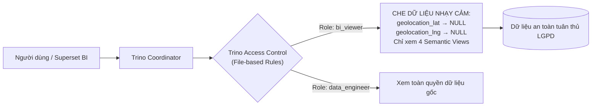

---

## 4.9. Ý tưởng 9: Mô hình Machine Learning dự báo trễ giao hàng phục vụ CSKH chủ động

### a. Vấn đề nghiệp vụ và bằng chứng thực tế
Chuyển hóa dữ liệu từ **Báo cáo quá khứ (Descriptive)** sang **Hành động đón đầu (Predictive)**: Hiện tại cột `is_late_delivery` chỉ báo cho biết đơn hàng đã trễ sau khi khách đã bức xúc đánh giá 1 sao. Dự báo sớm nguy cơ giao trễ ngay lúc khách vừa đặt hàng giúp sàn CSKH chủ động, tặng voucher xin lỗi hoặc đổi đơn vị vận chuyển nhanh hơn.

### b. Kiến trúc kỹ thuật đề xuất
* **Đặc trưng (Features):** Khoảng cách địa lý giữa bang người bán và người mua, trọng lượng/kích thước hàng hóa, lịch sử giao trễ của người bán, thời điểm trong tuần và yếu tố mùa vụ.
* **Mô hình:** Thuật toán phân loại nhị phân siêu nhẹ LightGBM huấn luyện định kỳ hàng tuần.
* **Suy luận (Batch Inference):** Tích hợp vào cuối pipeline sau tầng Gold, ghi kết quả dự báo xác suất trễ vào bảng `lakehouse.gold.fact_delivery_risk` để hiển thị danh sách đơn rủi ro cao lên Superset.

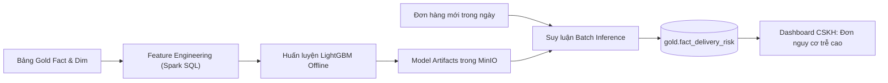

---

# PHẦN V: KẾ HOẠCH HÀNH ĐỘNG & LỘ TRÌNH GO-LIVE (PRODUCTION ROADMAP)

Để đưa hệ sinh thái Olist Data Lakehouse từ trạng thái hiện tại tiến thẳng lên môi trường Live Production một cách an toàn và chuẩn mực nhất, toàn bộ công việc được chia làm **3 giai đoạn triển khai có kiểm soát**:

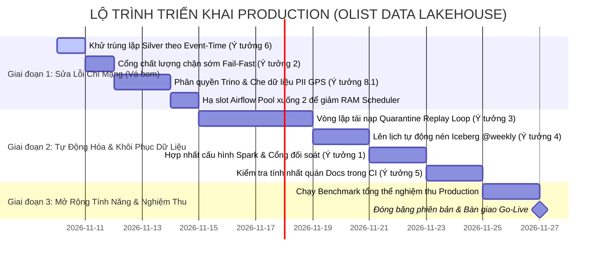

---

## 5.1. Phân kỳ triển khai chi tiết

### Giai đoạn 1: Triệt tiêu 4 Rào cản Chí mạng (Thời gian: 4 ngày công — RAM: 0 MB)
* **Mục tiêu:** Vá toàn bộ các lỗi làm sai lệch doanh thu và rò rỉ bảo mật.
* **Các việc cần làm ngay:**
  1. Triển khai **Ý tưởng 6**: Thêm `event_time_column` vào `deterministic_result`, kiểm chứng lại bằng bộ dữ liệu `06_duplicates` để đảm bảo đơn hủy luôn thắng đơn cũ 100%.
  2. Triển khai **Ý tưởng 2**: Tách cổng kiểm định chất lượng thành 3 nấc (sau Bronze, sau Silver, sau Gold) để bảo vệ bảng Gold không bao giờ bị ghi đè dữ liệu xấu.
  3. Triển khai **Ý tưởng 8 (Bước 1)**: Cấu hình `access-control.properties` cho Trino, che mặt nạ tọa độ GPS `geolocation_lat/lng` đối với các tài khoản thông thường.
  4. Hạ số slot của Airflow Pool `lakehouse_writes` từ 8 xuống **2**, cắt giảm ngay 3-4 GiB RAM cho Scheduler.

### Giai đoạn 2: Tự động hóa Vận hành & Thu hồi Thất thoát (Thời gian: 9.5 ngày công — RAM: 0 MB)
* **Mục tiêu:** Đưa hệ thống vào trạng thái tự vận hành ổn định, không cần can thiệp thủ công.
* **Các việc cần làm:**
  1. Triển khai **Ý tưởng 3**: Xây dựng DAG `olist_quarantine_replay` và bảng `quarantine_rulings`, cứu 197 đơn hàng kẹt và xóa bỏ 14 cảnh báo WARN.
  2. Triển khai **Ý tưởng 4**: Cấu hình DAG bảo trì chạy `@weekly`, mở rộng nén tệp cho tầng Control và bật `WRITE ORDERED BY`.
  3. Triển khai **Ý tưởng 1**: Gom cấu hình Spark về một nguồn và bổ sung script `verify_runtime_config.py`.
  4. Triển khai **Ý tưởng 5**: Tích hợp kiểm tra tính nhất quán tài liệu vào CI.

### Giai đoạn 3: Nghiệm thu Tổng thể & Go-Live
* Thực hiện chạy lại trọn bộ 8 kịch bản Benchmark trên môi trường đã nâng cấp.
* Đối soát doanh thu từng cent giữa bảng Gold và file CSV nguồn.
* Ký biên bản nghiệm thu kỹ thuật và chính thức chuyển giao sang trạng thái **Production Live**.

---

## 5.2. Kế hoạch hành động chi tiết theo từng ngày (Day-by-Day Implementation)

Dưới đây là kế hoạch chi tiết từng bước thực thi trong 15,5 ngày công:

* **Ngày 1 (Thứ Hai): Vá thuật toán Khử trùng lặp (Ý tưởng 6)**
  * Sửa hàm `deterministic_result` trong `transformation/silver/_common.py`.
  * Khai báo `event_time_column` cho `orders`, `order_items`, `payments`, `reviews`.
  * Chạy lại test `06_duplicates` 3 lần liên tiếp, xác nhận tỷ lệ thắng của bản ghi `canceled` đạt 100%.
* **Ngày 2 (Thứ Ba): Tách Cổng kiểm định Fail-Fast (Ý tưởng 2)**
  * Cập nhật `transformation/quality/job.py` hỗ trợ cờ `--layer`.
  * Tách DAG `olist_daily_pipeline` thành 3 nấc `quality_gate_bronze`, `quality_gate_silver`, `quality_gate_gold`.
  * Thử nghiệm tiêm lỗi bộ `05_integrity_violations`, xác nhận pipeline ngắt ở giây 48 trước khi chạm vào Gold.
* **Ngày 3 (Thứ Tư): Cấu hình Trino Access Control & PII Masking (Ý tưởng 8.1)**
  * Tạo file cấu hình `access-control.properties` và `rules.json` trong image Trino.
  * Phân quyền tài khoản Superset chỉ đọc 4 Semantic Views.
  * Kiểm tra qua Trino CLI: Cột `geolocation_lat` và `lng` phải trả về `NULL`.
* **Ngày 4 (Thứ Năm): Tối ưu Airflow Pool & Đo đạc lại RAM Scheduler**
  * Sửa cấu hình Pool `lakehouse_writes` từ 8 slots xuống 2 slots.
  * Kích hoạt chạy thử bộ `02_flash_sale` 40.000 đơn hàng.
  * Đo đạc `docker stats`, khẳng định RAM Airflow Scheduler giảm từ 6.4 GB xuống dưới 3.0 GB.
* **Ngày 5 - 8 (Tuần 2): Xây dựng Vòng lặp tái nạp Quarantine Replay (Ý tưởng 3)**
  * Tạo bảng `control.quarantine_rulings` và module phân loại `transformation/quarantine/classify.py`.
  * Viết module PySpark nạp bù bằng `MERGE INTO`.
  * Tạo DAG `olist_quarantine_replay`.
  * Giải cứu 197 đơn hàng Olist gốc, xác nhận 643 bản ghi con trong Gold tìm lại được cha, triệt tiêu 14 WARN.
* **Ngày 9 - 10: Tự động hóa Bảo trì Iceberg định kỳ (Ý tưởng 4)**
  * Đổi lịch DAG `olist_maintenance` sang `@weekly`.
  * Bổ sung bảng `control.transformation_targets` vào allowlist nén tệp.
  * Chạy lệnh `WRITE ORDERED BY` trên 4 bảng Fact.
* **Ngày 11 - 12: Hợp nhất Cấu hình Spark & Kiểm tra Docs CI (Ý tưởng 1 & 5)**
  * Tạo `spark_config.py` và script `verify_runtime_config.py`.
  * Tạo script `check_docs_consistency.py` và cấu hình GitHub Actions.
* **Ngày 13 - 15: Nghiệm thu Tổng thể, Chạy Benchmark & Bàn giao**
  * Chạy trọn vẹn 8 bài benchmark tự động.
  * Đối soát toàn bộ số liệu doanh thu.
  * Bàn giao tài liệu vận hành và chính thức Go-Live.

---

## 5.3. Bảng dự toán công sức, tài nguyên và nhân sự

| Hạng mục triển khai | Nhân sự phụ trách | Thời gian ước tính | RAM bổ sung | Rủi ro kỹ thuật |
|:---|:---|:---:|:---:|:---:|
| **Giai đoạn 1: Vá lỗi chí mạng** | Senior Data Engineer | 4 ngày công | **0 MB** (Tiết kiệm thêm 3GB) | Thấp (Có bộ test chaos đối soát) |
| **Giai đoạn 2: Tự động hóa** | DataOps / Platform Eng | 9.5 ngày công | **0 MB** thường trú | Trung bình (Đụng chạm cấu trúc lưu trữ) |
| **Nghiệm thu & Benchmark** | Lead Architect & Tester | 2 ngày công | **0 MB** | Không có |
| **TỔNG CỘNG** | **1 Data Engineer + 1 Lead** | **15.5 ngày công** | **0 MB** | **Được kiểm soát hoàn toàn** |

---

## 5.4. Bộ tiêu chí nghiệm thu Production (Definition of Done Checklist)

Hệ thống chỉ được phép bấm nút Go-Live khi thỏa mãn đầy đủ **7 tiêu chuẩn nghiệm thu bắt buộc (Gate Checklist)** sau:

- [ ] **Tiêu chuẩn 1 (Event-Time Consistency):** Bộ test `06_duplicates` chạy 3 lần liên tiếp đều cho ra kết quả duy nhất: 100% bản ghi hủy mới hơn phải thắng bản ghi cũ.
- [ ] **Tiêu chuẩn 2 (Gold Protection Gate):** Khi cố ý nạp dữ liệu vi phạm khóa ngoại (bộ `05`), pipeline phải ngắt ngay trước khi task `build_gold_closure` được phép chạy; bảng Gold giữ nguyên dữ liệu sạch trước đó.
- [ ] **Tiêu chuẩn 3 (Data Reconciliation):** Doanh thu tổng hợp tại `gold.fact_orders` và `marts.mart_revenue_daily` khớp chính xác từng cent với tổng giá trị tiền hàng từ các file CSV nguồn (sai số = 0).
- [ ] **Tiêu chuẩn 4 (Zero Orphan Records):** Tỷ lệ bản ghi gán `customer_key = 0` (Unknown Member) trong bảng Fact đạt dưới 0,01% sau khi chạy chu trình Replay vùng cách ly.
- [ ] **Tiêu chuẩn 5 (Security Compliance):** Kiểm tra qua Trino CLI bằng tài khoản `bi_viewer`: truy vấn cột `geolocation_lat`, `geolocation_lng` phải trả về `NULL`; truy vấn bảng `lakehouse.control.*` phải bị từ chối truy cập (`Access Denied`).
- [ ] **Tiêu chuẩn 6 (Resource Ceiling):** Toàn bộ cụm 13 container khi chạy bài thử tải 40.000 đơn hàng (`02_flash_sale`) không có container nào tiêu thụ vượt quá 85% ngưỡng RAM được cấp phát; container Airflow Scheduler duy trì dưới 3,5 GiB RAM.
- [ ] **Tiêu chuẩn 7 (Documentation Integrity):** Chạy `check_docs_consistency.py` trên toàn bộ thư mục tài liệu `docs/` đạt kết quả `PASSED 100%` không còn bất kỳ đường dẫn gãy hoặc tên cột sai lệch nào.

---

## 5.5. Sổ tay Xử lý Khủng hoảng & Kế hoạch Khôi phục (Disaster Recovery & Rollback Runbook)

Trong môi trường Production, sự cố là điều không thể tránh khỏi. Để đảm bảo tính sẵn sàng cao (High Availability) và bảo vệ an toàn dữ liệu, đội ngũ vận hành cần nắm vững 4 quy trình xử lý khẩn cấp (Standard Operating Procedures - SOP) sau:

### a. Kịch bản 1: Phát hiện số liệu doanh thu sai lệch khẩn cấp — Rollback Snapshot Iceberg
Khi phát hiện bảng `gold.fact_orders` bị ghi nhận dữ liệu sai do lô nạp lỗi mà cổng chất lượng vô tình bị bỏ qua, người trực vận hành tuyệt đối **không được chạy lại pipeline đè lên**, mà phải thực hiện quay ngược thời gian (Time-Travel Rollback) về snapshot sạch gần nhất.

```sql
-- Bước 1: Kiểm tra lịch sử snapshot của bảng fact_orders qua Trino
SELECT 
    snapshot_id, 
    committed_at, 
    operation, 
    summary['total-records'] AS total_records
FROM lakehouse.gold."fact_orders$snapshots"
ORDER BY committed_at DESC 
LIMIT 5;

-- Bước 2: Xác định snapshot_id của ngày hôm trước (trước thời điểm pipeline lỗi chạy)
-- Ví dụ snapshot hợp lệ là: 7891234567890123456

-- Bước 3: Thực hiện Rollback tức thì thông qua Spark SQL hoặc Trino System Procedure
CALL lakehouse.system.rollback_to_snapshot('gold', 'fact_orders', 7891234567890123456);

-- Bước 4: Xác nhận lại số lượng bản ghi và doanh thu sau khi khôi phục
SELECT count(*), sum(total_order_value) 
FROM lakehouse.gold.fact_orders;
```

*Thời gian thực hiện:* Dưới 1 phút. Nhờ kiến trúc metadata của Iceberg, việc rollback chỉ là thao tác trỏ lại con trỏ metadata hiện tại về snapshot cũ mà không phải sao chép hay di chuyển bất kỳ tệp dữ liệu vật lý nào trên MinIO S3.

### b. Kịch bản 2: Container Airflow Scheduler bị sập do tràn bộ nhớ (OOM Crash)
Nếu trong đợt cao điểm mua sắm, các task Silver kích hoạt đồng thời làm cạn kiệt RAM host và Linux OOM-Killer tiêu diệt tiến trình `airflow-scheduler`:

```bash
# Bước 1: Kiểm tra log sự cố của kernel Linux
dmesg -T | grep -E -i "killed process|oom_reaper|airflow"

# Bước 2: Hạ ngay lập tức số worker slots trong database PostgreSQL của Airflow
docker exec -i olist-lakehouse-postgres-1 psql -U airflow -d airflow <<EOF
UPDATE slot_pool SET slots = 1 WHERE pool = 'lakehouse_writes';
EOF

# Bước 3: Khởi động lại container Scheduler
docker compose -f docker-compose.yml -f docker-compose.orchestration.yml restart airflow-scheduler

# Bước 4: Kiểm tra trạng thái hàng đợi trên giao diện Airflow
# Các task đang chạy dở sẽ tự động chuyển sang trạng thái UP_FOR_RETRY
```

### c. Kịch bản 3: Xử lý rò rỉ dữ liệu PII và phong tỏa tạm thời Semantic Layer
Nếu có nghi vấn tài khoản phân tích viên bị lộ mật khẩu hoặc có hành vi trích xuất trái phép dữ liệu tọa độ GPS từ Superset:

```bash
# Bước 1: Khóa tạm thời tài khoản kết nối của Superset trên PostgreSQL
docker exec -i olist-lakehouse-postgres-1 psql -U postgres <<EOF
ALTER ROLE superset_user WITH NOLOGIN;
EOF

# Bước 2: Áp dụng ngay lập tức cấu hình Access Control khắt khe trên Trino
cat << 'EOF' > infrastructure/docker/trino/access-control.properties
access-control.name=file
security.config-file=/etc/trino/rules_emergency.json
EOF

# Nạp lại cấu hình Trino không cần restart cụm
docker exec -i olist-lakehouse-trino-1 trino-admin reload-access-control
```

### d. Kịch bản 4: Xung đột ghi đồng thời trên Iceberg (Concurrent Append/Overwrite Conflict)
Khi hai DAG hoặc hai tiến trình nạp dữ liệu cùng ghi vào một bảng Iceberg tại một thời điểm, Iceberg sử dụng cơ chế Khóa lạc quan (Optimistic Concurrency Control - OCC). Giao dịch nào commit sau sẽ gặp lỗi `CommitFailedException`.

*Giải pháp chuẩn hóa trong `spark_session.py`:*
```python
# Tăng số lần thử lại khi xung đột commit Iceberg
.config("spark.sql.iceberg.commit.retry.num-retries", "10")
.config("spark.sql.iceberg.commit.retry.min-wait-ms", "100")
.config("spark.sql.iceberg.commit.retry.max-wait-ms", "5000")
```

---

### LỜI KẾT CỦA BAN THẨM ĐỊNH

Hệ sinh thái **Olist Data Lakehouse** hiện tại là một sản phẩm kỹ thuật rất chất lượng, có tính hoàn thiện cao về mặt khung kiến trúc và đặc biệt sở hữu sự liêm chính kỹ thuật hiếm thấy (đầy đủ số liệu đo lường thực tế, không che giấu lỗi). 

Khoảng cách giữa trạng thái hiện tại và một hệ thống **Production chuẩn Enterprise** không nằm ở việc phải viết lại toàn bộ hay mua thêm phần cứng đắt tiền, mà nằm ở **15,5 ngày công tập trung xử lý dứt điểm các ranh giới nghiệp vụ và quản trị dữ liệu**. Khi hoàn thành Giai đoạn 1 và Giai đoạn 2 theo đúng lộ trình trên, doanh nghiệp sẽ sở hữu một nền tảng Lakehouse hiện đại, mạnh mẽ, chính xác tuyệt đối và hoàn toàn sẵn sàng cho mọi bài toán kinh doanh quy mô lớn. 

Khoảng cách giữa trạng thái hiện tại và một hệ thống **Production chuẩn Enterprise** không nằm ở việc phải viết lại toàn bộ hay mua thêm phần cứng đắt tiền, mà nằm ở **15,5 ngày công tập trung xử lý dứt điểm các ranh giới nghiệp vụ và quản trị dữ liệu**. Khi hoàn thành Giai đoạn 1 và Giai đoạn 2 theo đúng lộ trình trên, doanh nghiệp sẽ sở hữu một nền tảng Lakehouse hiện đại, mạnh mẽ, chính xác tuyệt đối và hoàn toàn sẵn sàng cho mọi bài toán kinh doanh quy mô lớn.